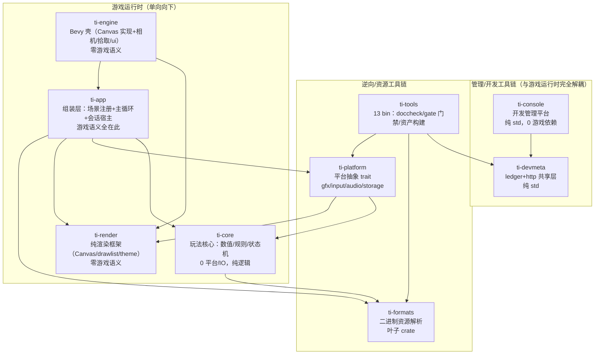
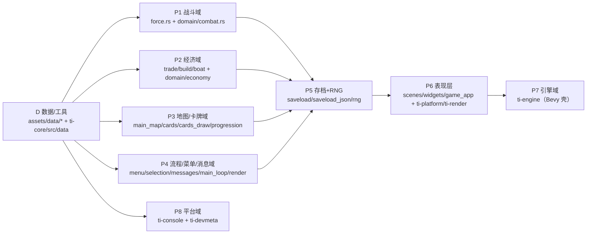

# 模块 / 玩法 / 逻辑 审计 — 职责分离与边界

> **定位**：对《金银岛 TreasureIsl》游戏「模块 ↔ 玩法 ↔ 逻辑」做**职责分离 + 边界**审计。
> 不是复述玩法（规则细节单一事实源在各业务文档），而是**核查边界划得好不好、有没有越界、文档↔代码↔数据是否漂移**。
> 审计基准面 = 代码 ground truth（`crates/*` 实测）+ 文档声明（`docs/business` + `packages.yaml`）+ 数据（`assets/data`）。
> 本文件**只登记 findings + 边界判定，不复述规则**（规则引用各单一事实源，避免双源）。
>
> 图文沿用仓库既有 mermaid 先例（`01_game_logic_overview.md` 唯一 mermaid 源），不引入 plantuml。

## 0. 审计结论速览

| 维度 | 判定 | 说明 |
|---|---|---|
| crate 职责分离 | ✅ 好 | 9 crate 单向依赖清晰，游戏链与管理链完全解耦 |
| 分层边界（规则/会话/场景/渲染） | ✅ 好 | 规则纯逻辑无渲染，场景层经 trait 窄接缝，渲染零游戏语义 |
| 数据驱动边界 | ⚠️ 一处已修 | 易变平衡公式曾写进 `ai_policy_v2` 函数体（EXP-196/CS-5 已参数化进 `balance.json`） |
| **文档↔代码漂移** | ❌ 2 处真漂移 | `packages.yaml` P1 仍指已删的 `rules/battle.rs`；`07_ui_flow.md` 仍写 176×220 + 方向键 Walk 旧口径 |
| 边界守门 | ✅ 门禁覆盖 | CS-1~5 + doccheck2 守住主要边界；**漂移面是门禁盲区**（`packages.yaml`/`07_ui_flow` 数值未机器核） |

**总判定**：职责分离与边界**整体良好**（crate/分层/数据驱动三层清晰，门禁守得较严）。主要问题 = **文档侧边界漂移**（机读源 `packages.yaml` + `07_ui_flow` 数值过期），属"文档没跟代码走"，非代码越界。

---

## 1. 模块全景（9 crate 依赖 + 职责）



> **关键非显然点**（审计须知）：`ti-platform` 对 `ti-core`/`ti-render` 是**向下依赖**（非叶子层）——它抽象平台能力但帧缓冲本体在 `ti-render::framebuffer`、`TextureFilter` 挂 bevy，故平台层反向依赖核心/渲染。这与"平台层是最底层"的直觉相反，边界划分时须认清。
> **管理链零游戏依赖**：`ti-console → ti-devmeta → 纯 std`，`Cargo.toml` 注释 + DoD 显式断言不含任何游戏 crate（与游戏运行时双向解耦，S32 定案）。

### 1.1 各 crate 职责边界（负责 / 不碰）

| crate | 负责 | 不碰（边界红线） |
|---|---|---|
| **ti-formats** | 原版二进制资源解析/序列化（lpk/PCX/.Map/INI/save），0 未知字节 + roundtrip 逐字节 | 玩法/渲染/平台 IO；叶子 crate 0 依赖。⚠️ **发货态休眠**（见 §1.2）：解析器本体保留但发货产物不喂原版 pak |
| **ti-core** | 玩法数值/规则/状态机（`rules/`）+ 业务类型（`domain/`）+ 数据表加载（`data/`）+ 逆向差分基准（`oracle/`） | 任何平台/IO 后端；只依赖 `ti-formats`，可无窗口跑差分/回归 |
| **ti-platform** | 平台能力 trait（gfx/input/audio/storage/clock）+ 纯计算内核 | 玩法数值（全在 ti-core）；真实上屏（Bevy 壳承担） |
| **ti-render** | 纯渲染框架：Canvas/drawlist/theme/font/framebuffer，**零游戏语义** | 场景名/角色/战斗等游戏概念；z-order 层枚举（层序权威在 ti-app `chrome`，契约 09） |
| **ti-app** | 组装层：场景注册 + 主循环 + 会话宿主（`game_app/`）+ 场景表现（`scenes/`）+ i18n/粒子 | 规则逻辑（全在 ti-core）；渲染原语实现（全在 ti-render/ti-engine） |
| **ti-engine** | Bevy 呈现后端（Canvas 的 Bevy 实现 + 相机/拾取/bevy_ui），零游戏语义 | 游戏语义；与 ti-render 对等定位，都"零游戏语义" |
| **ti-tools** | 13 bin：门禁执行体（doccheck/doccheck2）+ 资产构建 + 逆向工具 | 游戏运行时；依赖 ti-formats/ti-platform/ti-devmeta，不依赖 ti-core/ti-app/ti-engine |
| **ti-devmeta** | ledger 解析 + 最小 HTTP（纯 std） | 任何游戏逻辑；被 ti-tools/ti-console 共享 |
| **ti-console** | 开发管理平台（看板/门禁/测试运行/审计/内容运营向导） | 游戏运行时（0 游戏依赖，双向解耦） |

---

### 1.2 ti-formats 与原版关系审计（发货态休眠）

**关键事实**（代码 + 构建 ground truth，2026-11 审计）：`ti-formats` 解析的原版 `.pak`
（`ui.pak`/`glmap_m0*.pak`/`glpics.pak`）**现只在 `legacy/data/`（逆向归档），不进发货产物**——
发货（native/wasm）实际 UI 资产 = `assets/ui/*.png`（PNG 数据管线：`ui_assets.py` 生图 +
`ui_manifest.json` 登记 + `scenes.json` 版面），**原版 pak 不参与发货渲染**。

| 面 | 现状 | 与原版关系 |
|---|---|---|
| 运行时资产解包（`lucency`/`pcx`/`font`/`terrain`） | 代码在（`sprite_atlas`/`terrain_atlas`/`menu_shell`），但发货**不喂 pak 字节**，`set_atlas`/`set_terrain` 解析失败保持 `None` → 渲染**退回占位网格**（不黑屏） | 解包器为原版 pak 写，发货态**休眠**（主链 = PNG 数据管线） |
| 存档二进制（`save.rs`） | 运行时 0 处读/写，存档走 **JSON v5**（`rules/saveload_json` + `persistence.md`） | 纯逆向参照 |
| 工具/逆向（`unpak`/`map2json`/`controls` + 调试 bin `element-dump`/`sprite-step`/`render-png`） | 读 `legacy/data/*.pak` 做逆向导出/像素快照 | **真用原版**（唯一活跃面） |
| 0 直接消费模块（`ids`/`ini`/`resource_names`/`field`/`error`/`macros`） | 被 `define_format!` 宏内部用或真死 | 待核（非宏内部用 = 死代码） |

**判定**：`ti-formats` 本体职责（解析原版二进制）**已与发货运行时脱钩**——原版 pak 不进产物，
解包路径在发货态休眠。它**仍有独立存在必要**（①逆向工具链真读 `legacy/data/`；②若将来要发货带原版高清资产可重新喂 pak 激活；③`legacy/exe` 逆向参照面），但**有模块级收窄空间**（`save` 退工具面 + 6 个 0 消费死模块待核）——见 §6.4 后续项。

---

## 2. 玩法 / 逻辑分层（数据 → 规则 → 会话 → 场景 → 渲染）

```mermaid
flowchart LR
    subgraph 数据层["数据层（单一事实源，0 代码改动调平衡）"]
        BAL["assets/data/*.json<br/>balance.json 数值单源<br/>board/terrain/scenes/strings<br/>地图包 assets/maps/"]
    end
    subgraph 规则层["规则层 ti-core::rules（纯逻辑，0 渲染 0 IO）"]
        FORCE["force.rs<br/>兵力模型（战斗）"]
        TERR["territory_v2.rs<br/>领地/攻占/破产"]
        BOARD["board.rs<br/>环岛摇骰"]
        PROG["progression.rs<br/>跨图 20 图"]
        ECON["trade/build/boat<br/>经济"]
        MORE["cards/merchant/events<br/>cards_draw/rng/saveload"]
    end
    subgraph 会话层["会话层 ti-app::game_app（组合根，持全部状态）"]
        BATTLE["battle.rs<br/>BattleView（兵力占位）"]
        GBOARD["board.rs<br/>赛道结算接线"]
        HOST["host.rs<br/>SceneHost 8 子 trait 实现<br/>依赖倒置"]
    end
    subgraph 场景层["场景层 ti-app::scenes（9 场景，只做三面）"]
        S1["index/select_role/select_map"]
        S2["main_map/vs/message"]
        S3["saveload + chrome 共享壳"]
    end
    subgraph 渲染层["渲染层 ti-render + ti-engine（零游戏语义）"]
        CANVAS["Canvas trait → Bevy 实现<br/>drawlist/theme/相机/拾取"]
    end
    BAL --> 数据注入["ti-core::data 类型化+缓存<br/>table_source 注入接缝"]
    数据注入 --> 规则层
    规则层 --> 会话层
    会话层 --> 场景层["场景层经 host trait 读写状态<br/>不直接摸 GameApp 字段"]
    场景层 --> 渲染层
```



### 2.1 分层边界契约（每条 = 一条红线，门禁映射在 §5）

| 边界 | 契约 | 守门门禁 |
|---|---|---|
| 数据 ↔ 规则 | 数值/文案**只**从 `balance.json`/`strings.json` 读，代码不写死平衡值 | CS-5（rules 层非中性浮点系数）+ `check_hardcode` |
| 规则 ↔ 会话 | 规则层**纯函数**（`force::resolve`/`territory_v2::assault` 无 IO 无渲染），会话层只做接线 | 规则层 0 平台/IO 依赖（crate 边界） |
| 会话 ↔ 场景 | 场景 struct **不持有** `GameApp`，只持 `&mut dyn SceneHost`（8 子 trait），经 trait 读写（依赖倒置） | CS-4（场景层禁构造持久会话） |
| 场景 ↔ 渲染 | 场景层 0 资产路径字面量（走 `chrome.rs` 单源 + `ui_manifest`）；渲染零游戏语义 | CS-1（资产路径单源）+ `check_hardcode` |
| 游戏链 ↔ 管理链 | ti-console/ti-devmeta 0 游戏依赖（双向解耦） | `cargo tree -p ti-console` DoD 断言 |

---

## 3. 模块包（P 包）↔ 业务系统 ↔ 场景 映射

`plan/packages.yaml` = 包划分**机读唯一源**（9 包）。审计须核"包声明的文件集 ↔ 代码实际文件集"一致：



> **审计点**：P 包白名单两两交集 = ∅（机器校验），每个规则文件归且仅归一个包。包声明须与代码实际文件集一致（§6 漂移 ① 抓到 P1 过期）。

### 3.1 三向映射（包 × 业务系统 × 场景）

| 包 | 业务系统（单一事实源） | 服务场景 |
|---|---|---|
| P1 战斗 | `combat.md`（兵力模型） | Vs |
| P2 经济 | `economy.md`（贸易/建造/船/商人） | MainMap（HUD 三经济臂） |
| P3 地图/卡牌 | `progression.md`（赛道/跨图）+ `cards` | MainMap |
| P4 流程/菜单/消息 | `loop_core.md`（场景状态机） | Index/SelectRole/SelectMap/Message |
| P5 存档/RNG | `persistence.md` | Saveload |
| P6 表现层 | `08_layout_design.md`（版面/配色） | 全部 9 场景 |
| —（领地，跨 P1/P3） | `territory.md`（主玩法大富翁化） | MainMap + Vs |

---

## 4. 核心玩法逻辑（引用单一事实源，只画边界不重述规则）

```mermaid
stateDiagram-v2
    [*] --> MainMap
    MainMap: 摇骰 → 沿环岛 31 格前进
    MainMap --> 落格分叉
    落格分叉: 无主→副本 / 他人→交钱或攻占 / 自己→升级或领产出
    落格分叉 --> Vs: 攻占（兵力 force::resolve 一次性）
    落格分叉 --> 副本: 无主（进副本战）
    落格分叉 --> 升级/领产出: 自己（pending_own 玩家可选，A-06）
    Vs --> MainMap: 胜=占领 / 败=交双倍过路费
    副本 --> MainMap: 胜=占领（首占奖励）
    MainMap --> BOSS战: 绕满圈+落 BOSS 格
    BOSS战 --> 跨图: 胜（unlocked_mask 置位）
    跨图 --> MainMap: m02..m20 按 boss_tier
```

> 玩法细节**不在此复述**：落格分叉 = `territory.md` §4；兵力模型 = `combat.md` §兵力模型；赛道 = `progression.md` §环岛；跨图 = `progression.md` §跨图 20 图。本审计只在 §6 核查"文档声明 ↔ 代码实现"是否一致。

---

## 5. 边界审计 — 越界 / 漂移 findings

### 5.1 真漂移（文档没跟代码走，须修）

| # | 位置 | 漂移 | ground truth | 修法 |
|---|---|---|---|---|
| **F-01** | `plan/packages.yaml` P1 包（L34/L40） | 仍列 `rules/battle.rs` + `tests/rules_battle.rs`（**已删**，S34.6 D5 迁 `force.rs` + 2026-11-19 HP 本体删除） | 战斗规则 = `rules/force.rs`；无 `rules_battle.rs` | P1 主文件 `rules/battle.rs`→`rules/force.rs`；test `rules_battle`→`force.rs 内联单测`（或删该行） |
| **F-02** | `docs/business/07_ui_flow.md`（L68/L91/L110） | 写 `MainMap 方向键 Walk(N/S/E/W)` + "176×220 逻辑坐标" 旧口径 | 现行 = **1080×1920**（S18 起）；S19.1 **已删方向键自由移动**，主地图移动**只留摇骰**（`GameInput::Spin`） | L68 方向键 Walk 行删（主地图无 Walk）；L91/L110 176×220 → 1080×1920 现行口径 |

> **门禁盲区**（本次审计暴露）：`check_module_contracts.py`（gate 第 16 项）只核 P 包白名单**两两交集=∅**，不核"包声明文件是否真实存在"⇒ `packages.yaml` 指向已删文件不报。`07_ui_flow` 的数值口径（176/1080）无任何断言。这两处 = 文档↔代码漂移的**机器守门缺口**（审计建议 §7 补）。

### 5.2 误报（探索阶段报出但代码 ground truth 否掉）

| 探索报告称 | 审计核实 | 判定 |
|---|---|---|
| "00_design §6 与 01_architecture §1.1 的 8 子 trait 命名不一致" | 代码 `scenes/mod.rs` 实际 trait = `NavHost/RenderHost/SpriteHost/MenuHost/SelectionHost/MapHost/EconomyHost/SessionHost`；00_design §6 列的**正是这 8 个**（带 Host 后缀），01_architecture 用短名（Nav/Render/…）指同一组 | **非漂移**：00_design 与代码一致；01_architecture 是省略短名（非权威口径）。探索 subagent 误读 |
| "9 场景清单需核对 SceneKind" | `SceneKind` 实际 = Intro/Index/SelectRole/SelectMap/MainMap/Vs/Message/Saveload/Exit = **9 值**，与文档"9 场景"声明一致 | **一致** ✓ |

### 5.3 边界良好面（审计确认守住，无需改）

- **数据驱动**：`balance.json` = 数值唯一源，`rules/` 经 `data::balance()` 读（CS-5 守 rules 层无硬编码浮点系数）；易变平衡公式 2026-11-19 已参数化进 `balance.territory.ai`（EXP-196）。
- **分层零越界**：规则层 0 平台/IO（crate 依赖实测）；场景层经 trait 不直接摸 `GameApp` 字段（CS-4 + 依赖倒置）；渲染层零游戏语义（`ti-render`/`ti-engine` 只认原语/主题）。
- **游戏/管理解耦**：`ti-console` 0 游戏依赖（`cargo tree` DoD 断言），管理面不污染运行时。
- **战斗口径统一**：`combat.md` 已标 S34.6 D5 兵力模型 + HP 本体删除声明；`rules/force.rs` 是唯一战斗实现（`rules/battle.rs` 已删，文档已同步）。

---

## 6. 边界判定与后续

### 6.1 本轮可修（文档↔代码漂移，低风险）
- **F-01**：`packages.yaml` P1 `rules/battle.rs`→`rules/force.rs`（机读源跟随代码，一行）
- **F-02**：`07_ui_flow.md` 删方向键 Walk + 176×220→1080×1920（业务文档跟随 S18/S19.1 现行口径）

### 6.2 门禁盲区（建议后续补机器守门，非本轮必做）
- `check_module_contracts.py` 扩：P 包声明的**每个文件须真实存在**（防 `packages.yaml` 指已删文件，F-01 类）
- `07_ui_flow` 数值口径断言（1080 现行，防 176×220 旧值复现）

### 6.3 已收口的边界问题（2026-11 本轮，供追溯）
- 易变平衡公式进代码层 → 参数化 `balance.json` + CS-5 门禁（EXP-196）
- HP 本体残留 → 彻底删除（`rules/battle.rs`/`combat.items`/3 测试/3 example/oracle）
- 玩家自己格无选择权 → `pending_own` 待决 + 玩家可选（A-06）
- `assault` 无格属校验 → `debug_assert` 前置契约（A-08）

### 6.4 后续项：ti-formats 模块级收窄（非本轮必做，须用户拍板）

审计发现 `ti-formats` **发货态休眠**（§1.2）：原版 pak 不进发货产物，解包路径发货态退回占位，
真用面仅剩逆向工具链。后续可做（按价值降序，须确认「是否要保留发货带原版高清资产」方向后定）：

1. **死模块清理**：核 6 个 0 直接消费模块（`ids`/`ini`/`resource_names`/`field`/`error`/`macros`）
   是否被 `define_format!` 宏内部用（grep 宏展开）→ 真死代码删除（须过 `check_hardcode`/占位门禁）。
2. **`save.rs` 退工具面**：存档已走 JSON v5，`save.rs` 运行时 0 用 → 标注「仅工具/逆向参照」或移入 ti-tools。
3. **方向二选一**（用户拍板）：
   - A = **保留全模块 + 发货态休眠**（现状；万一将来要发货带原版高清资产可重新喂 pak 激活，零改动）；
   - B = **收窄到逆向工具面**（删发货休眠解包链 + save 退工具 + 死模块清理，`ti-formats` 退成纯逆向/工具 crate）。
   判据 = 「发货是否要带原版 pak 高清资产」（若否 = B 可行；若可能 = A 保留休眠链）。

**B 已执行（2026-11-19 用户拍板收窄到逆向工具面）**：
- **native 喂原版 pak 段已删**（`treasure_bevy.rs` `load_resources` 的 `set_atlas`/`set_terrain`
  原版 pak 字节解包）：解出的 `atlas`/`terrain_atlas` 在场景渲染 0 blit（现行主链 = PNG 数据管线
  + HD pack），喂 pak 字节只是休眠回退路径；删后 0 视觉变化（`atlas`/`terrain_atlas` 字段保留——
  HD pack `load_hd_pack_from_dir` 真喂 RGBA，调试 bin `element-dump`/`sprite-step` 独立 `SpriteAtlas::new` 真用）。
- **`save.rs` 退工具面**（顶部注释标注：存档走 JSON v5，运行时 0 用，仅 `ti-tools` 逆向参照消费）。
- **Android 解包链保留**（`android_shell.rs` 喂 `assets/ui.pak` = APK 真带 pak，Android 态活跃，
  与 native/wasm 不同）；**6 内部基础设施模块保留**（`error`/`field`/`ini`/`ids`/`resource_names`/
  `macros` 是 `define_format!` + 各格式内部依赖，非死代码）。

---

## 7. 第一性模块功能审计（从代码实际调用面，非文档声明）

> **方法**：不参考「文档说模块干什么」，只查**代码里谁真 import / 调用谁**（跨 crate 边 + 模块内
> pub 真消费面），从第一性原理判定每个模块的真实功能 + 死面 + 漂移。本节 findings 均已修复。

### 7.1 跨 crate 调用边（谁真用谁，代码 ground truth）

| crate | 被谁 import（运行时） | 中心度 |
|---|---|---|
| `ti-core` | ti-app + ti-engine + examples | **最中心**（71 文件） |
| `ti-app` | ti-engine | 组装层，被壳消费 |
| `ti-formats` | ti-app + ti-platform + ti-tools | 资产解包（B 收窄后 = 逆向工具面 + Android） |
| `ti-render` | ti-app + ti-engine + ti-platform | 渲染框架（横向共享） |
| `ti-platform` | ti-app + ti-engine + ti-tools | 平台抽象 |
| `ti-devmeta` | ti-console + ti-tools | 管理链共享层 |
| `ti-tools` / `ti-console` | 仅自身/tests | 工具/管理 bin 终点 |

### 7.2 ti-core::rules 22 模块真用面（外部运行时调用文件数）

**全部 22 模块均有真用面**（无死模块）：`board`(7) / `build`(5) / `progression`(6) / `main_map`(4) /
`trade`(4) / `territory`(4) / `territory_v2`(3) / `selection`(4) / `cards`(3) / `boat`(4) / `force`(2) /
`messages`(4) / `rng`(4) / `main_loop`(2) / `saveload`(1) / `saveload_json`(1) / `cards_draw`(1) /
`events`(被 data 层) / `menu`(被测试+data) / `merchant`(被 data) / `render`(自身)。**0 死模块**——
「0 外部调用」的模块（events/menu/merchant/render/saveload_json）各有消费面（data 层 / 测试 / 自身），
非死代码。

### 7.3 战斗模型双类型并存判定（第一性核心发现）

`rules/force.rs`（兵力模型：`Force`/`ForceSide`/`ForceResult` + `resolve`）= **现行战斗**；
`domain/combat.rs`（`Unit`/`Side`，`hp`/`atk` 字段）= **数据载体**（非旧 HP 血条）——
`defender_unit()`（territory.rs:585）用 `Unit.hp`=守军人手、`Unit.atk`=武器数承载兵力，经
`force::resolve` 一次性结算。`combat::Unit` 真被 data/mod.rs:951（构造）/ territory.rs（守军）/
saveload.rs（存档 hp 字段）消费，**非死**，但头注仍描述「`rules::battle::BattleSession` 回合推进」
= 旧 HP 模型漂移（已修，§7.4）。

### 7.4 死代码 / 注释漂移 findings（本轮已修）

| # | 位置 | 第一性判定 | 处置 |
|---|---|---|---|
| **M-01** | `vs_duel.rs::DuelAction`（Attack/Defend/Item） | **死枚举**：全仓 0 消费（旧 HP 动作残骸，随 battle 删除；vs_duel 其余 `DuelPhase`/`trigger_strike`/`animate_stage` 全活） | **删** |
| **M-02** | `combat.rs` 头注（提 `rules::battle::BattleSession` 回合推进） | 注释漂移（battle 已删，现行 `force::resolve`） | **修注释** |
| **M-03** | `territory.rs`（口径同 `rules::battle` / `BattleSession::new_with_enemy` 注入 / 守军 HP/ATK） | 注释漂移（旧 HP 措辞） | **修注释**（兵力口径） |
| **M-04** | `boat.rs`（叠加 `rules::battle::CombatBonus`） | 注释漂移（CombatBonus 已删） | **修注释**（经 force 结算） |
| **M-05** | `chrome.rs`（环形取整 `rules::battle` 同口径） | 注释漂移 | **修注释**（force 数值口径） |
| **M-06** | `treasure_bevy.rs` native 喂原版 pak 段 | 休眠路径（解包结果渲染 0 blit，B 收窄） | **删**（§6.4） |

**结论**：ti-core 模块层**无死模块**（22 rules 全活）；死面集中在**注释残留**（5 处提已删 `rules::battle`）
+ **1 个死枚举**（`DuelAction`）——均本轮修。战斗口径统一 = `force::resolve`（兵力模型），
`combat::Unit` 降级为兵力数据载体（非旧 HP 血条语义）。

---

## 8. 台账定位 + 门禁开销（第一性：350 任务现在还有没有用）

> 回应「台账 350 这东西现在还有用没有？业务规格文档还不行吗？每次跑门禁有影响吗？」三连问。
> 判据 = 代码 ground truth（门禁真读面）+ 耗时实测，非印象。

### 8.1 台账 vs 业务规格文档（不同维度，互不替代）

| | 业务规格文档（`docs/business/` 10 篇） | 台账（`plan/ledger.yaml` 350 任务） |
|---|---|---|
| 维度 | 规则「**是什么**」（战斗/经济/领地怎么运作） | 任务「**做没做完**」（每任务 DoD + evidence + 收口记录） |
| 活价值 | **高**（现行开发依据，改业务必读） | **低**（全 verified = 无活任务，纯追溯档案） |
| 能否互替 | 不能替代台账 | 不能替代业务文档 |

**结论**：业务规格文档「行」（改业务/数值/规则它已是单一事实源），但它**不记录「哪些活收口了、evidence 在哪」**—— 这是台账独有面。**两者不同维度，业务文档替代不了台账。**

### 8.2 台账真活的 ~10%（不能删）

1. **门禁 2 项真读它**（代码 ground truth）：
   - gate 第 8 项 `ledger validate`（`ledger` bin 解析台账 schema/状态）
   - gate 第 14 项 `check_ledger_reality`（**防虚报三方对账**：verified ↔ 377 evidence 文件 ↔ 代码符号，EXP-058）
2. **防虚报价值**：台账 verified 必须有对应 evidence + 代码符号 = 机器证明「任务真收口没虚报」，业务文档无此机制。

### 8.3 台账死存档的 90%

- **0 pending/0 blocked**（350 全 verified）= 无「下一步待办」驱动价值（项目已全收口）
- 大量任务是**历史过程**（S0 逆向 / S8 重写…），现行开发不再读它（读 business/ + process/）
- 它现在是「**审计追溯档案**」，不是「**进度驱动器**」

### 8.4 每次跑门禁的影响（实测，几乎无）

| 项 | 实测耗时 | 占全 gate（~10min+）|
|---|---|---|
| `ledger validate`（第 8 项，YAML 解析 + 校验 350 任务） | **0.3s** | <1% |
| `check_ledger_reality`（第 14 项，三方对账 350 verified ↔ 377 evidence ↔ 代码符号） | **0.2s** | <1% |
| **合计** | **~0.5s** | **<1%** |

**判据**：全 gate 耗时大头 = wasm 构建 + 浏览器 e2e + bevy 渲染对拍（分钟级）；台账 2 项是**轻量 YAML 解析 + grep 对账**（亚秒级），**不拖累门禁快慢、不影响门禁成败**（350 verified 稳定 0 failure）。

### 8.5 判定 + 处置

- **不删台账**（门禁 2 项真依赖 + 防虚报三方对账是硬价值，删了丢可追溯 + 丢防虚报）
- **不压缩 350 任务**（DoD/evidence 是防虚报证据面，压缩 = 丢证据）
- **唯一可做** = 台账头部加 1 行定位说明「全 verified = 收口档案；现行开发依据 = business/ 10 篇 + process/；本台账只供追溯 + 门禁三方对账」（让读者不误以为它是活 WBS）—— 非必做，读者能从 0 pending/blocked 自行看出
- **门禁开销**：台账 0.5s / ~10min = **<1%，可忽略**（为「精简门禁耗时」动它无收益）

---

## 附录：单一事实源路由（本审计引用但不复述）

| 主题 | 单一事实源 | 本审计 |
|---|---|---|
| 领地/副本/对手/热座/终局 | `docs/business/territory.md` | §4 只画分叉，规则引 §4 |
| 战斗兵力模型 | `docs/business/combat.md` | §1/§5.3 标口径，公式引 combat |
| 经济/船/商人 | `docs/business/economy.md` | §3.1 引，不复述数值 |
| 赛道/跨图 | `docs/business/progression.md` | §4 引，不重述 |
| 场景转换 | `docs/business/07_ui_flow.md` §1 | §1/§3 引 9 场景，转换表引 07 |
| 版面/配色 | `docs/business/08_layout_design.md` + `ui-redesign-v3/` | §5 只查 176 vs 1080 漂移 |
| 包划分机读 | `plan/packages.yaml` | §3 引，§6 审计其文件集真实性 |

> 本文件**新增** = 边界审计视角（§5 findings + §6 判定）+ 模块/包/场景映射图（§1/§3，全仓库此前无人画过 crate 依赖图 + P 包↔系统↔场景三向映射）。规则/数值/版面细节一律引用单一事实源，避免双源。
