# 游戏逻辑总览（Game Logic Overview）

> **定位**：`docs/business/` 全局业务逻辑的**唯一总览入口**。按章节整理「整个游戏怎么运转」，
> 每章配流程图（Mermaid）。规则细节与数值**不在此复述**——本文只做总览 + 流程 + 索引，
> 具体数值/规则引用各系统单一事实源（`territory.md` / `combat.md` / `economy.md` /
> `progression.md` / `persistence.md` / `balance.json`），遵守「同一结论只写一处」。
>
> **当前版本 = v3 热座（S36）+ S37 20 图**：5 席位（2~5 人类热座 + 可配 AI 席），
> 20 张不同场景地图（m01~m20，boss_tier 0~19，m20 = 通关图）。
>
> 改业务规则前先读对应系统文档定案（硬规则 7），本文随之更新。

## 目录

| 章 | 内容 | 流程图 |
|---|---|---|
| §1 | 全局总览：核心循环 + 场景态图 + 多席热座 + 20 图推进链 | 场景态图 + 核心循环图 |
| §2 | 开局与选角 | 选角决策图（席位校验分叉） |
| §3 | 选图与跨图推进 | 解锁链状态机 |
| §4 | 主地图回合（摇骰→落格结算） | 落格结算分叉图（核心） |
| §5 | 领土与战争 | 攻防/破产/驻军结算图 |
| §6 | 战斗（兵力模型） | 战斗回合状态机 |
| §7 | 经济（贸易/建造/船/银行） | 金币流图 |
| §8 | 热座会话与对局生命周期 | 终局 3 路径（Defeat/Victory/Draw） |
| §9 | 存档与迁移 | 存读档迁移图 |
| §10 | 失败与边界路径 | 异常路径汇总 |
| §11 | 数值锚点速查 | 各系统数值引用表 |

---

## §1 全局总览

### 1.1 核心循环（`loop_core.md` 定案）

玩家是海盗船长，驾船**绕岛航行**。一次操作 = **摇骰定步数 → 沿环岛赛道前进 N 格 → 落格结算**
（大富翁式，`GameInput::Spin`；方向键自由移动 S19.1 起已彻底删除）。

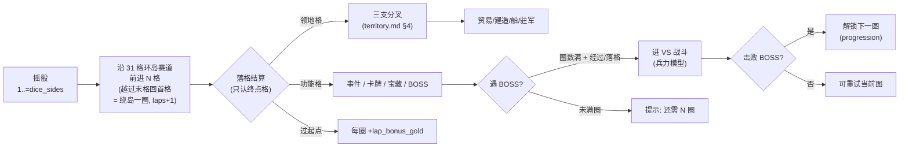

### 1.2 场景态图（9 场景 + 20 转换，`07_ui_flow.md` §1 单一事实源）

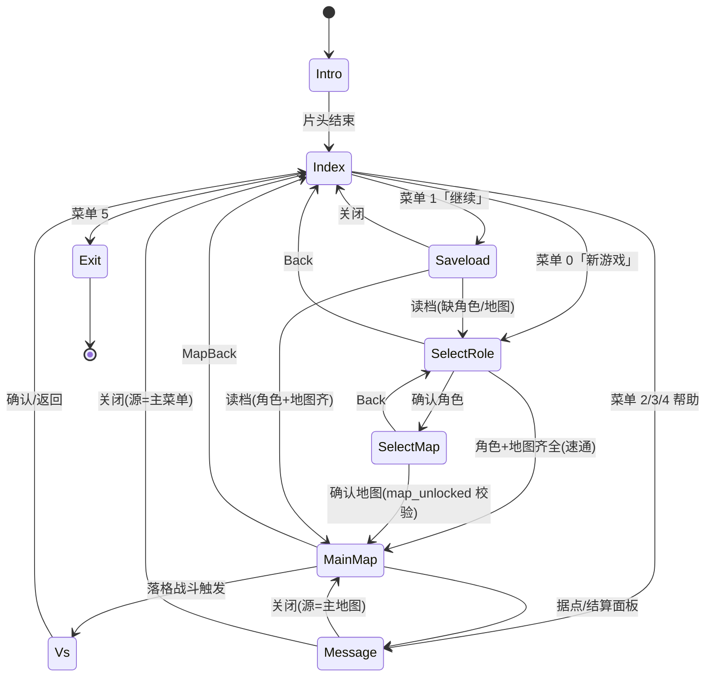

> 场景判别值 0..8 一场景一值（`SceneKind::discriminant()`，S10.2 修复项）；
> 非法转换（如 `SelectRole → Vs`）类型层面不存在，编译期报错（`scene_transition!` 宏 19 条 + 路由层派生 1 条）。

### 1.3 多席热座结构（v3，`territory.md` §1 单一事实源）

| 项 | 规则 | 值来源 |
|---|---|---|
| 席位池 | 5 角色（`panda`/`tichy`/`kidd`/`drake`/`katharina`），每角色 = 1 席位 | `balance.selection.characters[]` |
| 人类席 | 选角界面勾选 **2..5** 名角色作热座（`min_players=2`） | `balance.selection.min_players` |
| AI 席 | 数可配 `0..=(5-人类席)`（`max_ai_seats=4`）；未勾选角色按 index 升序补 AI | `balance.selection.max_ai_seats` |
| 回合顺序 | 席位按 `characters[].index` 升序循环（只在本局在场席间循环） | `balance.selection` |
| 热座交接 | 轮到下一人类席前**必须显式 Confirm「开始回合」**（遮蔽他人情报）；AI 回合自动播 | 设计意图 |
| 独立性 | 每席独立：赛道位置/圈数/金币/人手/武器/领地/驻军/建筑/船只/存活态 | 设计意图 |

**不变量**：`players ≥ 2`（单人局 = 假多人，v2 缺陷 D4 修复）；`players + ai ≤ 5`；
同局内同一席位不得既是玩家又是 AI。

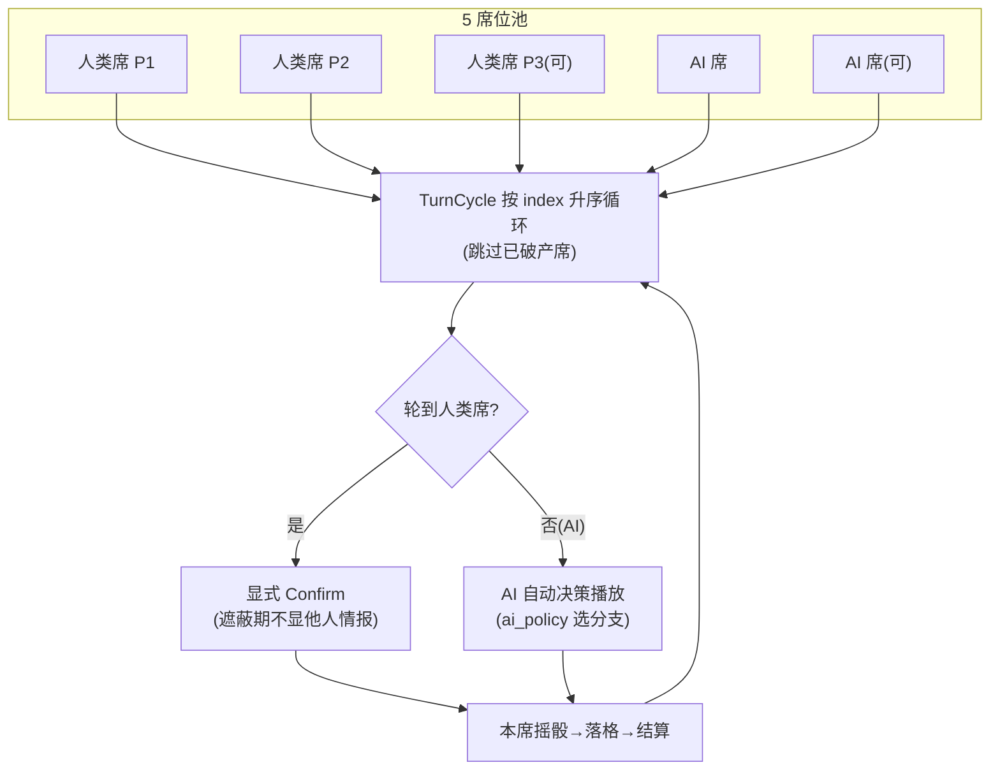

### 1.4 20 图推进链（S37，`progression.md` §跨图推进 + `selection.rs` 单一事实源）

- 20 张图 m01~m20，难度按 `boss_tier` 升序（0→19）；`MapSlot::count()=20`。
- 推进规则 = **击败当前图 BOSS 才解锁下一图**；m01 恒解锁；**击败 m20 = 通关**（`CLEARED_BIT=bit19`）。
- `unlocked_mask` = `u32`（bit 0..=18 = 第 1..=19 图已解锁；bit 19 = 通关位）；旧 `u8` 档读档时高 24 位=0 兼容。
- 失败（未击败）不解锁，可重试当前图。

---

## §2 开局与选角

选角 = 两段式：**勾选人类席** + **开始对局**（分离，v3 D5 修复：旧「toggle 后立即跳选图」无法多选）。

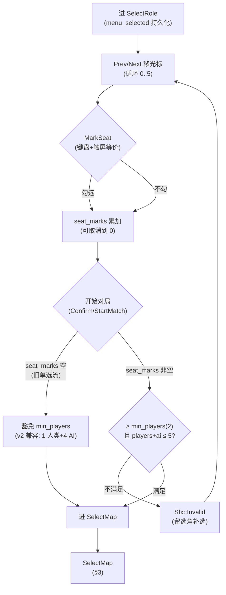

**关键规则**（`select_role.rs` + `selection.rs` + `balance.selection`）：
- `seat_marks` 空 = 旧单选流（1 人类 + 4 AI），**豁免 min_players 门禁**（v2 兼容路径，
  设计意图保留；`single_player_legacy_no_regression` e2e 锚定）。
- `seat_marks` 非空时校验 `seat_selection_ready`：`len(seat_marks) ≥ min_players(2)` 且
  `len + max_ai ≤ 5`；不满足 = 拒绝开局（留界面补选，`Sfx::Invalid`）。
- Confirm 兜底：首次进 `character=None` 时兜底选第 0 角色（对齐 select_map 的 map_slot 兜底语义）。
- 已勾选 ≥1 席时列表下方画「点行标记玩家席；未标记 = AI 对手」提示（`scene.select_role.seat_hint`）。

---

## §3 选图与跨图推进

`SelectMap` 显示**全部 20 图**（S37），锁定项置灰 + 深色「锁」块；Prev/Next 环形导航
（20 图：M20 后 Next 回 M01），仅 **Confirm** 经 `map_unlocked` 校验拒绝（未解锁 = `Sfx::Invalid`，
选择态不提交）。

```mermaid
stateDiagram-v2
    [*] --> M01_unlocked
    M01_unlocked: 初始: defeated=[false;20]<br/>unlocked_mask=0b0001<br/>(仅 m01)
    M01_unlocked --> M02_unlocked : 击败 m01 BOSS<br/>defeated[0]=true
    M02_unlocked --> M03_unlocked : 击败 m02 BOSS
    M03_unlocked --> M04_unlocked : 击败 m03 BOSS
    M04_unlocked --> Mid_unlocked : …(m04~m19 同链)…
    Mid_unlocked: m05..m19 逐级解锁<br/>defeated[i]=true ⟺ m(i+1) 已解锁
    Mid_unlocked --> M20_unlocked : 击败 m19 BOSS
    M20_unlocked --> CLEARED : 击败 m20 BOSS<br/>CLEARED_BIT(bit19)=1
    CLEARED: 通关(末人胜局)<br/>无下一图
```

**解锁链单调**：`m(i) 已解锁 ⟺ i==0 || defeated[i-1]`（`progression.md` §可测试规则
`progression_unlocks_monotonic`）。掩码口径 = `ProgressionState::unlocked_mask()→u32`，
读档 `for_save_restore(mask, map_slot)`：`mask≠0` 逐位忠实还原，`mask=0`（旧档）退
「最小前置链」`min_progression_to_select`，矛盾掩码退链修当前图——旧档恒可回读。

**BOSS 触发规则**（`progression.md` §BOSS 触发规则，S19.3）：
- **经过或落在 BOSS 格即遇 BOSS**（v5 31 格赛道「恰好落格」≈1/31，节奏可预期）。
- 现身门槛 = 绕岛满 `boss_min_laps`（默认 1）圈；未满圈 = 「BOSS 尚未现身（还需 N 圈）」提示。
- 现身时位置停到 BOSS 格（被 BOSS 拦停）。
- BOSS 档 = 该图 `boss_tier`（m01=0 … m20=19，`balance.combat.boss_tiers[]`）；
  选图卡右上角显示难度星（tier+1 颗，`rules::progression::boss_tier_of`）。

**与 AI 的关系**（`territory.md` §9）：击败 BOSS = 跨图推进，**被 AI 击败本图 BOSS 不影响
玩家解锁**（解锁只认玩家自己击败）。

---

## §4 主地图回合（摇骰 → 落格结算）

> **核心规则图**。赛道 = 每图 31 格闭合环（`territory.md` §2 定构）：
> 起点 1 + 领地格 20（10 类岛 × 2 格相邻成区）+ 功能格 9（事件 4 / 卡牌 3 / 宝藏 2）+ BOSS 1（环半周）。

### 4.1 摇骰与前进

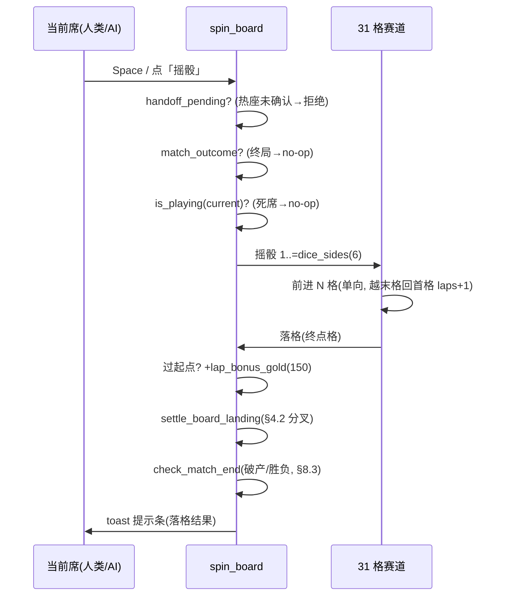

> 结算**只认终点格**（大富翁语义：路过不结算）。确定性：同 seed + 同摇骰序列 ⇒ 同落格串
> （`e2e_board_spin_loop` 判据）。

### 4.2 落格结算分叉（最核心的一张图）

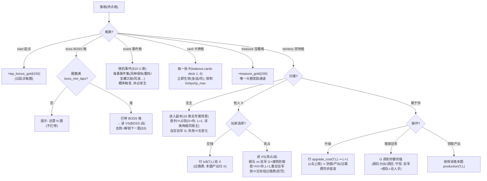

**10 类岛原型**（`territory.md` §3，每类 = 领地格 2 格 + 1 专属副本场景）：

| 原型 | 副本 | 守军 | 占领后产出 | 加固上限 |
|---|---|---|---|---|
| `harbour` 港口城 | 抢滩登陆 | 海盗水手 | 贸易抽成 | 3 |
| `lighthouse` 灯塔礁 | 灯塔夺灯 | 走私贩 | 航行加速 | 2 |
| `wreck` 藏宝沉船 | 沉船夺宝 | 守宝骷髅 | 宝藏金 | 3 |
| `pirate_lair` 海盗老巢 | 攻陷老巢 | 头目亲卫 | 掠夺金 | 3 |
| `shipyard` 帆船坞 | 夺船坞 | 船坞工头 | 造船折扣 | 2 |
| `trading_post` 军需商岛 | 商岛护镖 | 私掠队 | 贸易利润 + | 3 |
| `skull_cliff` 骷髅崖 | 崖上营寨 | 骷髅兵 | 战利品 | 2 |
| `volcano` 火山岛 | 熔岩洞府 | 熔岩守卫 | 熔金 | 3 |
| `lightship` 灯船站 | 登船夺旗 | 灯船船员 | 骰点 +1 | 2 |
| `boss_fort` 无畏号要塞 | 无畏号炮台 | BOSS 舰队 | 通关关键 | 3 |

> **多席位同格渲染**（`territory.md` §1.3，S36.1）：开局全席同起点 ⇒ 沿小圆周扇出
> （`seat_piece_offset`），船缩 70% 防重叠；当前席 = 金船 + 名牌，余席 = 暗灰旗 + P1..P5 徽标。
> 四条渲染路径（`render_track`/`render_v5_ring`/`render_v6_proto`/`render_v6_elem`）统一 `seat_slots`。

**中央据点岛**（`territory.md` §5）：= 当前玩家席位的大本营（可点 → 建造/造船/贸易/升级本家）；
不参与摇骰前进；其他席位据点不显示（避免信息过载）。

---

## §5 领土与战争

> 兵力模型（v2，`combat.md` §兵力模型 单一事实源）：战斗 = **人手 + 武器确定性 VS**，
> 双方必损，自动动效（无逐回合玩家输入）。

### 5.1 战力合成与胜负

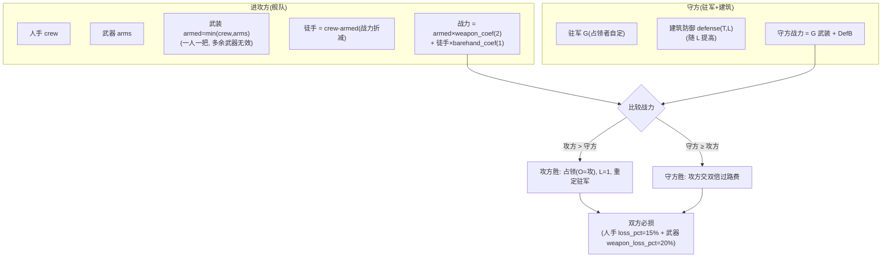

### 5.2 多人同格遭遇战（含 BOSS 战）

- **后到者决定打不打前一个占格者**（占格者 = 防守方）；序列 a→b→c：`b` 只打 `a`，`c` 只打 `b`
  （`territory.md` §4.3，`later_arrival_decides_duel_previous`）。
- 败者交钱（过路费）+ 损水手；胜者占领（重定驻军）；**双方必损**（武器 + 水手）。
- BOSS 格（`boss_fort`）同规则；最后一席可选「攻击」或「和平」（谈判通过，不战）。

### 5.3 破产与驻军

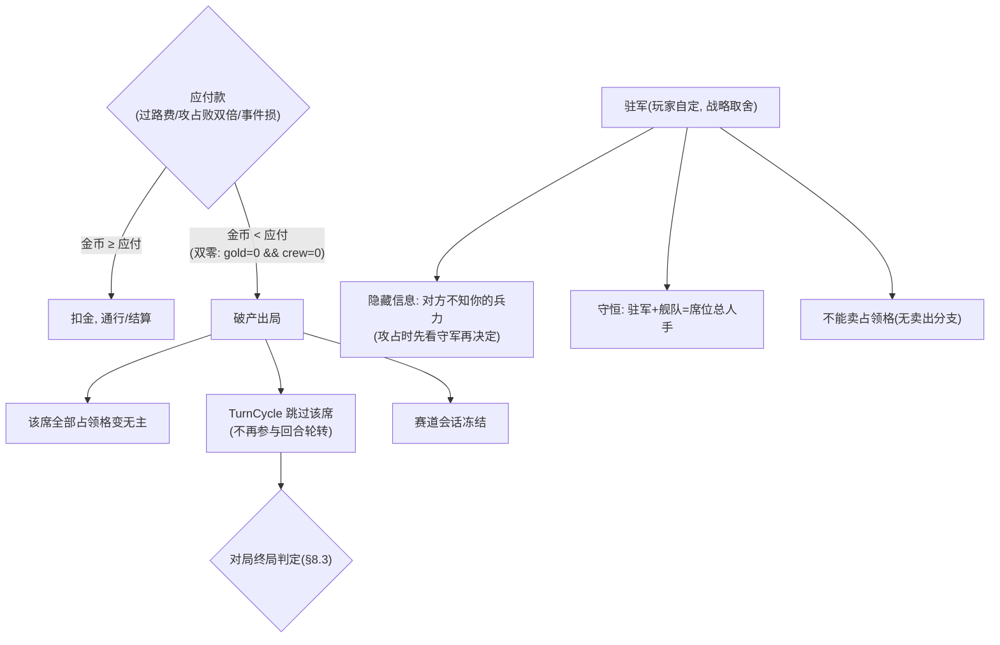

**破产触发**（`territory.md` §1.2 实测落地口径，`board.rs::check_match_end` 双零判据）：
`gold == 0 && crew == 0`。破产结算 = 金币归零 + 全占领格变无主 + 出局。

---

## §6 战斗（VS 场景，兵力模型）

> 设计意图（`combat.md`）：VS = **单场定胜负**的高潮场景：英雄 + 水手对战，自动动效，出结果。
> 刻意短（一次比较结算），避免拉锯。S34.6 D5：已从 HP 回合制迁移到兵力模型（`force::resolve`）。

```mermaid
stateDiagram-v2
    [*] --> Clash
    Clash: 战前列阵<br/>(双方舰队/驻军 + 武器)
    Clash --> Resolve: 触发 Attack(一次性 force::resolve)
    Resolve: 比较战力→判胜败<br/>不耗随机数(确定性)
    Resolve --> Attrition
    Attrition: 双方必损<br/>(人手-15% / 武器-20%)
    Attrition --> Result
    Result: 出结果横幅
    Result --> [*]
```

**战斗类型 → VS 画面**（`combat.md` §VS 界面，按格类 + 地图主题）：

| 战斗类型 | VS 画面 | 主题资产 |
|---|---|---|
| 攻占战（他人格） | 船队攻打建筑 | 地图特有建筑/城墙 |
| 副本战（无主格） | 英雄+水手登岛打守军 | 地图特有岛屿地形 |
| BOSS 战（`boss_fort`） | 英雄 vs 要塞炮台 | 地图特有 BOSS 要塞 |
| 多人同格遭遇 | 英雄+水手对决 | 地图特有甲板/海面 |
| 事件（功能格） | 不进 VS（随机事件直接结算 + 提示） | — |

**结果钩**（`combat.md` §S34.6 D5）：写回 `seat_crew/seat_arms`（attrition）；
副本胜 = 占领（§4.2）；BOSS 胜 = 通关/解锁下一图（§3）；攻占败 = 交双倍过路费（§5.1）。

**BOSS 档**（`balance.combat.boss_tiers[]`，S37 扩到 20 档 tier 0..=19）：
HP/ATK 随 tier 严格递增（`difficulty_ladder` 不变量）；`boss_tier_of(map)` 查表。

---

## §7 经济（贸易 / 建造 / 船 / 银行）

> 数值单一事实源 = `balance.json`（`trade`/`build`/`boat`/`economy` 段）。
> 设计意图（`economy.md`）：经济 = 金币进出两端，服务核心循环（探索→贸易→建造→战斗）。

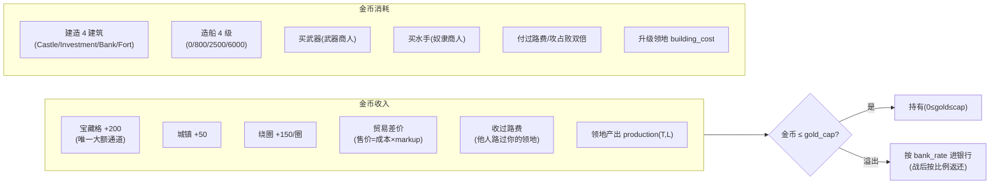

**贸易**（`economy.md`）：5 商品（id 1..5，`qty_max=400`）；单次数量上限 = `min(qty_max, 船 cargo)`
（`effective_qty_max`，`rules/boat.rs` + `rules/trade.rs` S21.10 落地）。价格固定（不做动态行情），
售价 = 成本 × `markup`（1.5），卖出钳到 `gold_cap`，溢出进银行。

**建造**（`economy.md`）：4 建筑单调升级链（`base_cost × (level+1)` 递增），每级 = 抬金上限
（`gold_max` 取已建最大）+ 抬战斗 atk/hp + 解锁玩法。

**船系统**（`economy.md` §船系统，S21.2）：

| 级 | 名 | 造价 | 货舱 cargo | 战斗 atk(累计) | 战斗 hp(累计) |
|---|---|---|---|---|---|
| 1 | 小舢板 | 0 | 99 | 0 | 0 |
| 2 | 双桅快帆船 | 800 | 150 | 4 | 80 |
| 3 | 三桅大帆船 | 2500 | 240 | 9 | 180 |
| 4 | 巡防战船 | 6000 | 400 | 15 | 320 |

- 单向升级，立即生效；船**不抬 gold_max**（金上限只归建筑/银行轴）；无维修/耐久/海战。
- 船等级 = **人手容量上限**（`crew ≤ boat_capacity`）；`arms ≤ crew`（一人一把）。
- 等级不随跨图重置（全局账号级，随存档持久化 `SaveSlot.boat_level`）。

**商人**（`territory.md` §7，每图必有）：武器商人（卖武器，`weapon_price`）+ 奴隶商人（卖水手，
`slave_price`）。水手来源 = 奴隶商人 + 随机事件（流浪儿/孤岛救援）+ 初始；武器来源 = 武器商人
+ 随机事件（宝藏沉船）+ 初始。

---

## §8 热座会话与对局生命周期

### 8.1 回合交接（隐藏信息）

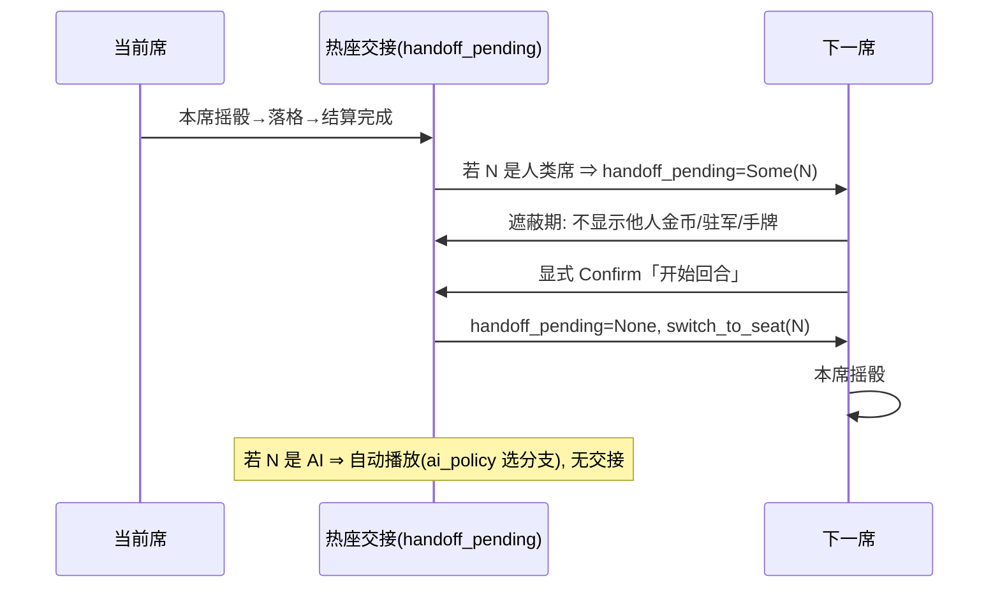

> **交接触发**（`board.rs` run_ai_turns 后）：`active_players ≥ 2`（在局 ∧ 存活 的人类席 ≥2）
> ⇒ `handoff_pending = Some(next_seat)`；否则 `handoff_pending = None`（单人类 + AI 免交接）。
> 已破产玩家席**不再触发交接**（`is_playing ∧ is_player_seat`，飞轮 R1 F-6.1 修复）。

### 8.2 每席独立会话

- 每席独立赛道会话（`seat_sessions[]`，v3 D2 修复：旧「人类席共用 self.board」已废）。
- 单一金币账本 `seat_gold[]`（v3 D3 修复：旧「两套账本」已废；`sync_gold_mirror` 同步镜像）。
- `switch_to_seat(seat)` = 互换 `board`↔`seat_sessions`（幂等，防会话漂移）。

### 8.3 对局终局（3 路径，`check_match_end` 单一事实源）

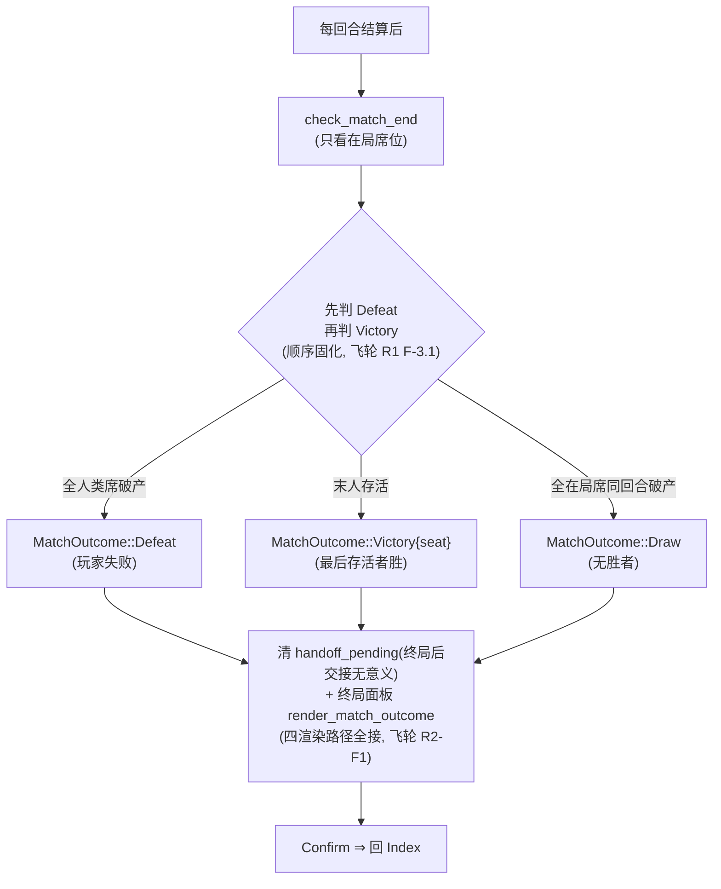

**终局面板**（`territory.md` §1.2 + `main_map.rs` `render_match_outcome`/`render_handoff`）：
Defeat/Victory/Draw 三条路径置 `match_outcome` 时**全清 `handoff_pending`**（飞轮 R3-F1：
Draw 路径对称清，对齐「终局 = 一次 Confirm 回主菜单」语义）；终局面板在
`render_track`/`render_v5_ring`/`render_v6_proto`/`render_v6_elem` 四条路径全画（飞轮 R2-F1
补 v6 主渲染路径）。终局后 `spin_board` no-op（`match_outcome.is_some()` 拦截，飞轮 R1 F-6.3）。

---

## §9 存档与迁移（`persistence.md` 单一事实源）

存档 = JSON（人可读、可 diff、可迁移），存**运行时状态**。当前 schema = `SaveSlotV5`
（v5 = 席位全量 + 领地图，S33.4）。

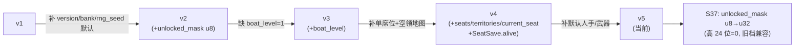

| 字段 | 类型 | 含义 |
|---|---|---|
| `version` | `u32` | 存档版本（v1→v5 迁移链） |
| `character` | 字符串 | 主玩家角色 label（panda/tichy/…） |
| `map` | 字符串 | 地图 id（m01~m20，S37） |
| `seats` | `Vec<SeatSave>` | 每席：角色/类型/金币/人手/武器/位置/船/建筑/**存活态(alive)** |
| `territories` | 领地图 | 谁占哪格/驻军/加固等级（`owner_seat`/`garrison`） |
| `current_seat` | `u8` | 热座交接：当前轮到哪席 |
| `unlocked_mask` | `u32` | 逐图推进位 + CLEARED（S37 升 u32，bit19 通关） |
| `boat_level` | `u8` | 船等级 1..=4 |
| `rng_seed`/`rng_steps` | — | 可复现 RNG（固定默认种子 42，不存时间戳） |

**迁移规则**（`persistence.md` §迁移）：
- 迁移函数纯函数、幂等、可单测（`tests/save_migration.rs`）。
- `SeatSave.alive` 缺省 `true`（旧档零回归；restore **只降不升**：已出局席若存档标活保持原态）。
- 读档 `restore_v4_ext`：`current_seat` 指向已出局席 ⇒ 自动 `advance()` 到下一存活在局席
  （飞轮 R1 F-5.3）；advance 后 `switch_to_seat` 同步 board 会话 + `sync_gold_mirror`
  （飞轮 R2-F4/F5）。
- 旧档 `unlocked_mask=0`（u8）读档 ⇒ 高 24 位=0 扩展为 u32，退「最小前置链」。

**读档还原完整性**：必须能还原「谁占哪格 / 各席金币·人手·武器·驻军 / 轮到谁 / 谁已出局」。

---

## §10 失败与边界路径

| 路径 | 行为 | 锚点 |
|---|---|---|
| **破产出局** | 双零判据（`gold=0 && crew=0`）⇒ 出局 + 全领地变无主 + 回合跳过 | §5.3 / `territory.md` §1.2 |
| **全人类席破产** | `MatchOutcome::Defeat`（玩家失败），终局面板 → Index | §8.3 |
| **末人存活** | `MatchOutcome::Victory{seat}`（最后存活者胜） | §8.3 |
| **全同回合破产** | `MatchOutcome::Draw`（无胜者） | §8.3 |
| **BOSS 未现** | 圈数 < `boss_min_laps` ⇒ 「还需 N 圈」提示，不拦停 | §3 |
| **地图切换失败** | 数据校验失败（balance 缺条目/坐标越界）⇒ 停留原场景（`Sfx::Invalid`，FIND-204） | §3 |
| **未解锁图 Confirm** | `map_unlocked` 拒绝 ⇒ 停留选图，选择态不提交 | §3 |
| **热座交接卡死** | `is_playing ∧ is_player_seat` 判定阻止交接到死席（飞轮 R1 F-6.1） | §8.1 |
| **旧档兼容** | `unlocked_mask` u8→u32 高 24 位=0；`SeatSave.alive` 缺省 true 只降不升 | §9 |
| **单人类 + AI 旧流** | `seat_marks` 空 ⇒ 豁免 min_players（v2 兼容），`single_player_legacy_no_regression` 锚定 | §2 |
| **终局后摇骰** | `match_outcome.is_some()` ⇒ `spin_board` no-op（飞轮 R1 F-6.3） | §8.3 |
| **场景无死锁** | 任意场景可经 ≤ `balance.ui.max_back_steps` 次操作回主菜单（`loop_core.md` 约束） | §1.2 |
| **金币恒非负** | `0 ≤ gold ≤ gold_cap` 恒成立（`economy_gold_never_exceeds_cap`） | §7 |

---

## §11 数值锚点速查（引用，不复述）

> 本文**不写数值**（`00_index.md` 约定：数值在 `balance.json`，本目录只写「哪个数、为什么」）。
> 下表 = 各系统数值引用表，改数值只改 `balance.json` 对应段。

| 系统 | 数值段（`balance.json`） | 关键键 | 说明 |
|---|---|---|---|
| 贸易 | `trade` | `goods[1..5].buy`（20/76/95/114/133）、`qty_max=400`、`markup=1.5` | 价格固定，无动态行情 |
| 建造 | `build.buildings` | `Castle/Investment/Bank/Fort` 的 `base_cost`/`gold_max`/`atk_bonus`/`hp_bonus` | 单调升级链 |
| 船 | `boat.levels` | 4 级 `cost`(0/800/2500/6000)/`cargo`(99/150/240/400)/`atk`/`hp` | 单向升级，cargo 抬贸易上限 |
| 经济上限 | `economy` | `gold_max=999999`、`bank_rate=1.0`、`initial_gold=1000` | 溢出进银行 |
| 兵力 | `manpower` | `weapon_coef=2`、`barehand_coef=1`、`loss_pct=1500`(15%)、`weapon_loss_pct=2000`(20%) | 战力合成 + 双方必损 |
| BOSS | `combat.boss_tiers[0..=19]` | 每档 `hp`/`atk`（tier 0..=19 严格递增，S37） | 选图卡难度星 = tier+1 |
| 席位 | `selection` | `min_players=2`、`max_ai_seats=4`、`map_count=20` | 热座 + 20 图 |
| 地图 | `selection.maps[0..=19]` | 每图 `id`/`index`/`boss_tier`/`grid_w`/`grid_h`/`player_start` | m01~m20 20 条 |
| 赛道 | `board` | `dice_sides=6`、`lap_bonus_gold=150`、`city_gold=50`、`battle_damage=30`、`battle_gold_loss=20`、`treasure_gold=200` | 31 格定构 |
| 卡牌 | `cards` | `deck[1..5]`、`event_chance`、`hand_size=1` | 单卡 roguelite 事件 |
| 商人 | `merchants` | `weapon_price`、`slave_price` | 每图必有 |
| 海事事件 | `events` | 常用集 + 每图 `events[]` 特有 | 功能格概率触发 |
| 存档 | — | `version=5`、`rng_seed=42`（固定默认） | 可复现 RNG |

**单一事实源边界**（改规则前必读对应文档）：

| 主题 | 单一事实源 | 改动落点 |
|---|---|---|
| 领地/副本/对手机制 | `territory.md` | 规则 + `balance.territory` |
| 战斗模型 | `combat.md` | 规则 + `balance.combat/manpower` |
| 经济/船 | `economy.md` | 规则 + `balance.trade/build/boat/economy` |
| 地图/赛道/跨图 | `progression.md` | 规则 + `balance.board/selection` + `board.json` |
| 存档/RNG | `persistence.md` | `SaveSlotV5` + `saveload.rs` |
| 版面/坐标 | `08_layout_design.md` + `ui-redesign-v3/` | `scenes.json` |
| 地图包格式 | `process/21_map_package_spec.md` | `assets/maps/<id>/` |

---

## 与既有系统的关系（`territory.md` §9 单一事实源）

| 系统 | 关系 |
|---|---|
| 战斗 `rules::battle` | v2 = 兵力模型（`combat.md` §兵力模型）；副本/BOSS 同模型 |
| 建造 `rules::build` | 建筑 = 个人成长线；领地建筑 = 地图成长线（独立叠加） |
| 船只 `rules::boat` | 船等级 = 人手容量上限 + 贸易上限；不影响领地攻防公式 |
| 跨图推进 `rules::progression` | 击败本图 BOSS = 解锁下一图；被 AI 击败不影响玩家解锁 |
| 卡牌 `rules::cards` | 功能格不再抽卡（改海事随机事件）；副本内不抽卡 |

> **跨模块原因**（`territory.md` §12）：领地状态同时被「落格结算（规则）× 棋盘渲染（表现）
> × 副本入口（场景流）× 存档（持久化）× AI（回合驱动）」五面读写——任何一面单独改都会
> 出现「显示有主但规则无主」或「规则易主但存档不存」。故业务规则先定案（本目录），
> 再按 §10 可测规则表逐条落地。
