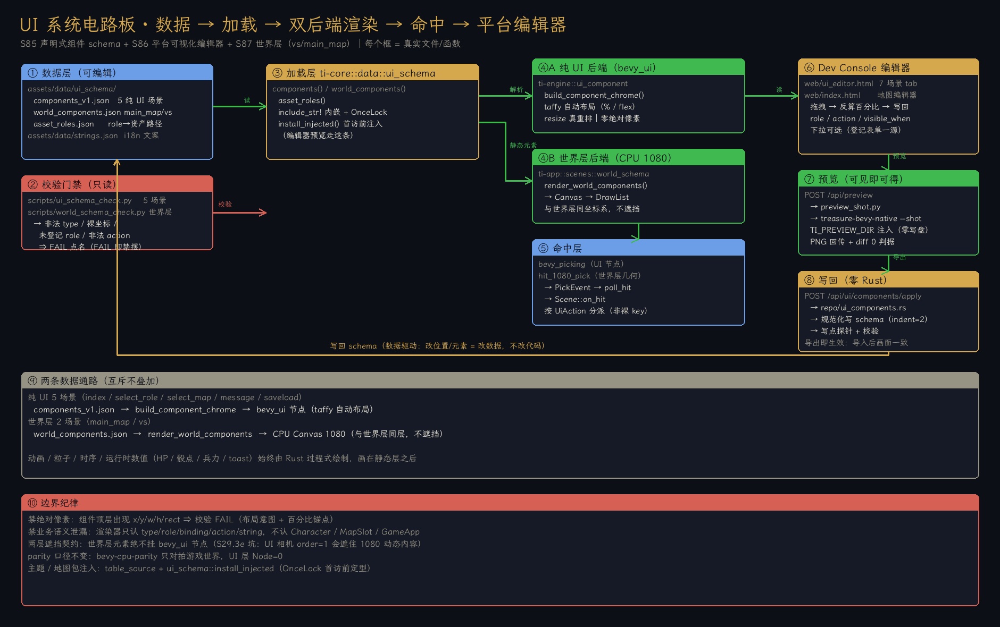
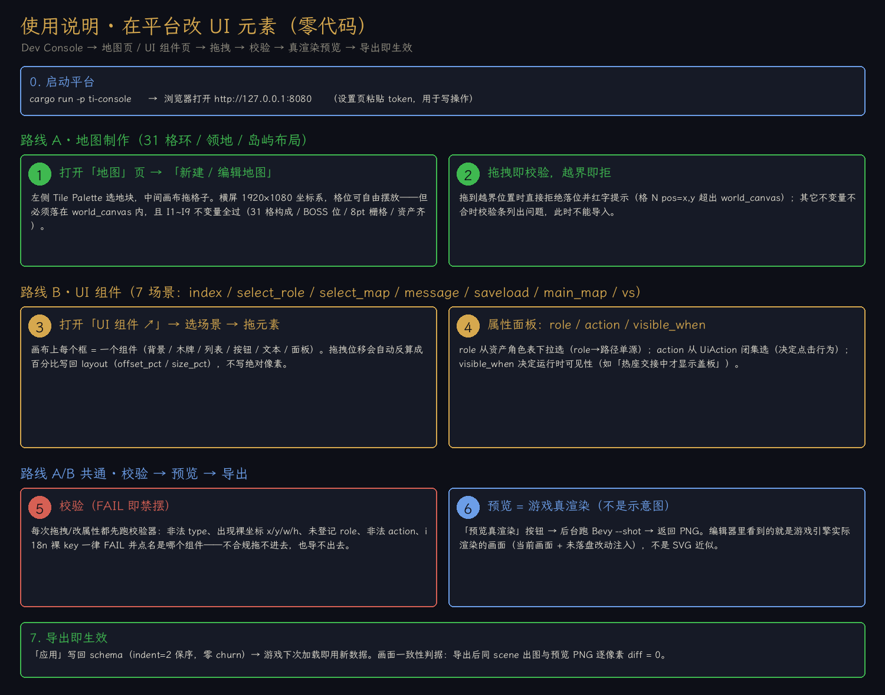

# 33 · UI 组件 Schema 规范（S85 单一事实源）

> S85 用户拍板「完整 UI 系统重构」：把 UI 从「逐条死坐标 prim + Rust `format!` 硬拼」
> 改为「声明式组件 schema + 通用渲染器 + 业务绑定」。本文是 schema 契约的**唯一事实源**，
> 机读形式 = `assets/data/ui_schema/components_v1.schema.json` + `components_v1.json`。
>
> 本文是「不手写像素」总纲（18 号）与 B1 布局引擎（17 号）的**继续**，不是推翻：
> 新元素只写 `type`/`binding`/`layout`/`role`/`action`/`state`，**禁绝对 rect**。

## 0. 系统总图与使用说明

> 图由 `scripts/draw_ui_system_map.py` 生成（真实接线，每个框 = 实际文件/函数）；机器可复跑。

> 图由 `scripts/draw_ui_howto.py` 生成。

## 1. 元素二分

| 类 | 定义 | schema 表达 | 坐标 |
|---|---|---|---|
| **无功能（展示层）** | 背景/装饰/氛围 | `type:image/rect/grad/glow` + `role` + `layout`（fill/center/side…） | 无绝对像素，引擎算 |
| **有功能（控件层）** | 按钮/输入框/列表/卡片/徽章 | `type:button/input/list/badge` + `binding` + `action` + `state` | 布局约束（flex/%/gap） |

## 2. 组件字段契约

| 字段 | 类型 | 必填 | 约束 |
|---|---|---|---|
| `id` | string | ✅ | 场景内唯一，正则 `^[a-z][a-z0-9_]*$` |
| `type` | enum | ✅ | `image`/`rect`/`text`/`button`/`input`/`list`/`badge`/`panel`/`grad`/`glow` 闭集 |
| `role` | string | 条件 | `type∈{image,rect,grad,glow,badge}` 必填；须在 `asset_roles.json` 登记（role→资产路径单源） |
| `binding` | string | 条件 | `type∈{text,button,input,list,panel}` 必填；格式见 §3 |
| `layout` | object | ✅ | `intent` 必填（枚举），可选 `side`/`width_pct`/`gap`/`align`；**禁 x/y/w/h 绝对坐标字段** |
| `action` | enum | 条件 | `type∈{button,list,badge}` 必填；见 §4，替 `if hit.key==N` |
| `state` | enum[] | 否 | `selected`/`hover`/`disabled`/`normal`，替 `when` 字符串 |
| `text` | string | 否 | i18n key 或字面量（`type=text/button`），见 §3 |
| `tier` | enum | 否 | `title`/`body`/`hint`（沿用字号档） |
| `icon` | string | 否 | `ui_icons.json` 已登记图标名（替 `format!("icon_{}.png")`） |
| `when` | enum[] | 否 | 兼容别名 → 等同 `state`（过渡期，S85.5 后删） |

**硬约束**：任何组件出现绝对坐标字段（`x`/`y`/`w`/`h`/`rect`）= 校验 FAIL（「不手写像素」机器守门）。

## 3. binding 语法

三种形态，解析器统一处理：
1. **i18n key**：`scene.select_role.title` → `sget(key)`。
2. **i18n key 模板**：`role.name.{label}` / `glmap{id}.Map` → binding 变量替换后 `sget`（新增 key 模板解析器；
   现有 `sgetf` 只填值占位 `{0}`，不填 key 占位，S85.4 实现）。
3. **业务数据路径**：`characters` / `save_slots` / `map_slots` / `msg_pages` → binding resolver 从 `SceneHost` 取列表并展开
   （每项的 `label`/`name`/`desc`/`index` 等子字段供 key 模板与 text 插值）。

binding resolver 是「binding 名 → Rust 取值闭包」注册表（S85.4），容忍 default fake 宿主的空/0 值。

## 4. action 枚举（替 7 处 `if hit.key==N`）

| action | 语义 | 对应 GameInput / 场景方法 |
|---|---|---|
| `menu_select` | index 木牌选择 | `set_menu_selected(idx)`+`Confirm` |
| `character_select` | 选角 | `set_character(idx)`+`Confirm` |
| `map_select` | 选图 | `set_map_slot(idx)`+`Confirm` |
| `slot_load` / `slot_write` | 存读档槽 | `LoadSave(slot)` / `WriteSave(slot)` |
| `msg_next` / `msg_prev` | 帮助翻页 | `MsgNext` / `MsgPrev` |
| `spin` | 主地图摇骰（key=4） | `GameInput::Spin` |
| `back` | 返回 | `GameInput::Back` |
| `attack` / `do_item` / `defend` | vs 战斗（key=2/3/4） | 对应 vs on_hit 分支 |

事件链：`action` → 统一 `PickTarget{key,index}`（key 由 action 注册表派生， opaque）→ `PickEvent` → `g.poll_hit` →
`route_hit` → 场景按 **action 而非裸数字 key** 分派。缺 action 的控件 = 不可点（沿用「缺键=不可点」语义）。

**S85.4 单一事实源**：`ti_core::domain::ui_action::UiAction` 枚举 + `ACTION_TABLE`（12 项字符串↔key↔variant 唯一表），
从它派生三处：① shell `action_key` = `UiAction::from_schema_str(action).key()`（零裸字面量）；
② 场景 `on_hit` = `match UiAction::from_key(hit.key)` 按 variant 族分派；③ doccheck2 表↔schema 闭集双向对账。
key 口径 = menu=1 / character·map=2 / slot_load·slot_write=3 / spin=4（沿用旧 route_hit）；
vs 世界 attack/do_item/defend 沿用 2/3/4（B1 边界，场景 on_hit 未迁）；
msg_next/msg_prev/back = 8/9/10（当前走键盘/滑动，schema 数据未使用，预留避免撞历史 1..7）。
同 key 多 variant 由场景按 variant 族分派（如 `CharacterSelect|MapSelect`、`SlotLoad|SlotWrite`）。

## 5. layout 意图枚举

`fill`（满屏）/ `center`（居中）/ `side_left` / `side_right`（贴边，配 `width_pct`）/ `bottom_bar`（底栏）/
`flex_col` / `flex_row`（配 `gap`/`align`）/ `anchored`（精细定位，配 `anchor` + `offset_pct{x,y}` + `size_pct{w,h}`）。渲染器按意图交给 bevy_ui taffy 自动布局 → resize 真重排。
禁 `x/y/w/h/rect` 绝对字段；`anchored` 的 `offset_pct`/`size_pct` 是百分比偏移，仍非绝对像素。
**用户拍板（2026-11-24）**：语义布局为默认 + `anchored` 锚点偏移供无功能装饰元素精细定位，两者都要。

## 6. 主题与地图包注入写点（解决 S84 遗留漂移）

- `scenes.json` **保留面**：main_map/vs 游戏世界 prim + `extra`/`ring`/`focus_anchor`/地图包 `layout.json` 键（B1 不迁）。
- `components_v1.json` 为 5 纯 UI 场景的新事实源；主题覆盖层写 `components_v1.json` 的 `overrides` 段
  （不再写已删的 `index.landscape.primitives`）。`map_pack.rs::merge_theme_scenes`/`apply_theme_preview`/
  `ui_theme.py`/`themes.rs`/`ui_wizard.rs` 统一指向新写点。
- `strings.json` upsert 保留为 i18n binding 源。

## 7. 门禁（机读）

- `components_v1.schema.json`：JSON Schema draft-07 校验 type/binding/action/layout.intent enum + 绝对坐标字段禁止。
- 校验脚本 `scripts/ui_schema_check.py`（工具契约 3 处登记）：`--check` 只读，非法枚举/绝对坐标/未登记 role/
  未登记 action/缺 binding = 非 0 退出 + 点名组件 id；负例自证（改坏→FAIL，还原→PASS）。
- doccheck2 `primitives-data` → `components-data`（id 可保留兼容名，语义改验新 schema）；`visual-signoff` TOUCH 加新文件名。

## 8. 与既有规约的关系

- 18 号「不手写像素」：本 schema 是其机器化执行面（绝对坐标字段直接 FAIL）。
- 17 号 B1：5 纯 UI 场景 chrome 由「Bevy 代码硬拼」回退为「schema 数据 + 通用 Bevy builder」，其余约定不变
  （bevy_ui 自动布局/picking/游戏世界 1080/parity 仅游戏世界）；须在 17 号补一条签核。
- vs/main_map 游戏世界**不迁**（UI 相机叠层会遮住 1080 动态内容）。
