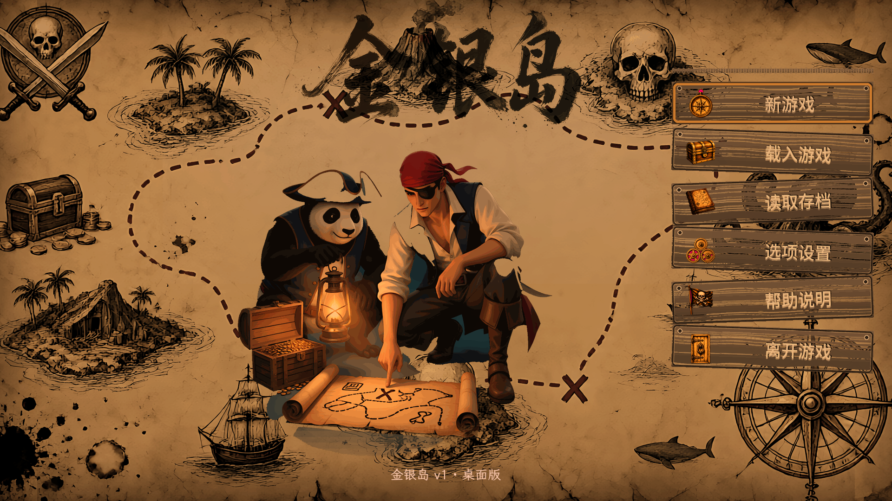
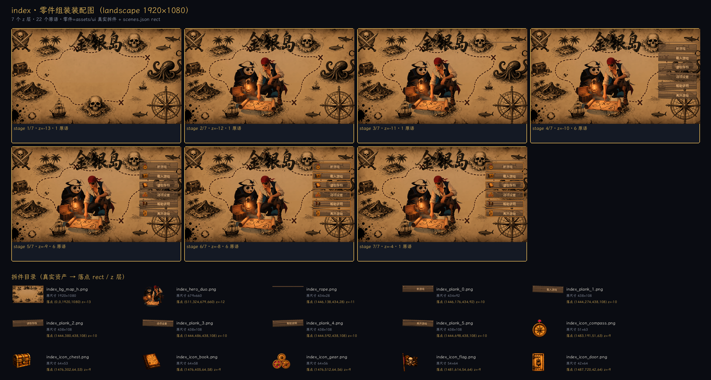

# index 场景 · 详细图文拆解

> **数据源单一事实源声明**（时点 2026-11-23，S76.1 实测 / S84 纯横屏重写）：
> - 版面/原语唯一事实源 = `assets/data/scenes.json` 的 `index.landscape.primitives`（22 条，逐条实测；旧版原语已随纯横屏重写作废）。
> - 设计规格 = `docs/ui-redesign-v3/14_index_treasure_map_spec.md`（羊皮藏宝图 + 绳挂木牌）；横屏基础设施 = `docs/process/27_landscape_adaptation.md`（U23 方案 A，横屏固定 1920×1080）。
> - 源码 = `crates/ti-app/src/scenes/index.rs`（输入/命中/渲染三面）＋ `crates/ti-engine/src/bin/treasure_bevy.rs`（`prims_for` 选源、`chrome_ui_system` 重建）＋ `crates/ti-engine/src/pick.rs`（拾取层）。
> - 真实渲染截图 = `evidence/bevy_native_index_1920x1080.png`（1920×1080）；引擎 `--shot` 离屏出图，非 AI 概念图。
> - 资产登记 = `assets/ui_manifest.json`（`assets[]` 387 项，逐项 name→file 核对）；i18n = `assets/data/strings.json` `scene.index.*`。
> - 测试 = `crates/ti-app/tests/e2e_playthrough.rs` / `game_app_flow.rs` / `e2e_ui_flow_deterministic.rs` / `landscape_drawlist.rs`。
>
> 引用 ID 不复述：`MenuAction`/`SceneKind` 流转见 `spec/menu.md §a`；数据化 UI 通道见 `docs/process/19_bevy_ui.md`（`build_data_chrome`）；资产双向同步见 `docs/process/18_asset_content_pipeline.md`；`export-icon-boundary` 守门见 `doccheck2`。

## 1. 场景职责与状态机位置

`index` = 游戏主菜单/标题页，玩家进入应用后的首个可交互场景（`SceneKind::Index`，9 场景判别值之一，`game_app_flow.rs::scene_discriminants_unique` 锚定）。

**进入条件**：应用启动进入（或退出各子场景后返回主菜单；`game_app_flow.rs` 断言「回主菜单后 `menu_selected` 复位到 0」）。

**退出/流转**（`index.rs::on_input` `Confirm`，MENU_COUNT=6）：

| 选中项 | 文案（i18n） | 动作 | 目标场景 |
|---|---|---|---|
| 0 新游戏 | 新游戏 | `reset_selection()` + `enter` | `SelectRole` |
| 1 载入游戏 | 载入游戏 | `enter` | `Saveload` |
| 2 读取存档 | 读取存档 | `open_help()` | `Message`（Help kind） |
| 3 选项设置 | 选项设置 | `open_help()` | `Message`（Help kind） |
| 4 帮助说明 | 帮助说明 | `open_help()` | `Message`（Help kind） |
| 5 离开游戏 | 离开游戏 | `request_quit()` + `enter` | `Exit` |

键盘 `MoveUp`/`MoveDown` = 6 项循环高亮（`(cur ± 1) % MENU_COUNT`，`game_app_flow.rs` 断言 0↔5 回绕）；触屏/点击走 `on_hit` → `set_menu_selected(idx)` → `advance(Confirm)`（与键盘同入口，**零逻辑分叉**）。

**横屏定案（S39，纯横屏重写）**：版面 = 1920×1080 羊皮藏宝图（标题正片叠底烘焙进底图）+ 人物互动层 + 右列 6 块木牌（烙印文案 + AI 图例徽章）；无 N8 焦点锚（横屏不走场景叙事 DSL 对账）。

**当前定案**：S39.0 数据化重构后为纯数据驱动（`scenes.json` `index.landscape.primitives`；`build_data_chrome` 通用「原语→bevy_ui」通道），换 UI = 改数据 + 换资产 = **Rust 零改动**（唯一例外 = 引入新交互形态）。详见 §10。

## 2. 真实渲染截图

出图 `cargo run -p ti-engine --bin treasure-bevy-native -- --shot index --viewport=1920x1080`：



图中可见：满屏做旧羊皮藏宝图底（手绘海岛 / 红色虚线航线 / X 宝藏 / 罗盘玫瑰，标题墨已烘焙进图）；中部偏左冷峻红头巾海盗 + 熊猫海盗人物互动层；右侧一列麻绳吊挂的 6 块木纹牌（首项金边高亮）+ 各牌 AI 图例徽章图标；底部版本签。

> 注：图为 Bevy 引擎真实离屏渲染（`evidence/bevy_native_*.png`），符合 A 纪律验收口径；AI 概念稿（`evidence/ui_concept/` 下 `index_v2.png` 等）仅作设计参考，不作验收图。

### 2.5 零件组装装配图（S39 拆件组件化概念）



由正式工具 `scripts/ui_assembly.py` 按 scenes.json 的 z-order 逐层叠加 **assets/ui 真实拆件**产出（非 PIL 裁切完整图、非 AI 概念图），landscape 1920×1080，7 个 z 层 / 22 原语 / 21 个资产零件。

- 复现：`python3 scripts/ui_assembly.py --scene index --orientation landscape --output evidence/scenes_assembly_index_landscape.png`
- 读法：上方每个 stage = 叠加一层后的画面，下方目录列出每件拆件的原尺寸 / 落点 rect / z 层。
- 说明：16 件拆件组件化（底图烘焙标题 + 人物 + 绳 + 6 木牌 + 6 图标 + 金边），逐层加载渲染，S39 spec 标准样本

## 3. ASCII 布局图

**1920×1080（羊皮藏宝图版，设计空间 1920×1080）**

```
┌───────────────────────────────────────────────────────────────┐ y=0
│  index_bg_map_h 满屏羊皮藏宝图（标题烘焙进底图） (0,0,1920,1080)     │
│                                                               │
│      index_hero_duo 人物互动层 (511,324,679,660)                 │
│      ┌────────────────────┐                                   │
│      │  红头巾海盗 + 熊猫  │           index_rope              │
│      │  围看藏宝图 + 宝箱  │           (1446,138,434,28)       │
│      └────────────────────┘           ┌─ 木牌0 新游戏 (1446,176) ┐│
│                                       │ 木牌1 载入 (1444,274)    ││
│                                       │ 木牌2 读档 (1444,380)    ││
│                                       │ 木牌3 选项 (1444,486)    ││
│                                       │ 木牌4 帮助 (1444,592)    ││
│                                       │ 木牌5 离开 (1444,698)    ││
│                                       └──────────────────────────┘│
│                                    （每牌叠图标 + 选中金边）      │
│                    版本签 (820,1008,280,32)                      │ y=1080
└───────────────────────────────────────────────────────────────┘
```

## 4. 逐元素坐标表

表 = `scenes.json` 原语逐条（`#` 为数组下标，绘制序 = `z` 升序；`color` 列按数据原值；`params` 省略 `assets/ui/` 前缀）。横屏 `index.landscape.primitives` 22 条全列如下。

| # | kind | rect(x,y,w,h) | z | item | when | params |
|---|---|---|---|---|---|---|
| 0 | image | (0, 0, 1920, 1080) | -13 |  | - | asset=index_bg_map_h.png |
| 1 | image | (511, 324, 679, 660) | -12 |  | - | asset=index_hero_duo.png |
| 2 | image | (1446, 138, 434, 28) | -11 |  | - | asset=index_rope.png |
| 3 | image | (1446, 176, 434, 92) | -10 | item=0 | - | asset=index_plank_0.png pick_key=1 pick_index=0 ui_layer=bevy_ui |
| 4 | image | (1483, 191, 51, 63) | -9 |  | - | asset=index_icon_compass.png ui_layer=bevy_ui |
| 5 | image | (1446, 176, 434, 92) | -8 | item=0 | selected | asset=index_plank_sel.png ui_layer=bevy_ui |
| 6 | image | (1444, 274, 438, 108) | -10 | item=1 | - | asset=index_plank_1.png pick_key=1 pick_index=1 ui_layer=bevy_ui |
| 7 | image | (1476, 302, 64, 53) | -9 |  | - | asset=index_icon_chest.png ui_layer=bevy_ui |
| 8 | image | (1446, 282, 434, 92) | -8 | item=1 | selected | asset=index_plank_sel.png ui_layer=bevy_ui |
| 9 | image | (1444, 380, 438, 108) | -10 | item=2 | - | asset=index_plank_2.png pick_key=1 pick_index=2 ui_layer=bevy_ui |
| 10 | image | (1476, 405, 64, 58) | -9 |  | - | asset=index_icon_book.png ui_layer=bevy_ui |
| 11 | image | (1446, 388, 434, 92) | -8 | item=2 | selected | asset=index_plank_sel.png ui_layer=bevy_ui |
| 12 | image | (1444, 486, 438, 108) | -10 | item=3 | - | asset=index_plank_3.png pick_key=1 pick_index=3 ui_layer=bevy_ui |
| 13 | image | (1476, 512, 64, 56) | -9 |  | - | asset=index_icon_gear.png ui_layer=bevy_ui |
| 14 | image | (1446, 494, 434, 92) | -8 | item=3 | selected | asset=index_plank_sel.png ui_layer=bevy_ui |
| 15 | image | (1444, 592, 438, 108) | -10 | item=4 | - | asset=index_plank_4.png pick_key=1 pick_index=4 ui_layer=bevy_ui |
| 16 | image | (1481, 614, 54, 64) | -9 |  | - | asset=index_icon_flag.png ui_layer=bevy_ui |
| 17 | image | (1446, 600, 434, 92) | -8 | item=4 | selected | asset=index_plank_sel.png ui_layer=bevy_ui |
| 18 | image | (1444, 698, 438, 108) | -10 | item=5 | - | asset=index_plank_5.png pick_key=1 pick_index=5 ui_layer=bevy_ui |
| 19 | image | (1487, 720, 42, 64) | -9 |  | - | asset=index_icon_door.png ui_layer=bevy_ui |
| 20 | image | (1446, 706, 434, 92) | -8 | item=5 | selected | asset=index_plank_sel.png ui_layer=bevy_ui |
| 21 | text | (820, 1008, 280, 32) | -4 |  | - | text=金银岛 v1 · 桌面版 tier=hint |

> 场景专属参数：`landscape` 节点仅含 `primitives`（22 条），无独立 status/focus_anchor；版本签走 `text` 原语 `(820,1008,280,32)`。横屏不走场景叙事 DSL（N8）对账。

## 5. 横屏版面要点

- **画布**：1920×1080 满屏。
- **背景**：`index_bg_map_h.png`（满屏羊皮藏宝图，标题已 multiply 烘焙进图）。
- **焦点形态**：人物互动层 `index_hero_duo` + 右列 6 木牌（线性列布局）。
- **菜单载体**：6 × `image(index_plank_i)` + `image(icon)` + `image(index_plank_sel)`（3 原语/项）。
- **选中态**：单独 `index_plank_sel.png` 金边叠加层（`when=selected`）。
- **图标来源**：`kind=image` 直接引用 AI 图例徽章 PNG（生图阶段已上色）。
- **富文本**：标题无运行时 `text` 原语（已烘焙进底图）；仅版本签 `text`。
- **N8 焦点锚**：无（横屏未声明 focus_anchor，不参与 N8 对账）。
- **命中**：木牌 `pick_key=1` / `pick_index=0..5`。

**方向选源逻辑**：`ti_engine::is_landscape(window_w, window_h)`（`canvas.rs`）判横竖；`treasure_bevy.rs` 将方向写入 `Settings.orientation`，`render_primitives` 时取横屏 `landscape.primitives` 22 条。UI chrome 重建键含 `orientation_disc`（`key=(scene.discriminant(), sel_key, orientation_disc)`），方向变化时强制重建，规避「木牌永不渲染」类缺陷。横屏出图命令 `--shot index --viewport=1920x1080`。横屏版面设计意图详见 `14_index_treasure_map_spec.md` §2；方向适配背景见 `docs/process/27_landscape_adaptation.md`。

## 6. 资产接线

`scenes.json` `params.asset` 提取 → `assets/ui_manifest.json`（`assets[]` name→file）逐一核对，**全部已登记**（export-icon-boundary 守门：所有 `image` 原语 asset 必须入册，缺一项 doccheck2 FAIL）：

**横屏资产（16 件拆件，S39）**

| 用途 | asset（scenes.json） | ui_manifest name → file | role |
|---|---|---|---|
| 底图（标题烘焙） | `assets/ui/index_bg_map_h.png` | `index_bg_map_h` → 同名 file | background |
| 人物互动层 | `assets/ui/index_hero_duo.png` | `index_hero_duo` → 同名 file | portrait |
| 菜单主绳 | `assets/ui/index_rope.png` | `index_rope` → 同名 file | item |
| 木牌 ×6 | `assets/ui/index_plank_0..5.png` | `index_plank_0..5` → 同名 file | item |
| 选中金边 | `assets/ui/index_plank_sel.png` | `index_plank_sel` → 同名 file | item |
| 图标 ×6 | `assets/ui/index_icon_{compass,chest,book,gear,flag,door}.png` | 对应 name → 同名 file | item |

> 守门：`export-icon-boundary`（doccheck2）保证所有 `image` 资产从 `assets/ui/` 经 `ui_manifest.json` 单源登记；`validate_data.py` `check_asset_registry` 双向同步（disk↔registry）。横屏图标 = S39 新生成的 6 枚 AI 图例徽章（`index_icon_*`，已上色，非运行时 tint）。文案 i18n 单源 = `strings.json` `scene.index.*`（文案已烙进木牌资产，数据层 `text` 仅保留语义）。

## 7. 命中契约

**分布**：6 块木牌（#3/6/9/12/15/18）= 带 `pick_key=1` / `pick_index=0..5` / `ui_layer=bevy_ui`。无其它 pick_key（与 main_map 的 4/5/6/7、select_* 的 2 区分；见 `e2e_playthrough.rs` 注释清单）。

**数据化命中链**：`scenes.json` `pick_key`/`pick_index` → `ti-engine::pick` 拾取层（`spawn_pick_layer` 只认 `pick_key>0` 原语，挂 `PickTarget` `key`/`index`）→ 归一 `HitData {key, index, swipe}`（`pick.rs::PickTarget`/`HitData`）→ 壳 `poll_hit` → `game_app::route_hit` → `IndexScene::on_hit`。

**on_hit 行为**（`index.rs::on_hit`）：`swipe != 0` 忽略；`key != 1` 忽略（非首页木牌）；`key=1` 时 `idx = hit.index.max(0)` → `set_menu_selected(idx)` → `chrome::flash_press()` → `advance(Confirm)`，与键盘 Confirm 共用 §1 流转表（点击即选中并执行）。

**选中态重建**：`when="selected"|"normal"` 过滤读原语 `item` 字段（S39.0 实测 bug 修复：带 `when` 且 `ui_layer=bevy_ui` 的原语 `item` 必须 = 所属菜单序号 0..5，非 -1；否则选中态全被滤掉、木牌/图标/金边不渲染）。壳 `chrome_ui_system` 的 `sel_key` 含 `menu_selected` 与 `orientation_disc`，选中变化/方向切换均重建 UI 层。`validate_data.py::check_scenes_item_contract` 机器兜底（`item ≥ 0`）。相关 EXP：S39.0 数据契约修复（见 `14_index_treasure_map_spec.md` §3）。

## 8. 业务规则

index 本身**不改业务规则**（改动面声明：6 项 = 6 个既有 `MenuAction`）。只引用不复述：

- 菜单动作与场景流转 = `spec/menu.md §a`（case 0..=5）；`docs/business/01_game_logic_overview.md` 场景态图。
- 后续场景业务：选角/席位 = `docs/business/territory.md` §席位；经济/存档 = `docs/business/economy.md`、`docs/gamebook.md`。
- 版面坐标单一事实源 = `docs/business/08_layout_design.md` §4.1（横屏羊皮藏宝图版面；旧的列表版式与焦点锚点行已作废）。
- 场景叙事 DSL = `docs/ui-redesign-v3/02_场景叙事DSL.md`（`narrative` 字段语义；横屏 index 不声明 focus_anchor，不参与 N8 对账）。

## 9. 测试覆盖

| 测试文件 | 断言要点（index 相关） |
|---|---|
| `crates/ti-app/tests/e2e_playthrough.rs` | ① `MoveUp/MoveDown` 0↔5 回绕；② `e2e_touch_economy_loop`：`pick_key=1,index=0`（新游戏）→ `SelectRole` → Confirm → `SelectMap` → `pick_key=2` → `MainMap` 全链路；③ `pick_key` 约定注释（1=index 木牌 / 2=select_* / 4=摇骰） |
| `crates/ti-app/tests/game_app_flow.rs` | `menu_selected` 循环边界（0 上移到 5、5 下移到 0）；9 场景判别值唯一；回主菜单后 `menu_selected` 复位 0 |
| `crates/ti-app/tests/e2e_ui_flow_deterministic.rs` | `poll_hit(HitData)` 确定性 UI 流（index 命中入口） |
| `crates/ti-app/tests/landscape_drawlist.rs` | 横屏世界层：`index_bg_map_h` (0,0,1920,1080) / `index_hero_duo` (511,324,679,660) / `index_rope` (1446,138,434,28) / `index_plank_0` (1446,176,434,92) / plank_1 旋转 expand (1444,274,438,108) |

**出图/门禁覆盖**：`--shot index --viewport=1920x1080`（`landscape_drawlist.rs` 注：index readback 已知 GPU flake，仅作绘制意图断言，不依赖像素读回）；`bevy-cpu-parity` 仅游戏世界口径（index 无游戏世界动态层，UI 层已排除）；gate 全绿（含 `validate_data` / `doccheck2` / `check_data_driven` 原语闭集）。S39 验收判据 J1~J5 见 `14_index_treasure_map_spec.md` §5。

## 10. 数据驱动改法

**当前定案（S39.0 数据化重构后）**：index 全部视觉 = `scenes.json` 数据 + `assets/ui/` 资产，**Rust 零改动**（`IndexScene::on_hit` 只读 `hit.key/index`，不含版面数学；旧版环布局 Rust 实现已删除；横屏木牌版面由数据还原）。

**换 UI / 改坐标 / 换资产步骤**：

1. 改数据：编辑 `assets/data/scenes.json` 的 `index.landscape.primitives`（横屏 22 条）——坐标/尺寸/层序 `z`/`when`/`item`/`pick_key` 全在此。
2. 换资产：新 PNG 放 `assets/ui/`，`python scripts/ui_assets.py add <name>` 登记入 `assets/ui_manifest.json`（或按 `docs/process/13_ui_asset_pipeline.md` 批量），再把 `params.asset` 指向新路径；文案改 `assets/data/strings.json` `scene.index.*`。横屏木牌/图标等拆件按 `14_index_treasure_map_spec.md` §1 16 件清单组织。
3. 核对/出图：`python scripts/validate_data.py`（资产双向同步 + `check_scenes_item_contract` + 规范形 indent=1）→ 重建 → `cargo run -p ti-engine --bin treasure-bevy-native -- --shot index --viewport=1920x1080` → 用户视觉签收（A 纪律）。
4. 零 Rust 证据：`git diff crates/` 对 index 改动为空（`14_index_treasure_map_spec.md` §4）；`build_data_chrome` 通用通道（`docs/process/19_bevy_ui.md`）消费任意原语组合，新增纯视觉元素无需改引擎。唯一例外 = 引入**新交互形态**（新 `pick_key` 族/新手势）才需逻辑侧扩展。

> 工具/流水线登记见 `docs/process/14_tooling_catalog.md`；出图与资产工具用法见 `docs/process/13_ui_asset_pipeline.md`。跨模块原因（为何版面/命中必须同版数据）：见 `14_index_treasure_map_spec.md` ＋ 改动面声明。
