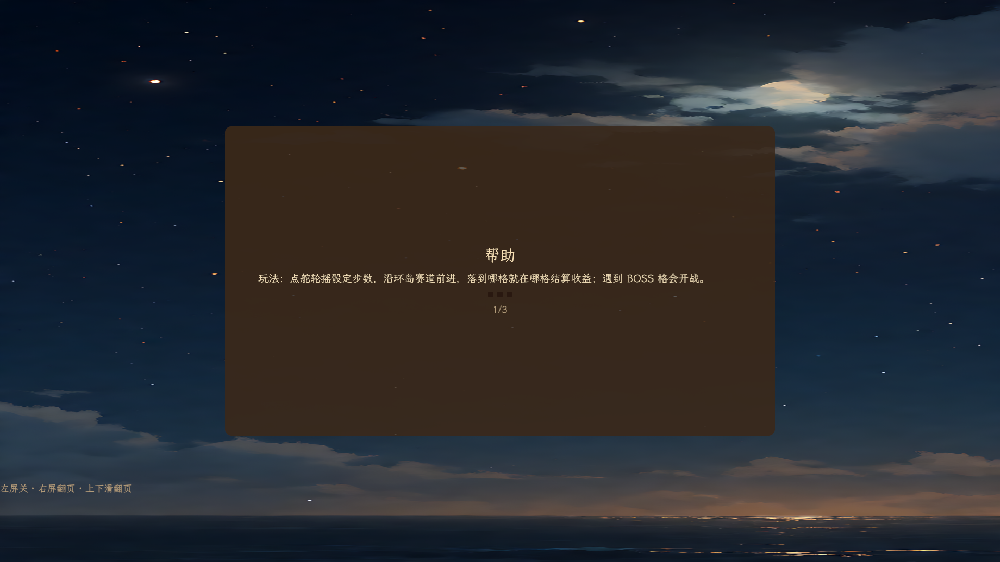

# 消息/帮助（message）场景 · 详细图文拆解

> **数据源单一事实源声明**：本文全部数值/坐标来自实测（时点 2026-11-23）：
> - 版面数据：`assets/data/scenes.json` → `message` 节点（`landscape.primitives` **1 条** + `focus_anchor` 叙事锚槽）。
> - 叙事规格：`assets/data/ui_schema/scene_manifest_v3.json` → `message`（`mood=reading` / `focus.anchor=text_panel` / `rhythm.rule=left_hero_right_text`）。
> - 源码：`crates/ti-app/src/scenes/message.rs`（`MessageScene`；翻页判定 + 页点/折行 CPU 路径）；Bevy 侧 `crates/ti-engine/src/bin/treasure_bevy.rs`（`build_message_chrome` + `message_chrome_footer` + `message_panel_params` + `chrome_ui_system` 翻页重建）。
> - 业务/规则：`rules::messages`（`page_text` / `total_pages` / `MsgSession`）+ `docs/business/07_ui_flow.md` §4 + `docs/business/08_layout_design.md` §4.5。
> - 文案：`assets/data/strings.json`（`msg.<kind>` 标题 + `msg.<kind>.<n>` 正文 + `scene.message.nav_hint` + `scene.message.page`）；页数 `assets/data/balance.json` → `messages.pages`。
> - 命中：`scenes.json` `message.landscape.primitives` **无 `pick_key`/`pick_index`**；翻页/关闭走 `GameInput` + swipe（`message.rs:18-53`）。
> - 资产：`assets/ui_manifest.json`（`bg_night_sea`，见 §6）。
> - 真实截图（引擎出图，验收口径）：`evidence/bevy_native_message_1920x1080.png`（横屏 8,296,178 B）。
> 本文只引用文档 ID（F-xxx/EXP-xxx/Sxxx）不复述结论；坐标直接抄上述实测值，禁凭记忆。

## 1. 场景职责与状态机位置

- **职责**：消息/帮助 = 一个**只读文本查看器**——按 `MsgKind`（`Msgs`/`Msgl`/`Msgm`/`Help`/`Info`，`domain/messages.rs:9-20`）显示对应 i18n 正文，支持翻页（上/下一页 + 首尾钳位/循环）与关闭回源场景。本场景不改业务数值，仅消费 `msg_page()` / `msg_total()` / `msg_kind()` 并响应输入。
- **状态机位置**：9 场景态图中的**弹出覆盖层**（非主流程站点）。`SceneKind::Message`，实现类型 `MessageScene`（`message.rs:11-16`）。可由 Index（主菜单帮助）或 MainMap（地标事件/面板结算）等打开，关闭回到打开源（`FlowSource::FromIndex` / `FromMainMap`，`domain/messages.rs:80-84`）。
- **进入条件**：主地图 `GameInput::Landmark(1)` → `MsgKind::Msgl`（`game_app_flow.rs:125-127` / `commands_test.rs:149-150`）；帮助入口 → `MsgKind::Help`（截图即此态，标题「帮助」、正文 `msg.help.1`、页码 1/3）。打开时 `MsgSession::open(kind, source)` 强制 `page=0`（`rules/messages.rs:107-114`，规则 12 场景切换复位）。
- **退出条件**（`on_input`，`message.rs:18-36`）：
  - `MsgClose | Back` → `host.close_message()` → 回打开源场景，返回 `true`（切场景）。
  - `MsgNext` / `MsgPrev` → `host.msg_{next,prev}_page()` + `chrome::reset_page_frame()` → 仅翻页，返回 `false`（不切场景）。
- **与前后场景流转**：`Index/MainMap →(open) Message →(MsgClose/Back) 源场景`；翻页始终停留本场景。`close_target()` 按 `FlowSource` 返回场景码 4（主地图）/ 0（主菜单）（`rules/messages.rs:167-176`）。`MsgSession::handle(PrevPage)` 在首页回末页（循环），`NextPage` 到末页保持（钳位）（`rules/messages.rs:123-162`）。

## 2. 真实渲染截图

**横屏（1920×1080，引擎出图）**



- 出图口径：`evidence/bevy_native_<scene>_<WxH>.png` = Bevy 原生离屏渲染（项目验收唯一图源，非 AI 概念图）；命令按 `docs/process/12_bevy_usage.md` 离屏截图约定（`--shot message --viewport=1920x1080`），见 S29.5 多视口出图。
- 尺寸实测：8,296,178 B / 1920×1080（RGBA）。
- **图中可见元素**（对照 §4/§5 坐标）：夜海渐变满屏底 `bg_night_sea.png`（星空/月亮/云层/海平面）；中部居中深棕木卡 ≈ 432,243,1056,594（55%×55%，left/top=22.5%）；卡内三行文本自上而下——标题「帮助」（金亮 `PARCH_BRIGHT`，30px）、正文「玩法：点舵轮摇骰定步数，沿环岛赛道前进，落到哪格就在哪格结算收益；遇到 BOSS 格会开战。」（奶油 `PARCH_CREAM`，20px，自动折行）、3 枚页点（第 1 枚实心、其余暗底）+ 页码「1/3」（暗金 `MUTED_GOLD`，18px）；底部全宽提示「左屏关 · 右屏翻页 · 上下滑翻页」（`scene.message.nav_hint`，top≈929，暗金）。**注意**：标题/正文/页点/页码/提示均由 **bevy_ui 文本节点**承载（§7/§10），`scenes.json` 横屏原语里只有底图 1 条——这是 message 场景「原语少但文字多」的关键。

### 2.5 零件组装装配图（S39 拆件组件化概念）

> **待重生成（横屏 1920×1080）**：按「都是横屏」决策，旧版装配图已退役；横屏装配图待用正式工具 `scripts/ui_assembly.py --scene message --orientation landscape` 重生成，当前暂无横屏装配验收图，以 §2 引擎出图为验收口径。

- 装配口径：正式工具 `scripts/ui_assembly.py` 按 scenes.json 的 z-order 逐层叠加 **assets/ui 真实拆件**产出（非 PIL 裁切完整图、非 AI 概念图）。
- 读法：上方每个 stage = 叠加一层后的画面，下方目录列出每件拆件的原尺寸 / 落点 rect / z 层。

## 3. ASCII 布局图

**横屏 1920×1080**（世界层仅 1 条 bg 原语；面板/文字走 bevy_ui）

```
┌──────────────────────────────────────────────────────────────────────┐ y=0
│  bg_night_sea 满屏底 (#0, 0,0,1920,1080)                             │
│          星空 / 月亮 / 云层                                          │
│                                                                      │
│              ┌──────────────────────────────────┐                    │ y=243
│              │  bevy_ui 面板 (55%×55%, left/top=22.5%)               │
│              │   ≈ 432,243,1056,594              │                    │
│              │         【标题「帮助」】            │                    │
│              │   【正文 msg.help.1 自动折行】      │                    │
│              │   【页点 ● ○ ○】【1/3】            │                    │
│              └──────────────────────────────────┘                    │ y=837
│                                                                      │
│           海平面 ≈ y=930                                             │
│  【nav_hint (全宽, top=86%≈929)】                                     │ y≈929
└──────────────────────────────────────────────────────────────────────┘ y=1080
```

## 4. 逐元素坐标表

### 4.2 primitives（实测 **1 条**，`message.landscape.primitives`）

| # | kind | rect (x,y,w,h) | z | when | params |
|---|---|---|---|---|---|
| 0 | image | 0,0,1920,1080 | 3 | — | asset=`assets/ui/bg_night_sea.png` |

> **逐条数对账：1 条**（满屏底图），与 `scenes.json message.landscape.primitives` 长度 1 完全一致。本场景**无**木卡/头带/金线/提示原语——面板与全部文字由 bevy_ui 按视口重排生成（`message_panel_params(landscape)` + `build_message_chrome`，见 §5/§7）。

## 5. 横屏版面要点

- **原语数量**：世界层仅 1 条满屏底图（`message.landscape.primitives`，1920×1080）；面板与全部文字由 bevy_ui 面板节点按视口重排生成——这正是「UI chrome 转 Bevy 代码」（S29.4 B1 约定）在 message 场景的体现。
- **底图尺寸**：`image` 0,0,1920,1080（资产 `bg_night_sea.png` 满屏铺）；`landscape_drawlist.rs:203-226` 实测断言 bg 满屏。
- **面板几何（`message_panel_params(landscape)`，Rust 侧）**：`(pw,ph,pl,pt) = (55%,55%,22.5%,22.5%)`，即面板居中 ≈ 432,243,1056,594（意图化，概念图 `message_landscape` 居中羊皮纸，`treasure_bevy.rs:1263-1271`）。
- **文字/页点/页码/提示**：由同一组 bevy_ui 节点（flex column + 自动折行）承载；提示行绝对定位 `top=86%`（`MSG_HINT_TOP_PCT` ≈ 929）。
- **orientation 切换逻辑**：`chrome_ui_system` 重建键 = `(scene.discriminant(), sel_key, orientation_disc)`；`orientation_disc` 变化 ⇒ 拆旧建新（S38 方案 A）。`scenes.json` 同节点下 `landscape.primitives` 为世界层表，壳按视口宽高比选表，横屏走该表（1 条满屏底图）。
- **landscape 专属参数**：实测 `message.landscape` 仅含 `primitives` 一个键；面板/文本几何全在 Rust 侧 `message_panel_params(landscape)` + `ti-engine/src/ui.rs::palette`。

## 6. 资产接线

`scenes.json` 原语 `params.asset` 提取 → `assets/ui_manifest.json` 登记项（实测）：

| 资产路径 | 引用原语（横屏） | ui_manifest 登记 | 实测 |
|---|---|---|---|
| `assets/ui/bg_night_sea.png` | #0 | name=`bg_night_sea`（ui_manifest.json line 161-163） | 夜海渐变满屏底图（1920×1080 源） |

- message 是**全项目最轻资产场景**：只有 1 张底图 PNG。面板底/头带/金线由 bevy_ui 节点配主题令牌（`PANEL_WOOD_BG` 等）呈现，标题/正文/页点/页码/提示是 bevy_ui 文本/圆角色块节点——**无角色立绘、无图标 PNG**（manifest 节奏里的 `hero_art` beat 在本场景无对应资产，仅 v3 叙事残留）。
- **图标边界**：message 无 `icon_*` 引用，`export-icon-boundary` 守门（`scripts/ui_icons.py` / 14 白蒙版图标集）不涉及本场景；新增图标须 `ui_asset_batch.py` 规格驱动，禁手写像素。
- **守门**：gate `validate_data::check_asset_registry` 做 disk↔registry 双向同步（新增/漏登即 FAIL）；gate `check_hardcode` / doccheck2 `engine-no-color-literal` 守「视觉量不硬编码」（palette 令牌单源 `ti-engine/src/ui.rs::palette`）；资产引用集由 `scripts/apk_audit.py --refset` 单源打包（未引用 0 进包，S35）。换底图须同时改 scenes.json `params.asset` + ui_manifest 登记 + 跑 sync。
- 概念图 `evidence/ui_concept/` 仅设计参考，非本场景验收图；验收图以 §2 引擎出图为准。

## 7. 命中契约

- **数据化命中：无**。实测 `message.landscape.primitives` 1 条**无 `pick_key`/`pick_index`**（区别于 select_role 的 `pick_key=2` / saveload 的 `pick_key=3`）。原因：message 是纯文本查看器，无「点某行选中」语义；翻页/关闭走输入事件而非命中矩形（源码 `message.rs:38-40` 注释明确「关闭仍走键盘 `GameInput::MsgClose`，左右半屏分区命中待 S29.3/S27.4 补 message 分区 `pick_key` 数据」——该分区**至今未落**，故现状无 pick_key）。
- **swipe 翻页（`on_hit`，`message.rs:41-53`）**：`swipe=1`（上滑）→ `host.advance(GameInput::MsgNext)`；`swipe=2`（下滑）→ `host.advance(GameInput::MsgPrev)`；`swipe=0`（点按兜底）→ `MsgNext`；其余不消费。`docs/modernization.md` §5 翻页表为口径来源。
- **键盘等价路径（`on_input`，`message.rs:18-36`）**：`MsgNext` / `MsgPrev` 翻页（不切场景，返回 false）；`MsgClose | Back` 关闭（切场景，返回 true）。翻页同时 `chrome::reset_page_frame()` 重置动画倒计时（起始最暗，`chrome.rs:141-144`）。
- **派发链**：触屏 swipe/point → 壳 `manual_1080_hit_system` / bevy_picking → `PickEvent` → `GameApp::poll_hit(HitData{key,index,swipe})` → `route_hit` → `MessageScene::on_hit`；键盘 → `GameInput` → `on_input`。`ti-engine/src/pick.rs` 提供 `PickTarget`/`PickEvent`/`HitData`/`swipe_dir_from` 通用结构（本场景仅消费 swipe）。
- **bevy_ui 层归属**：`build_message_chrome` 中 root/panel/所有 text/dots 节点均挂 `Pickable::IGNORE`（`treasure_bevy.rs:1283,1328,1376,1434,1460,1493`）——chrome 不挡 1080 世界层命中。CPU 路径 `render()` 在 `host.chrome_in_bevy_ui()` 为真时提前 return（`message.rs:64-66`），跳过木卡/标题/正文/页点/页码绘制，Bevy 侧全权负责文字渲染；未迁场景时 CPU 路径仍照旧（同一份 scenes.json 槽值）。

## 8. 业务规则

只引用不复述（单一事实源）：

- **消息分页**：`docs/business/07_ui_flow.md` §4——页数来自 `balance.messages.pages`（`rules::messages::total_pages` 读表，禁硬编码）；`page ∈ 0..total_pages`；下页到末页保持、上页到首页回末页（循环）。规则 10/11/12：`msg_page_wrap` / `msg_close_returns_source`（`07_ui_flow.md:131`）/ `scene_switch_resets_state`（`rules/messages.rs:123-162,167-182`）。
- **页数实测**：`balance.json → messages.pages` = `{msgs:1, msgl:1, msgm:1, help:3, info:1}`（line 531-539）。截图 Help 态 = 3 页（页码 1/3）。
- **文本 key**：正文 = `page_text(kind,page)` → `msg.<kind_key>.<page+1>`（`rules/messages.rs:38-51`，kind_key = `msgs`/`msgl`/`msgm`/`help`/`info`，line 55-62），`i18n::sget` 查 `strings.json`（line 40-50 为真实文案，S26.3 从占位填真值）。标题 = `msg.<kind.label()>`（`message.rs:73` / `treasure_bevy.rs:1289`；`label()` 映射 `msgs→"msgs"` / `msgl→"landmark"` / `msgm→"panel"` / `help→"help"` / `info→"info"`，`domain/messages.rs:31-38`）。
  > **观察（非本次修复项）**：`label()` 返回的 `landmark`/`panel` 与 `strings.json` 标题键 `msg.msgl`/`msg.msgm` 命名不一致，`sget` 缺失回退为裸 key（`i18n.rs:29-35`）；Help/Info/Msgs 三类一致，截图 Help 态标题「帮助」正常。
- **场景叙事**：`scene_manifest_v3.json → message`：`mood=reading`、`focus.anchor=text_panel`（bbox_pct `{37,12,56,63}`）、`rhythm.beats=[text_panel 0.55@y12, hero_art 0.25@y12, page 0.1@y77, hint 0.1@y96]`、`rule=left_hero_right_text`、`info_density={center_max_per_row:1,edge_min_per_row:1,dead_zone_max_pct:15}`、`permanent_hud_count_max=1`、`geometry_constraints.focus_bbox_must_contain=["body"]` + `no_rect_overlap_with=["focus_anchor"]` + `edge_anchors.bottom_hint_y_min_pct=92`（`scene_manifest_v3.json:282-339`）。
- **版面规格**：`docs/business/08_layout_design.md` §4.5（标题/卡片/正文/页点/页码/提示坐标表 + FIND-026 裁决：`body.h` 是渲染区上界而非行数）。坐标以 scenes.json 实测为准。

## 9. 测试覆盖

**e2e / 流程测试（`crates/ti-app/tests/`，grep `message`/`MessageScene`/`MsgNext`/`nav_hint` 实测）**

| 文件 | 断言要点 |
|---|---|
| `commands_test.rs:138-165` | `dispatch_message_next_and_close`：主地图 `Landmark(1)` → `Scene::Message`；`dispatch(MsgNext)` 返回 false（不切场景），有下页则 `page+1`、末页保持；`dispatch(MsgClose)` 返回 true 且回 `Scene::MainMap` |
| `game_app_flow.rs:117-135` | `flow_message_pages`：完整链路到主地图 → `Landmark(1)` → `Msgl` 消息，`msg_page()==0`；单页 `MsgNext` 保持 0；`MsgClose` 回主地图 |
| `render_intent.rs:168-181` | `message_layout_matches_doc`：标题 h=96、body `(y,h)==(768,176)` 且不越页码行（`body.y+body.h≤1800`，FIND-026）、`page.y==1008`、`hint.y==1840`；另 `:587` 7 场景渲染循环含 message |
| `landscape_drawlist.rs:200-227` | `message_landscape_world_layer`：横屏 bg 满屏 1920×1080；面板/导航由 bevy_ui 适配 |
| `fuzz_playtest.rs:161` | 随机输入映射含 `GameInput::MsgNext`（消息翻页参与模糊遍历）；`extract_panic_message` 为辅助函数 |
| `e2e_playthrough.rs:142` | 通关路径中含 `app.handle(GameInput::MsgNext)` |
| `game_app_flow.rs:374,451` | 其它流程分支中 `MsgNext` 翻页调用 |
| `map_pack_select_e2e.rs:64` | 地图包流程中 `GameInput::MsgNext` |
| `render_invariants.rs:33` | `("message","message")` 场景渲染不变量锚 |
| `e2e_playability.rs:360` | 7 场景循环含 `message` 可玩性校验 |
| `render_parity.rs` / `render_parity_hd.rs` / `render_parity_gpu.rs` | 场景帧互异 + CPU↔GPU 对拍（含 message，类比 select_role） |

**门禁覆盖**：gate `bevy-cpu-parity` 对 message 做 CPU↔Bevy 游戏世界像素对拍（UI 层排除口径，S29.4）；`check_scene_narrative`（gate 注释序号 21）对 `scene_manifest_v3.message` 做 N1~N8 判据 + focus bbox 对账（bbox_pct `{37,12,56,63}`）；`--shot message --viewport=1920x1080` 出图（§2）为视觉验收硬证据；doccheck 校验 i18n key（`msg.*`、`scene.message.page`、`scene.message.nav_hint`）存在且无孤儿；`gate validate_data` 校验 scenes.json 规范形与资产登记。

## 10. 数据驱动改法

「换这张 UI / 改文案 / 换资产」的具体步骤（**分清楚零 Rust 与需 Rust 的边界**，禁虚报）：

1. **改文案（零 Rust，典型路径）**：编辑 `assets/data/strings.json` 的 `msg.help.1..3` / `msg.info.1` / `msg.msgl.1` / `msg.msgm.1` / `msg.msgs.1` 正文 + `msg.<kind>` 标题 + `scene.message.nav_hint` + `scene.message.page` 模板——bevy_ui 文本节点与 CPU 路径都经 `i18n::sget`/`sgetf` 读表，改完 rebuild 即生效，无 `.rs` 改动。
2. **改页数（零 Rust）**：编辑 `assets/data/balance.json → messages.pages`（如 `help:3→4`），`total_pages` 读表、`page_text` 按页取 `msg.help.<n>`；须同步补 `strings.json` 的 `msg.help.4` key，否则该页显示裸 key（`sget` 缺失回退，非 panic）。
3. **改世界层原语（零 Rust，仅影响 1080 世界层）**：编辑 `assets/data/scenes.json` 的 `message.landscape.primitives`（#0 的 rect/asset）；坐标抄 §4 实测基线。`scenes.json` 经 `include_str!` 内嵌，改后须 rebuild（EXP-124/125）。
4. **换底图资产（零 Rust 需配合登记）**：替换 `assets/ui/bg_night_sea.png` 并在 `assets/ui_manifest.json` 同步登记；若换文件名，同步改 scenes.json `message.landscape.primitives` #0 的 `params.asset`。生成走 `scripts/ui_asset_batch.py`（规格 `assets/ui_batches/*.json`，原图落 `evidence/gen_tmp/`），禁手写像素。
5. **改 bevy_ui 面板几何/配色/字号（需 Rust，非零 Rust）**：面板定位在 `treasure_bevy.rs::message_panel_params`（横屏 55% 居中），padding/gap/radius/字号/颜色在 `ti-engine/src/ui.rs::palette`（`MSG_PANEL_*`/`MSG_*_FONT`/`MSG_DOTS_*`/`MSG_DOT_*`/`PARCH_BRIGHT`/`PARCH_CREAM`/`MUTED_GOLD`/`PANEL_WOOD_BG`）。按 S29.4 B1 约定「UI chrome 转 Bevy 代码」，这部分目前是代码常量，**不能声称零 Rust**；改后须 rebuild + 出图 + 视觉签收（A 纪律）。
6. **改叙事重心（零 Rust）**：编辑 `assets/data/ui_schema/scene_manifest_v3.json → message`（mood/focus.bbox_pct/rhythm/info_density）；须同步 scenes.json `focus_anchor.bbox` 满足 `check_scene_narrative` N8（bbox_pct `{37,12,56,63}`）与 `geometry_constraints`（focus 必含 body、hint y≥92%）。
7. **出图验收**：改完重建 → `--shot message --viewport=1920x1080` 出新截图 → 用户视觉签收（A 纪律）→ 跑 `scripts/gate.ps1` 全绿；证据写 `evidence/<task>.log`。**零 Rust 证据**仅限步骤 1~4/6：这些步骤只动 `assets/data/*.json`、`assets/ui/*.png`、`assets/ui_manifest.json`，`git diff -- crates/` 为空（内容运营核心判据，`docs/process/29_content_ops.md`）；步骤 5 必然改 `crates/`，如实登记。
