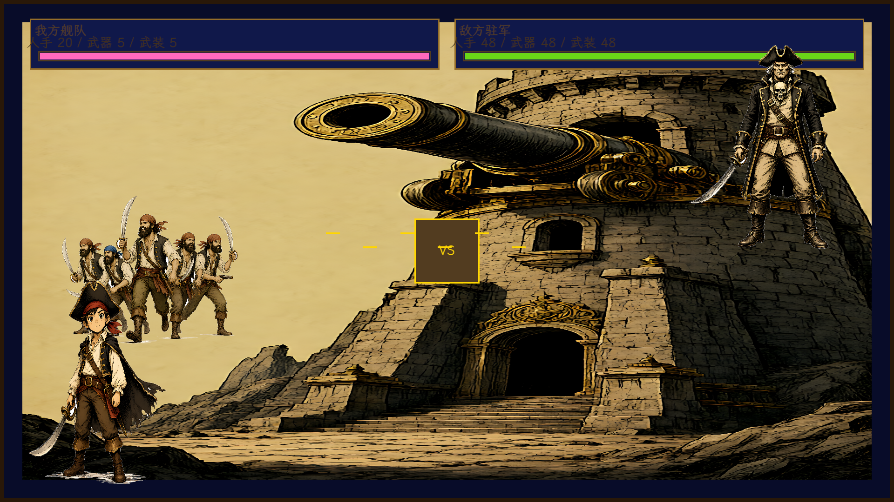

# vs 场景 · 详细图文拆解

> **单一事实源声明**：本文坐标/原语逐条抄自 `assets/data/scenes.json` 的 `vs` 节点
> （横屏 `landscape.primitives` **16 条**，时点 2026-11-23 实测）；
> 叙事锚点抄自 `assets/data/ui_schema/scene_manifest_v3.json` 的 `scenes.vs`；
> 行为/命中抄自 `crates/ti-app/src/scenes/vs.rs` + `vs_anim_proto.rs` + `vs_anim_v4.rs`
> + `vs_anim_proto_landscape.rs`（**立绘/动画由运行时代码绘制，不在 scenes.json**）；
> 截图为引擎真实渲染 `evidence/bevy_native_vs_1920x1080.png`（1920×1080），S63.6 候选 A 另附
> `evidence/ui_candidate/vs_{clash,duel}_A.png`（概念候选，仅作对照、不作验收图）。
> 业务规则引用 `docs/business/combat.md` §兵力模型/§VS 界面、`docs/ui-redesign-v3/12_main_map_v6_vs_v2_spec.md`
> §2、`docs/ui-redesign-v3/11_vs_spec.md`，不复述。

## 1. 场景职责与状态机位置

`vs`（对战场景，`Scene::Vs` / `SceneKind::Vs`，判别值 0..8 中一值，`S10.2`）是 9 场景态图中
**唯一战斗表现节点**（`docs/business/01_game_logic_overview.md` §1.2，`docs/business/07_ui_flow.md` §1）。

- **进入**：`MainMap --落格战斗触发--> Vs`（据点码 6 → 战斗，
  `game_app_flow.rs::flow_landmark_to_battle` 实测）。触发源按格类分：
  攻占战（他人格 `siege_snapshot` 在位）/ 副本战（无主格）/ BOSS 战 / 多人同格遭遇
  （`combat.md` §VS 界面、`12_main_map_v6_vs_v2_spec.md` §2.4）。
  非法转换（如 `SelectRole → Vs`）由 `scene_transition!` 宏编译期拦截。
- **退出**（`vs.rs:30-42`）：`Back` 时按战型分叉——
  ① 攻占战报（`siege_snapshot` 在位）= 清战报回 `MainMap`（结果已写回账本，S33.5）；
  ② 副本战（`in_dungeon_battle()`）= 回 `MainMap` 续局（`territory.md` §4）；
  ③ 其余（含 BOSS 战）= 回 `Index`（`spec/battle.md §d`，状态码 25→0）。
  规范态图简写为 `Vs --> Index : 确认/返回`（`01_game_logic_overview.md` §1.2）。
- **职责**：战斗界面不是单一模板——按**格类**换背景/主题资产，按**兵力模型**出确定性结算
  （人手 + 武器，非随机 HP 回合制）；演出 = 双方列阵 → 冲锋对攻 → 双方必损 → 结果横幅
  四帧自动时间轴（`12...spec.md` §2.2/§2.6），无逐回合输入。
- **表现层归属**：与 `main_map` 同属 **「游戏世界留 1080」** 场景（S29.3e 判定，
  `docs/process/19_bevy_ui.md` 坑位 9.8-13）：vs 的 chrome 与动态立绘同屏叠加，
  若迁 `bevy_ui` 会遮住 1080 世界层，故**整体留在 1080 正交世界层**——
  `vs.rs` 没有 `chrome_in_bevy_ui()` 守卫，始终走 `render_primitives_filtered` +
  代码 blit；`scenes.json` vs 原语无 `ui_layer` 标记（对比 index/select_role 等 5 个纯 UI 场景）。
  bevy-cpu-parity 门禁「仅游戏世界、UI 层排除」把 vs 纳入像素对照面。

## 2. 真实渲染截图

出图口径 = 引擎离屏截图（`docs/process/12_bevy_usage.md` 离屏截图验收），视口经 `--viewport` 指定：

- 横屏：`cargo run -q -p ti-engine --bin treasure-bevy-native -- --shot --viewport=1920x1080 vs`
  → `evidence/bevy_native_vs_1920x1080.png`（1920×1080）



**图中可见元素**：夜海背景 `bg_night_sea` + 羊皮框内海战底 `bg_battle_sea` + 顶双 HP 状态框
（左我方舰队 / 右敌方驻军）+ 屏心 VS 徽标 + 双方立绘/水手（**运行时代码 blit 的 `vs_v2/*.png`，
非 scenes.json**）+ 底部跳过/确认/重打指令 + 右下提示行。无战斗时空态 = 夜海底 +
scenes.json 原语 + 「无战斗」（`scene.vs.empty`）。

> 候选对照（**非验收图**）：`evidence/ui_candidate/vs_clash_A.png` /
> `evidence/ui_candidate/vs_duel_A.png` = S63.6 用户拍板「双人对峙居中」候选 A 的
> `--vs-phase=clash|duel` 横屏定格图，机制见 §5/§10；引擎真实渲染截图仍以上面这张为准（红线：
> AI 概念图不得当验收图）。

### 2.5 零件组装装配图（S39 拆件组件化概念）

> **待重生成**：横屏装配图尚未产出，旧方向（portrait）装配图已作废、不再引用。
> 重生成口径 = `scripts/ui_assembly.py --scene vs --orientation landscape --output evidence/scenes_assembly_vs_landscape.png`。

## 3. ASCII 布局图

**横屏 1920×1080**（坐标 = landscape 实测 + 代码绘制层）：

```
┌────────────────────────────────────────────────────────┐ y=0
│ 标题 816,24,288,44   ┌我方状态框 64,40,880,110（代码）┐ │
│                      └敌方状态框 976,40,880,110（代码）┘ │ y=40
│  ╔══ 羊皮边框 inset 44 + bg_battle_sea 60,120,1800,840 ═╗ │ y=120
│  ║ 木框上 60,120,1800,2 / 左 60,120,2,800 / 右 1858     ║ │
│  ║  VS 徽标 890,470,140,140（屏心 960,540）             ║ │ y≈470
│  ║  ★ S63.6 双人对峙居中（代码 blit，480×680）：         ║ │
│  ║  hero 左中 (360,280)          enemy 右中 (1080,280)  ║ │ y=280
│  ║  crew 前景 (820+cx,560)        火花/刀光              ║ │ y=560
│  ║  ─── 分割线 60,520,1800,1 ───                        ║ │ y=520
│  ║  木框下 60,920,1800,2                                ║ │ y=920
│  ╚══════════════════════════════════════════════════════╝ │
│ 提示行 text 0,1030,1920,50                              │ y=1030
└────────────────────────────────────────────────────────┘ y=1080
```

## 4. 逐元素坐标表

### 4.2 `landscape.primitives`（实测 16 条，逐条）

| # | kind | rect (x,y,w,h) | z | when | params |
|---|---|---|---|---|---|
| 1 | image | 0,0,1920,1080 | 3 | — | asset=`assets/ui/bg_night_sea.png` |
| 2 | image | 60,120,1800,840 | 4 | — | asset=`assets/ui/bg_battle_sea.png` |
| 3 | rect | 64,40,880,48 | 4 | — | color=`brass_dark`（左 HP 槽底） |
| 4 | rect | 68,44,872,2 | 4 | — | color=`brass_dark`（左槽顶线） |
| 5 | rect | 976,40,880,48 | 4 | — | color=`brass_dark`（右 HP 槽底） |
| 6 | rect | 980,44,872,2 | 4 | — | color=`brass_dark`（右槽顶线） |
| 7 | rect | 60,120,1800,2 | 4 | — | color=`wood_warm`（竞技区上边） |
| 8 | rect | 60,920,1800,2 | 4 | — | color=`wood_warm`（竞技区下边） |
| 9 | rect | 60,120,2,800 | 4 | — | color=`wood_warm`（竞技区左边） |
| 10 | rect | 1858,120,2,800 | 4 | — | color=`wood_warm`（竞技区右边） |
| 11 | rect | 60,520,1800,1 | 4 | — | color=`brass_dark`（中部分割线） |
| 12 | rect | 907,510,106,2 | 5 | — | color=`gold_warm`（准星横） |
| 13 | rect | 958,487,2,106 | 5 | — | color=`gold_warm`（准星竖） |
| 14 | rect | 954,534,12,12 | 5 | — | color=`gold_warm`（准星心） |
| 15 | text | 816,24,288,44 | 5 | — | color=`gold_warm`, params.text_key=`scene.vs.title`, tier=body |
| 16 | text | 0,1030,1920,50 | 11 | — | color=`text_on_parch`, params.text_key=`scene.vs.hint`, tier=hint |

**landscape.extra（非 primitives，代码读键）**：
`player_hp {64,40,880,48}`；`boss_hp {976,40,880,48}`；
`rounds {960,384}`；`outcome {960,720}`；`empty {960,720}`；`fx_hit {960,544}`。

### 4.3 运行时代码绘制的立绘/动画层（**不在 scenes.json**，另节）

正式战斗路径 `vs.rs:95-119` → `vs_anim_proto::render_v2_elem` →
`vs_anim_proto_landscape::render_v2_elem_landscape`（S38 方案 A + S63.6 双人对峙居中）。
这一层的全部坐标来自 Rust 代码（经 `chrome::V2_*` 资产单源常量），
**不出现在 §4.2 的 JSON 原语表**，也不能靠改 JSON 调整：

| 帧 | 元素 | 横屏代码坐标（S38+S63.6） |
|---|---|---|
| clash | hero | `(360,280,480,680)` 左中（S63.6 由 `(60,600,300,440)` 改） |
| clash | enemy | `(1080,280,480,680)` 右中（由 `(1480,100)` 改） |
| clash | crew | `(820+cx,560,280,240)` 居中前景 |
| duel | hero | `(360+hx,280,480,680)`，tri() 向屏心逼近 |
| duel | enemy | `(1080+ex,280,480,680)` |
| VS 徽标 | 屏心 | `(960-70,540-70,140,140)`（屏心 960,540） |
| 顶状态框 | 攻/守 | `(64,40,880,110)` / `(976,40,880,110)` |
| result 横幅 | banner | `(960-250,80,500,300)` |
| result 战报框 | 框 | `(240,1080-360,1440,300)` |
| 指令区 | 跳过/确认/重打 | 横屏构图内，i18n `scene.vs.v4_cmd_*` |

4 帧（clash/duel/result_win/result_lose）定义见 `12_main_map_v6_vs_v2_spec.md` §2.2，
时间轴 `t` 四阶段（0 列阵 <1200ms / 1 冲锋 1200–3000 / 2 必损 3000–4200 / 3 横幅 ≥4200）
与参数源 `balance.combat.anim` 见 §2.6.1；S63.6「双人对峙居中」为横屏正式构图（`evidence/S63.6.log`）。
攻占战报另走 `render_siege`（`vs.rs:148-230`），读 `SiegeSnapshot` 画双兵力条 + 结果行。

## 5. 横屏版面要点

- **原语条数**：横屏 `landscape.primitives` **16 条**，不含 chart_wide 指令按钮原语；
  指令由代码绘制的 `scene.vs.v4_cmd_*`（跳过/确认/重打）承担，走 `on_hit` 的 key 2/3/4 语义。
- **坐标布局（1920×1080）**：夜海底 `1920×1080`；海战底 `(60,120,1800,840)`；
  竞技区框 `60..1860 / 120..920`；HP 槽左右对称 `(64,40,880,48)` / `(976,40,880,48)`；
  中部分割线 `y=520`；标题 `x=816`；提示行 `y=1030,h=50`；准星 `(907,510)` 一带（屏心 960,540）。
- **立绘对峙（S63.6 核心）**：横屏路径 `render_v2_elem_landscape` 的 clash/duel 帧 =
  **双人对峙居中**（hero 左中 `(360,280)` / enemy 右中 `(1080,280)`，各 `480×680` 对称；
  VS 徽标屏心 `(960,540)`；clash 另有 crew 前景 `(820,560)`），由用户 2026-11-20 拍板兑现
  （`evidence/S63.6.log`）。
- **orientation 切换**：`host.shell().settings.orientation == Landscape` 走横屏分支
  （`vs_anim_proto.rs:251-267`；`vs.rs:125-128` 决定背景铺 `bw,bh`）；
  `--shot --viewport=1920x1080 vs` 出横屏图。世界层按 contain 缩放，vs 无 bevy_ui chrome。
- **landscape 节点参数** = `primitives` + `extra`（6 个语义锚点）；构图由横屏代码固定。

## 6. 资产接线

`scenes.json` `params.asset` 提取 → `assets/ui_manifest.json` 登记项（CS-1 资产单源）：

| scenes.json asset | manifest 项 | role | 用途 |
|---|---|---|---|
| `assets/ui/bg_night_sea.png` | `bg_night_sea` | background | 夜海满屏底 |
| `assets/ui/bg_battle_sea.png` | `bg_battle_sea` | background | 竞技区海战底（尺寸见 §4） |
| `assets/ui/chart_wide.png` | `chart_wide` | command | 指令按钮底图（清单登记项；横屏指令由代码绘制承担，见 §5） |

**代码绘制层资产（经 `chrome::V2_*` 常量，登记于 ui_manifest，非 scenes.json params）**：

| chrome 常量 | 资产路径 | 用途 |
|---|---|---|
| `V2_HERO` | `assets/ui/vs_v2/hero.png` | 玩家船长立绘（clash/duel/result 复用，U22 角色一致性） |
| `V2_ENEMY` | `assets/ui/vs_v2/enemy.png` | 敌方船长立绘 |
| `V2_CREW` | `assets/ui/vs_v2/crew.png` | 水手冲锋前景 |
| `V2_BANNER_WIN` / `V2_BANNER_LOSE` | `assets/ui/vs_v2/banner_win.png` / `banner_lose.png` | 胜/败书法横幅 |
| （`vs_bg_asset` 按格类） | `assets/ui/vs_v2/{vs_bg,bg_siege,bg_dungeon,bg_boss}.png` + `scene_{encounter,raid,boss,attack}.png` | 格类分层背景（`12...spec.md` §2.4） |

历史批次（选型期/被取代，仍在册）：`assets/ui_batches/vs_v1.json`
（`boss_captain` / `hero_back` / `deck_battle` / `item_{keg,medkit,rum,smoke}`，`11_vs_spec.md` §3，
5 套版式已作废见 §2 注记）；`vs_v2` 元素批次 `assets/ui_batches/vs_v2.json`。

- **守门**：`validate_data::check_asset_registry` 全类型 disk↔registry 双向同步；
  `export-icon-boundary` 禁令禁止把图标烘焙进底图（图标一律白蒙版 + 运行时 tint，S21.14）。
- **换立绘注意**：立绘路径在 Rust 常量里（CS-1 单源 `chrome.rs:461-469`），
  换图改 PNG 内容即可零 Rust；但**改立绘位置/尺寸必须改 Rust**（S63.6 根因，见 §10）。

## 7. 命中契约

- **指令键来源**：横屏 `landscape.primitives` 无 pick 标记，跳过/确认/重打由代码绘制指令层承担，
  走 key 2/3/4（见下 `on_hit`）。
- **事件链**：`bevy_picking` 指针事件 → `PickPending` → `pick_flush` →
  `PickEvent{key,index,swipe}`（`crates/ti-engine/src/pick.rs`，`PointerClick`=tap、
  `PointerDragEnd.distance`=swipe）→ ti-app `route_hit` → `HitData` → `VsScene::on_hit`。
- **on_hit 行为**（`vs.rs:50-66`）：
  - `key=2`：`vs_anim_proto::skip_anim_to_banner()`（快进至结果横幅），不消费输入；
  - `key=3`：`host.advance(GameInput::Back)`（确认结束，按战型分叉见 §1）；
  - `key=4`：`vs_anim_proto::reset_anim()`（重置时间轴重打），不消费输入；
  - 无 key 命中：`swipe==2`（下滑）→ `Back`，其余 swipe/点按 → `Attack`
    （S29.2 原语义：「点任意处 / 上左右滑 = 攻击一回合」）。
- **键盘输入**（`vs.rs:18-45`）：`Attack` = 攻占战报在位则 `settle_siege()`，否则
  `battle_step()`；`Back` = 按 §1 三分支退出。
- **空绝对命中**：vs 不迁 bevy_ui，1080 原语拾取由 `manual_1080_hit_system` 按
  `pick_key` 几何命中（`20_bevy_picking.md` 坑位 20-8/9/10）；与 bevy_ui 命中层不双发。

## 8. 业务规则

仅引用不复述（单一事实源）：

- **兵力模型（v2）**：`crew` / `arms` / `armed=min(crew,arms)` / `power=armed×weapon_coef+
  unarmed×barehand_coef`，确定性比较、不消耗随机数、双方必损 —— `docs/business/combat.md`
  §兵力模型；数值锚点 `balance.manpower`（loss_pct=1500 万分比 = 15%，weapon_loss_pct=2000 = 20%）。
- **VS 界面按格类变化**：攻占/副本/BOSS/遭遇/事件 5 类 —— `combat.md` §VS 界面；
  构图/4 帧/时间轴/兵力 HUD —— `12_main_map_v6_vs_v2_spec.md` §2（v2 重设计）；
  道具/动作历史方案（已作废）—— `11_vs_spec.md` §2 注记。
- **攻占战**：`territory.md` §4（落格三支分叉），`assault` 一次性确定性结算（S33.5），
  胜方占领重定驻军 / 败方交双倍过路费（`combat.md` §胜负判定）。
- **文案/数值源**：`assets/data/strings.json` 的 `scene.vs.*`（title/hint/empty/siege_*/
  anim_*/taunt_*/v2_elm_*/v4_cmd_*）；`assets/data/balance.json` 的 `combat.anim`（动效参数单源）。
- **用户要求总账**：`13_user_requirements_ledger.md`（U8/U9/U12/U19/U20/U22/U25/U26 等 VS 相关项；
  U16 视觉签收待办）。

## 9. 测试覆盖

| 测试文件 / 断言 | 要点 |
|---|---|
| `crates/ti-app/tests/landscape_drawlist.rs::vs_landscape_world_layer` | 横屏 bg 在羊皮框 `(44,44,1832,992)`；**S63.6 候选 A**：hero `(360,280,480,680)` / enemy `(1080,280,480,680)` / crew `(820,560)`；顶双 HP 框 `(64,40,880,110)` / `(976,40,880,110)` |
| `crates/ti-app/tests/render_parity.rs::render_vs` + `render_parity_hd.rs::render_vs_hd` | vs 游戏世界 CPU/HD 渲染基线（bevy-cpu-parity 对照） |
| `crates/ti-app/tests/e2e_playthrough.rs::e2e_battle_determinism` | 同 seed 同兵力 → 同战斗轨迹 |
| `crates/ti-app/tests/game_app_flow.rs::flow_landmark_to_battle` / `flow_battle_to_menu` | 据点码 6 → Vs + 战斗会话在位；推进至结束 → 回主菜单（Index） |
| `crates/ti-app/tests/app_dungeon_e2e.rs` / `app_dungeon_panel_e2e.rs` | 副本入口接 defender 兵力；副本面板 Confirm → Vs 战斗 |
| `crates/ti-app/tests/app_siege_e2e.rs::confirm_siege_enters_vs_report` | 攻占确认 → Vs 战报视图（`render_siege` 分支） |
| `crates/ti-app/tests/commands_test.rs::dispatch_vs_attack_does_not_consume` | Vs 下 Attack 派发语义 |
| `crates/ti-core/tests/rules_battle.rs` | 兵力模型 / 战斗规则单测（`combat.md` 可测试规则表） |

- **出图门禁**：`--shot --viewport=1920x1080 vs` 横屏截图存在即 §2 验收；
  `TI_VS_ANIM_T0={0,1200,3000,4200} --shot --viewport=1920x1080 vs` 四阶段定格（§2.6.1 判据）；
  S63.6 `--vs-phase=clash|duel` 候选 A 出图见 `evidence/S63.6.log`。
- **bevy-cpu-parity**：gate 第 31 位「仅游戏世界、UI 层已排除」，vs 属游戏世界面
  （`scripts/gate.ps1`）；`check_scene_narrative` N8 焦点锚对账（`focus_anchor` ↔ manifest）。

## 10. 数据驱动改法

**改空态版面 / 换背景 / 换文案（零 Rust）**：

1. 改坐标/颜色/文案：`assets/data/scenes.json` 的 `vs.landscape.primitives` 逐条改
   `rect`/`color`/`text_key`；语义锚（`player_hp` / `boss_hp` / `rounds` / `hint`）改 `landscape.extra`。
2. 换 PNG：替换 `assets/ui/{bg_night_sea,bg_battle_sea}.png`（或 `vs_v2/*.png` 内容）
   并同步 `assets/ui_manifest.json`（`ui_assets.py add/build/verify`，`13_ui_asset_pipeline.md`）。
3. 改动效参数：`assets/data/balance.json` 的 `combat.anim`（时间轴阶段/周期/幅度），
   文案改 `strings.json` 的 `scene.vs.*`。
4. 重出图验收：`--shot --viewport=1920x1080 vs`，用户视觉签收（A 纪律：
   `docs/process/00_index.md` §UI 视觉改动）。零 Rust 证据 = `git diff crates/` 为空
   （内容运营判据，`29_content_ops.md`）。

**改立绘位置/尺寸/构图（必须改 Rust，不算零 Rust）**：

- S63.6 根因实证：VS 立绘是**运行时代码绘制**（`vs_anim_proto_landscape.rs` 等），
  不在 scenes.json。候选 A「双人对峙居中」把 clash 帧 hero `(60,600,300,440)` →
  `(360,280,480,680)`、enemy `(1480,100)` → `(1080,280,480,680)`，
  duel 帧同步改为向屏心逼近——**只能改代码 + 重编译**，
  换立绘 PNG 内容本身才是零 Rust（`evidence/S63.6.log`）。
- 切换原型/定格用于设计比对：`TI_VS_PROTO=a|b|c|d|e`（5 套已作废的历史版式）、
  `TI_VS_ANIM_PROTO=clash|duel|result_win|result_lose`、`TI_VS_ANIM_T0=<ms>`、
  `TI_VS_V6=0`（关回 v5/v4 调试）——均为**只读原型开关**，不改发货产物。
