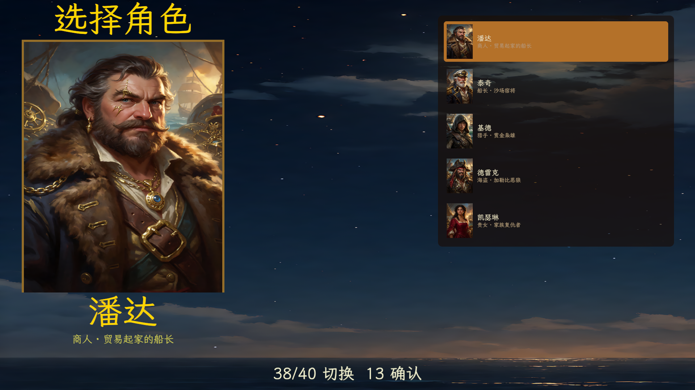
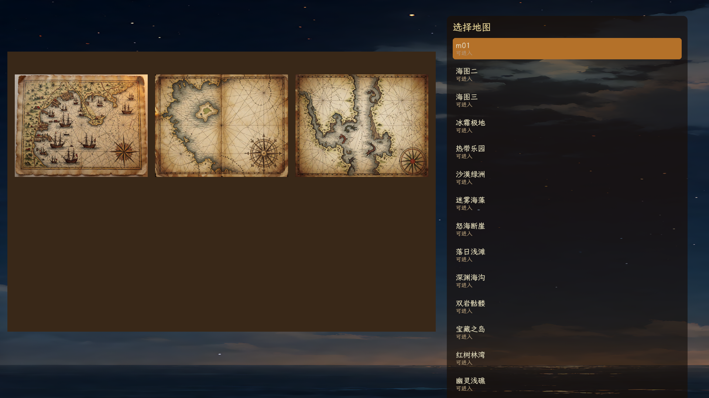
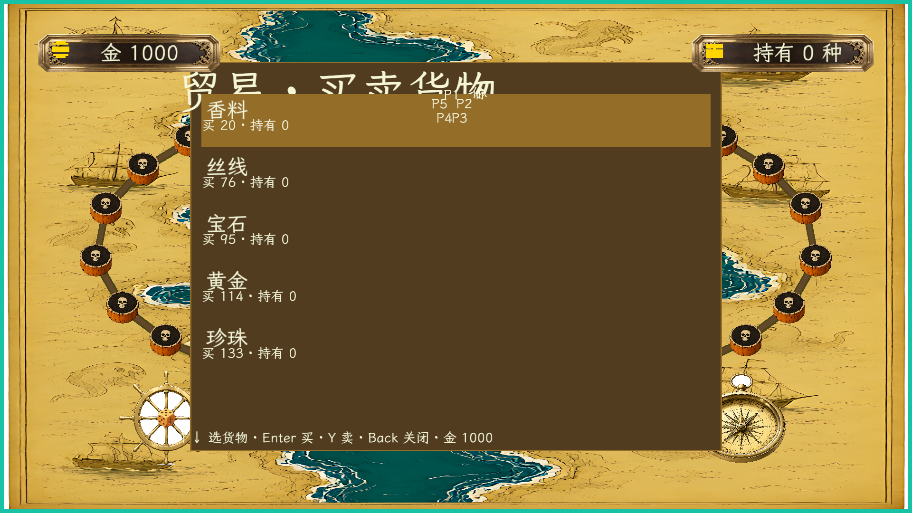
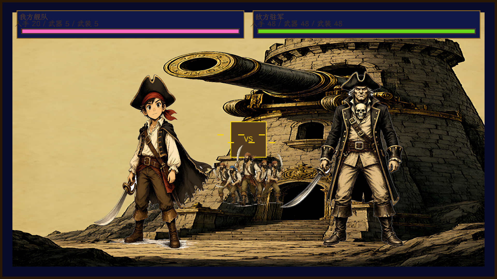
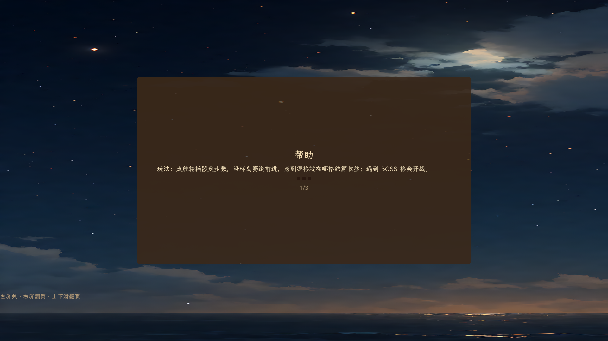
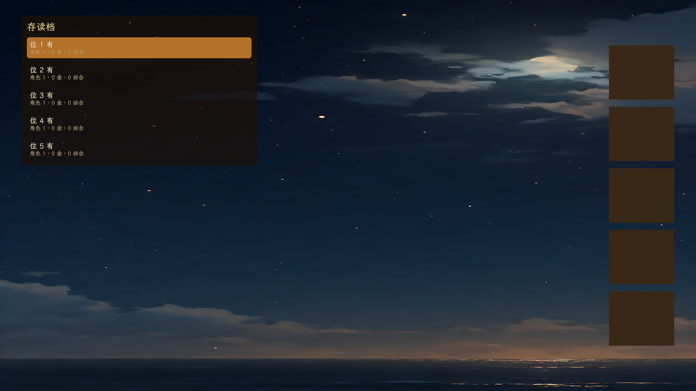

# 游戏态（场景）全览 · 截图 + 图文说明

> 本项目共 **8 个游戏态**（`crates/ti-app/src/game_app/mod.rs::Scene` 枚举），其中 **7 个可渲染**
> （`Intro` 触发即自动跳 `Index`，无独立帧；`Exit` 是动作非场景，不渲染）。
> 单一事实源：场景枚举 = `Scene`；场景态流转 = `docs/gamebook.md` §场景流转表 + `docs/00_design.md`；
> 逐场景版面/坐标 = `docs/business/08_layout_design.md`；逐场景 UI 重设计规格 = `docs/ui-redesign-v3/`。
> **截图 = 当前代码最新渲染**（`evidence/bevy_native_<scene>.png`，2026-11-20 用 `xvfb-run
> treasure-bevy-native -- --scene=X --shot` 实时出图，main_map 带 `--viewport=1920x1080` 横屏主语面 + main_map 带 `--spin=5` seed=42 可复现运行时态；
> 旧 S26~S39 时点存档已废弃，本表全部重出最新态；**横屏 1920×1080 为主语面**（S39 index 横版重设计 / U23 横屏适配，竖屏 1080×1920 为兼容保留，旧竖屏截图 = S22 早期版面，勿用）；表现层静态帧载体，动态过程截不动）。

## 场景态流转图

```
                        ┌──────────┐
   启动 ───────────────▶│  Index   │ ◀──────────────────────┐
                        │ (主菜单) │                        │ 确认回主菜单
                        └────┬─────┘                        │
        选角（确认）            │                              │
                                ▼                            │
                        ┌──────────────┐                     │
                        │ SelectRole   │  选图（确认）          │
                        │ (角色/席选择) │────────┐             │
                        └──────────────┘        │             │
                                                 ▼             │
                        ┌──────────────┐         │             │
   据点/面板/卡片 ◀──── │  MainMap     │ ◀───────┘             │
      （叠加窗口）      │ (主地图·环岛) │                       │
                        │  摇骰/落格/   │──落格 BOSS/副本/攻占──┐│
                        │  贸易/建造/   │   战斗               ││
                        └──────┬───────┘                      ││
                               │                               ▼│
                        存读档（叠加子窗口）           ┌──────────────┐
                               │                      │     Vs       │
                        ┌──────┴───────┐              │  (战斗结算) │
                        │   Saveload   │              └──────┬───────┘
                        │  (存读档叠加) │                     │ 胜负
                        └──────────────┘                     │ 回主地图
                               │                              │
                               └──────────────────────────────┘
```

> **主循环**（`docs/00_design.md` 核心循环）：Index → SelectRole（2..5 人类热座 + 可配 AI 席）→
> SelectMap（已解锁地图，m01..m20 推进）→ **MainMap（环岛赛道：摇骰→沿环落格→分叉结算）** →
> 落格触发 `Vs`（BOSS/副本/攻占战斗，兵力模型一次性结算）→ 回 MainMap → … 通关 m20 BOSS。
> `Message` / `Saveload` 是**叠加窗口**（不离开主地图，随时呼出）。

---

## 逐场景说明 + 截图

### 1. Index（主菜单）
**职责**：6 菜单项沿罗盘环/绳挂木牌（横屏羊皮藏宝图主题 S39，竖屏罗盘环 S22）+ 中心舵轮 logo +
版本签；命中契约 `pick_key=1`。
**版面规格**：`docs/ui-redesign-v3/09_index_compass_spec.md`（竖屏）+ `14_index_treasure_map_spec.md`（横屏）。
**输入**：确认菜单项 → SelectRole。


*最新渲染 2026-11-20（当前代码，横屏 1920×1080）*

*最新渲染 2026-11-20（当前代码，横屏 1920×1080）*

---

### 2. SelectRole（角色/席位选择）
**职责**：5 角色热座选择（`Next`+`MarkSeat` × N 勾选 2..5 人类席）+ 可配 AI 席（`seat_ai_count`，
0..=4，`balance.selection.max_ai_seats`）；旧单选流（0 `MarkSeat`）= v2 兼容 1 玩家 + 4 AI。
**版面规格**：`docs/business/08_layout_design.md` §select_role。
**输入**：确认 → SelectMap（席位池 = 已选人类席 + 可配 AI 席）。



*最新渲染 2026-11-20（当前代码，横屏 1920×1080）*

---

### 3. SelectMap（地图选择）
**职责**：已解锁地图卡（m01..m20，`unlocked_maps` 推进链）+ 已装地图包（`assets/maps/<id>`，
S31 地图包运行期换图）；锁/开放态金边条标记，未注入包 = 内嵌默认图。
**版面规格**：`docs/business/08_layout_design.md` §select_map。
**输入**：确认地图 → MainMap（`enter_main_map_at` 全量重建 board/territory）。



*最新渲染 2026-11-20（当前代码，横屏 1920×1080）*

---

### 4. MainMap（主地图 · 环岛赛道，核心玩法态）
**职责**：主玩法 = 摇骰定步数 → 沿 31 格环岛赛道前进 → 落格结算（`territory.md` 落格三支分叉）：
- **无主格** → 进副本占领（`EnterDungeon`）
- **他人格** → 交钱（`PayToll`）或攻占（`Siege`，兵力模型 `force::resolve` 一次性）
- **自己格** → 升级加固 / 领产出（`Upgrade`/`Collect`/`Maxed`）
- **BOSS 格**（绕满 `boss_min_laps` 圈现身）→ 战斗（`Vs`），击败 = 跨图推进 / 对局终局（S61 A1）
**领地系统**：31 格 = 起点 1 + 领地格 20（10 类岛 × 2）+ 功能格 9（事件 4/卡牌 3/宝藏 2）+ BOSS 1；
每圈过起点 `+lap_bonus_gold` − 领地维护费（S61 A2）。
**AI 自动对抗**：`turn_cycle` 轮转 AI 席自动结算（`ai_policy_v2`，S61/飞轮 R21 驱动器）。
**版面规格**：`docs/ui-redesign-v3/10_main_map_v5_spec.md`（v5 中央据点岛 + 环形格子环）+ `territory.md`。
**出图态**：`--spin=5` seed=42 可复现运行时帧。



*最新渲染 2026-11-20（当前代码，横屏 1920×1080，--spin=5 运行时态）*

---

### 5. Vs（战斗 · 兵力模型一次性结算）
**职责**：BOSS/副本/攻占战斗 = 攻方席位舰队（`crew`+`arms`）vs 守方（`defense_at` 驻军 + 建筑防御），
`force::resolve` 一次性确定性结算（双方必损，无逐回合 HP，S34.6 D5 兵力模型）。表现层 = 列阵/炮火/
横幅自动动效（`vs_v6` 阶段机 + 兵种/道具图标，缺省 `vs_anim_v4` 回退）；兵力 HUD 走运行态。
**版面规格**：`docs/ui-redesign-v3/11_vs_spec.md` + `12_main_map_v6_vs_v2_spec.md` §2（VS v2 战斗动画）。
**业务规则**：`docs/business/combat.md` §兵力模型。
**输入**：自动播完即结算 → 回 MainMap（胜 = 占领/通关，败 = 交双倍过路费）。



*最新渲染 2026-11-20（当前代码，横屏 1920×1080）*

> **S63 候选 A「双人对峙居中」**（用户 2026-11-20 拍板，改 Rust 运行时立绘兑现）：
> `vs_anim_proto_landscape.rs` clash/duel 帧的 hero/enemy 立绘从旧「左下 300×440 vs 右上 300×440
> 对角」改为 **hero 左中 (360,280) + enemy 右中 (1080,280) 各 480×680 对称对峙**，VS 徽标屏心，
> crew 居中前景（clash 帧）。出图 `evidence/ui_candidate/vs_{clash,duel}_A.png`。result 帧胜方已
> 居中 400×560（无需改），败方保持对角叙事（合理保留）。立绘是运行时代码绘制（非 `scenes.json`
> 数据），此改动验证了「Vs 美术需改代码、非纯资源替换」。

---

### 6. Message（消息/帮助/据点面板，叠加窗口）
**职责**：据点/面板/卡片信息 + 帮助正文；**叠加在主地图之上**（不离开 MainMap，随时呼出）。
**版面规格**：`docs/business/08_layout_design.md` §message。
**输入**：确认/方向翻面板 → 回 MainMap。



*最新渲染 2026-11-20（当前代码，横屏 1920×1080）*

---

### 7. Saveload（存读档，叠加子窗口）
**职责**：存档槽（`balance.save.slot_count` = 5）选读/写 + RNG 精确续流（`rng_seed`+`rng_steps`）；
**叠加子窗口**（不离开主地图）。存档 v5 = 兵力模型席位/驻地字段（`seats[].crew`，`persistence.md`）。
**版面规格**：`docs/business/08_layout_design.md` §saveload + `persistence.md`。
**输入**：选槽确认 → 读档重建 / 写档 → 回 MainMap。



*最新渲染 2026-11-20（当前代码，横屏 1920×1080）*

---

## MainMap 子面板（S63 补全，叠加层非独立 Scene）

> 5 个可玩子面板 = 主地图上的叠加层（bevy_ui 世界场景层 CPU 画布，`samescene`），
> 键位开关互斥（trade/build/merchant/event/ship 同时只开一个）。
> 截图 = `evidence/ui_candidate/*_panel_live.png`（`--shot --panel=<id>` 横屏出图）。

| 面板 | 键位 | 职责（rules 接线） | 截图 |
|---|---|---|---|
| 贸易 | T | 买/卖货物走 `TradeLedger`，扣金/持有入账 | `ui_candidate/trade_panel_live.png` |
| 建造 | B | 建建筑走 `BuildManager`（原 S34 删入口已恢复）+ 造价 | `ui_candidate/build_panel_live.png` |
| 商人 | M | 买人手/武器走 `rules::merchant`，写回 seat_crew/seat_arms（船容量约束） | `ui_candidate/merchant_panel_live.png` |
| 海事事件 | V | 7 种 `MaritimeEvent` 展示 + `events::effect` 应用（金/人手/武器增减+损耗） | `ui_candidate/event_panel_live.png` |
| 造船厂 | N | `BoatSession` 当前船级/货舱/火力/下一级造价 + Enter 升级（扣 bank_gold） | `ui_candidate/ship_panel_live.png` |

**未做独立面板（逻辑已可玩，UX 增强降级，见 `plan-s63-subscenes.md`）**：
- 副本（`pending_dungeon`+`confirm_dungeon` 落格自动进守军战）、
- 领地升级（`pending_own`+`confirm_own` 落格自己格 Confirm 升级/领产出）、
- 卡牌详情（落格 `draw_one`+`apply_card_effect` 即时结算+toast）——三者无持久待决展示态，按键开面板会空白，
  如需独立面板须先扩展 SceneHost 待决查询接口（后续轮）。

## 非渲染态

- **Intro**（片头）：触发即自动跳 `Index`，无独立帧（可选片头过场）。
- **Exit**：动作（非场景），主菜单退出确认 → 进程结束。

## 出图命令（复现本说明的截图）

```
xvfb-run -a treasure-bevy-native -- --scene=<场景> --shot --viewport=1920x1080   # 横屏主语面
# main_map 另加 --spin=5（seed=42 可复现运行时态）；
# main_map 子面板：--panel=trade|build|merchant|event|ship（S63 五面板出图）；
# 或 pwsh -ExecutionPolicy Bypass -File scripts/ui_preview.ps1 --viewport=1920x1080 index select_role ...
# （产物带 _1920x1080 后缀 = 横屏最新主语面）。
# 竖屏（1080×1920）= 兼容保留，旧竖屏图（S22 罗盘环 index 等）为早期版面，勿作最新态引用。
# 产物 = evidence/bevy_native_<scene>.png；逐场景变体（vs 动效阶段 / main_map 地图包 m01..m40 /
# index 主题 t01..t10）见 evidence/ 同名前缀文件。
```

> **口径**：表现层截图 = 静态帧载体（`--shot`/`ui_preview` 离屏读回）；**动态过程帧 headless 截不动**
> （DISPLAY 限制），对局过程图走规则层 `evidence/adv_seed*.png`（飞轮 R21/S61，见
> `evidence/ai_adversarial_e2e_options.md`）。
