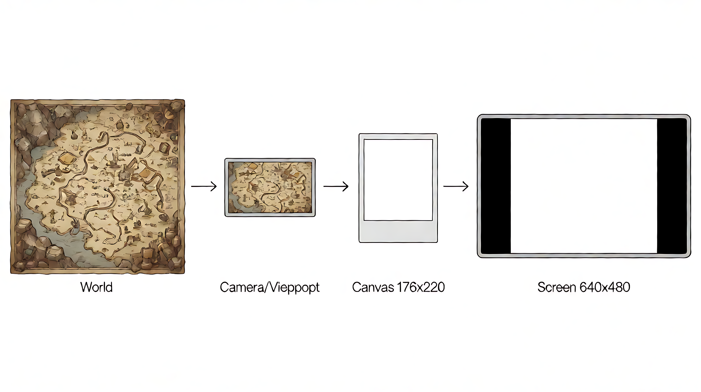
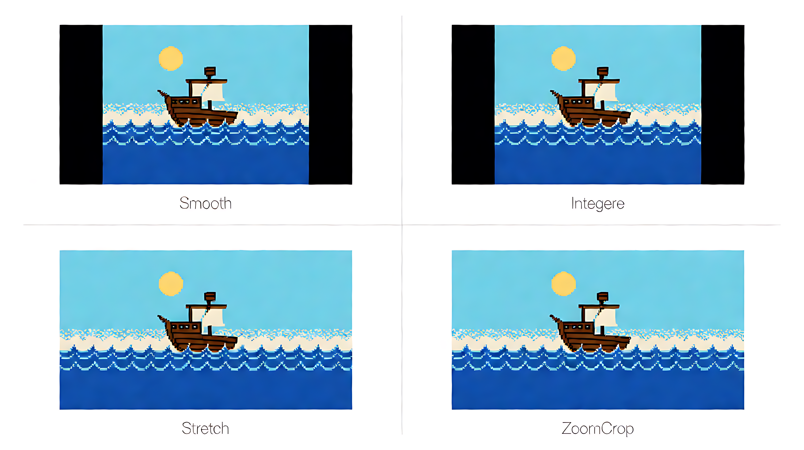
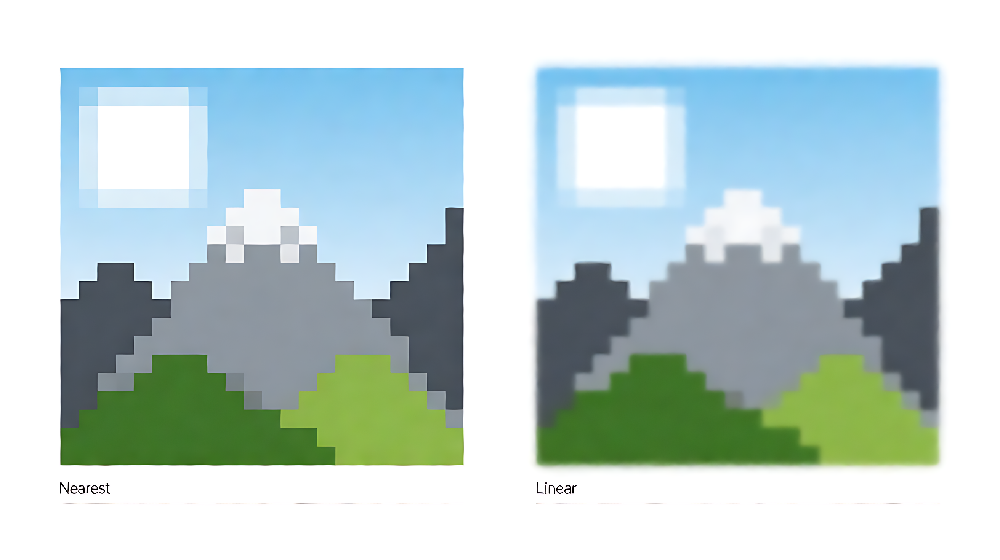
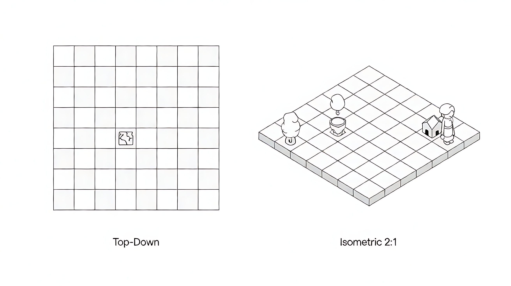

# 第 3 章：坐标系与变换

## 学习目标

- [ ] 理解三种坐标系：世界坐标、屏幕坐标、本地坐标
- [ ] 理解坐标变换的本质（不是一个系数直接转换）
- [ ] 理解摄像机的作用（视野矩形：位置 + 放大倍率）
- [ ] 掌握一个点从世界坐标到屏幕坐标的完整转换过程
- [ ] 理解逻辑分辨率（1080×1920）vs 物理分辨率
- [ ] 理解等距投影（2D 模拟 3D）+ 动态瓦片尺寸（board_fit）
- [ ] 理解 Bevy 坐标换算（1080 逻辑 → Bevy 世界坐标）
- [ ] 说清"世界 / 画布 / 物理屏幕"三个空间的关系与单位
- [ ] 理解黑边是 ScaleMode 的选择，理解 FilterMode 的采样差异

## 核心概念

### 为什么需要多个坐标系

游戏世界里有很多"位置"，但它们不在同一个空间里：

```
世界坐标：玩家站在地图的哪个格子
屏幕坐标：玩家画在屏幕的哪个位置
本地坐标：按钮在面板内的相对位置
```

如果用同一个坐标表示所有东西，地图移动、窗口缩放、UI 嵌套都会变成噩梦。**不同层次用不同坐标，变换负责翻译。**

---

### 先打通全局：三个空间的关系

**这一步是全章的地基，务必先看懂。**

```
┌────────────────┐     ┌────────────────┐     ┌────────────────┐
│   世界坐标       │     │   逻辑画布       │     │   物理屏幕       │
│                │     │                │     │                │
│  地图 = 世界     │ ──→ │ 画布 = 拍下来   │ ──→ │ 屏幕 = 印的纸   │
│  g×g 格        │     │  的一张照片     │     │  设备像素       │
│  （如 20×20）  │     │  1080×1920 像素  │     │  （如 1920×1080）│
└────────────────┘     └────────────────┘     └────────────────┘
        ↑                      ↑                      ↑
   ① 摄像机取景              ② 视口放大
   （含等距投影）            （Bevy Camera2d letterbox）
```

**比喻串起来**：

```
  地图   = 整张城市地图（很大）
  摄像机 = 手里的取景框（只框住一小块）
  画布   = 取景框里拍下来的那张照片（1080×1920）
  屏幕   = 把照片印出来的相纸（物理设备像素）
```

**关键结论：画布 ≠ 地图**

```
  进画布之前 → 单位是「格」（逻辑地图格子）
  进画布之后 → 单位是「像素」（1080×1920 画布像素）

  画布 1080×1920 比地图"大"还是"小"？取决于视野：
    视野框住 g×g = 20×20 格 → 画布装 20×20 格
    视野框住 g×g = 15×15 格 → 画布装 15×15 格（格更大）
```

**所以第 ② 步就是渲染流水线**（详见第 7 章）：

```
  世界 ──摄像机──→ 画布 ──Bevy 渲染──→ 物理屏幕
       格子          1080 像素         设备像素

  前半段 = 几何变换（本章讲的）
  后半段 = GPU 光栅化（第 7 章讲的）
```



---

### 坐标系 1：世界坐标（World Space）

**生活类比：城市地图上的地址**

```
想象一张巨大的城市地图铺在地上，256米 x 256米。

   (0,0) ─────────────────→ x
     │
     │    你在 (128, 64)
     │    学校在 (200, 150)
     │    公园在 (50, 200)
     ↓
     y

你的地址 (128, 64) 是绝对的：
  不管谁来地图上看，你的位置不变。
  不管用多大的屏幕看，你的位置不变。
  你的位置只取决于你在地图上的哪里。
```

**特点**：
- 与屏幕无关，地图不动坐标就不变
- 地图可以很大（256x256），但屏幕只能显示一小块
- 玩家移动 = 世界坐标变化
- 游戏逻辑（碰撞检测、移动规则）用世界坐标

---

### 坐标系 2：屏幕坐标（Screen Space / 画布坐标）

**生活类比：你视野里的位置**

```
你站在地图前，眼前有一个矩形视野（1080×1920 画布像素）。
你通过视野看地图，只有视野范围内的东西才看得见。

假设视野左上角对准地图 (118, 54)：

  视野左上角 ───────────→ x
     │
     │    你（地图 128, 64）在视野的 (10, 10)
     │    公园（地图 50, 200）在视野外（太偏，看不到）
     │    学校（地图 200, 150）在视野的 (82, 96)
     ↓
     y

你的视野位置 (10, 10) 是相对的：
  你向右转头 → 你在视野里的位置向左移动
  你凑近看 → 你在视野里的位置向外推
  你后退 → 你在视野里的位置向中心缩
```

**特点**：
- 只有视野范围内的坐标才有意义
- 视野移动/缩放，同一世界物体的屏幕坐标会变
- 渲染用屏幕坐标（画在视野的哪个位置）
- 视野范围外的东西不画

---

### 坐标系 3：本地坐标（Local Space）

**生活类比：剧院里的座位号**

```
你在剧院第 3 排第 5 号。
这个位置是相对于剧院的，不是相对于城市的。

  如果剧院搬到别的地方：
    你的座位号不变（还是第 3 排第 5 号）
    但你在城市里的绝对位置变了

  如果剧院里的座位重新排列：
    你的座位号变了（变成第 4 排第 6 号）
    但剧院在城市里的位置不变
```

**游戏中的应用**：
```
面板在画布 (100, 100)，按钮在面板内 (10, 20)
  按钮的本地坐标 = (10, 20)
  按钮的画布坐标 = (100 + 10, 100 + 20) = (110, 120)

移动整个面板到 (200, 200)：
  按钮的本地坐标不变 = (10, 20)
  按钮的画布坐标变了 = (200 + 10, 200 + 20) = (210, 220)
```

**特点**：
- UI 嵌套时，每个控件用本地坐标
- 父容器负责变换（移动面板，按钮自动跟随）
- 移动整个面板，按钮本地坐标不变

---

### 变换 1：世界 → 画布（摄像机变换）

**相机 = 人眼的视野矩形**

```
人眼不动，眼前有一个矩形视野：
  凑近看 → 视野里看到的地图区域变小，但物体更大（放大）
  拉远看 → 视野里看到的地图区域变大，但物体更小（缩小）

相机参数只有两个：
  1. 视野矩形对准地图的哪个位置
  2. 视野矩形放大还是缩小
```

**为什么不是一个系数直接转换**：

```
同一个点 A (50, 30)：
  视野左上角对准 (40, 20) → A 在视野 (10, 10)
  视野左上角对准 (0, 0)   → A 在视野 (50, 30)
  视野左上角对准 (50, 30) → A 在视野 (0, 0)（A 正好在视野左上角）
  视野左上角对准 (40, 20) 且 zoom=2 → A 在视野 (20, 20)

同一个点，视野位置不同、zoom 不同，在视野里的位置不同。
所以必须知道视野的位置和 zoom，不能固定一个系数。
```

**一个点是怎么转换的（看图）**：

已知条件（三幅图共用）：
```
点 A 在世界坐标 (50, 30)
视野左上角对准世界 (40, 20)
```

#### ① 世界（从上往下看）

```
        x →
      0 ┼──────────────────────────────────────
        │              整个世界（如 256×256）
        │              视野只是其中一小块
        │
     20 ├──────────┬─────────────────┬───────────
        │          │ ← 视野左上角      │
        │          │   对准 (40,20)   │
        │          │        ● A       │
        │          │      (50,30)     │
        │          │                 │
        │          └─────────────────┘
        ↓
```

#### ② zoom = 1：A 落在视野的哪里

```
        x →
      0 ┼──────────────────────────────
        │ ● A
        │ │
     10 ├─╂────────────
        │ │
        ↓

      量法（只做减法）：
        A 离视野左边  50 − 40 = 10
        A 离视野上边  30 − 20 = 10
                   → A 在视野 (10, 10)
```

#### ③ zoom = 2：同一个 A，被推得更远

```
        x →
      0 ┼──────────────────────────────
        │
        │       ● A
        │       │
     20 ├───────╂──────────
        │       │
        ↓

      量法（减完再乘）：
        10 × 2 = 20 → A 在视野 (20, 20)

      看图要点：
        A 在图 ② 里紧贴左上角，在图 ③ 里被推到斜下方。
        点没动，是"看到的范围变小、东西变大"把它顶开的。
```

#### 三幅图串起来 = 两步公式

```
世界 ──① 减去视野左上角──→ 相对距离 ──③ 乘 zoom──→ 视野坐标
       (50−40, 30−20)          (10, 10)      ×1 →  (10, 10)
                                          ×2 →  (20, 20)
                                          ×0.5→  (5, 5)
```

总结公式：
  画布 x = (世界 x - 视野位置 x) × zoom
  画布 y = (世界 y - 视野位置 y) × zoom

**关键理解**：
- 平移 = 减去视野左上角坐标（把视野原点移到画布原点）
- 缩放 = 乘 zoom（放大 = 距离变大，缩小 = 距离变小）
- 两步缺一不可：不平移不知道相对位置，不缩放不知道大小

**摄像机只算，渲染器才画**（关键分工）：

```
  每帧三步：

  ① 数据层（世界）
     地图 = 一张 g×g 的数组
     每个格子存"这里是什么"（地形/物品/角色）
     不做任何渲染，纯数据

  ② 摄像机（纯计算，不画图）
     输入：我在看哪个区域（中心格 + 视野大小 + zoom）
     输出：哪些格子可见 + 每个格子落在画布哪个像素位置
     用 iso_cell_fit 公式算位置
     ★ 不产生任何像素

  ③ 渲染器（Bevy GPU，真正画图）
     拿到摄像机给的坐标列表
     逐格调用 blit_image：把贴图画到对应像素位置
     这一步才产生像素
```

**"渲染到多少"取决于摄像机给了多少格**：

```
  视野能看见 10 列 × 8 行 = 80 格
    → 每帧算 80 次 iso_cell_fit
    → 每帧画 80 张贴图
    看不见的 g×g − 80 格完全不算不画

  不是"先把整个 g×g 世界画好一张大图，再裁剪"
  而是"摄像机说看哪些格，渲染器就画哪些格"——按需渲染
```

> 3D 游戏里叫 frustum culling（视锥体剔除），
> 2D 格子里叫 tile culling，原理一样：只画看得见的。

---

### 变换 2：画布 → 物理像素（Bevy 视口变换）

**生活类比：把照片印在不同大小的纸上**

```
你的画布是 1080×1920 像素（逻辑分辨率，固定）。
你的手机屏幕可能是 1080×2400 像素（物理分辨率）。
你的电脑屏幕可能是 1920×1080 像素。

同一张"照片"（画布画面），印在不同大小的纸上，方法不同：
  纸比照片大 → 放大照片，两边留白边
  纸比照片小 → 缩小照片，上下留白边
  纸和照片一样大 → 直接印
```

**Bevy 的做法（本项目）**：

```
  Bevy 用 Camera2d + OrthographicProjection
  投影区域 = 1080×1920 画布
  视口 scale = 物理宽/1080（或物理高/1920，取小）

  例：窗口 540×960（逻辑半大小）
    scale = min(540/1080, 960/1920) = 0.5
    画布以 50% 放大填充窗口，无黑边（比例匹配）

  例：窗口 1920×1080（横屏桌面）
    scale = min(1920/1080, 1080/1920) = min(1.78, 0.5625) = 0.5625
    黑边 = (1920 − 1080×0.5625×2)  → 左右各留黑边
```

**Bevy 坐标换算（1080 逻辑 → Bevy 世界）**：

```
  Bevy 2D 世界：原点在画布中心，y 向上
  1080 逻辑：原点在画布左上，y 向下

  换算（唯一口径，`scene_render.rs::to_world`）：
    world_x = logical_x − 540
    world_y = 960 − logical_y

  例：画布 (100, 200) → Bevy 世界 (−440, 760)
```

**总结公式（等比 letterbox）**：
```
  scale = min(物理宽/1080, 物理高/1920)
  物理 x = 逻辑 x × scale + 黑边 offset_x
  物理 y = 逻辑 y × scale + 黑边 offset_y
```

---

### 黑边是"选择"的结果：4 种缩放模式

黑边不是 bug，是默认模式的**主动选择**。本项目实现了 4 种
（`crates/ti-platform/src/settings.rs`）：

| 模式 | 做法 | 有黑边？ | 副作用 |
|---|---|---|---|
| `Smooth`（默认） | 等比缩放 + 居中留边 | **有** | 无 |
| `Integer` | 等比但对齐到整数倍 | **无** | 像素锐利，不模糊 |
| `Stretch` | 宽高各拉各的，填满 100% | **无** | **画面变形** |
| `ZoomCrop` | 等比放大到铺满，溢出的**裁掉** | **无** | 边缘视野变少 |

**为什么现在的手机游戏基本没黑边**：

```
  主流做法（ZoomCrop / 不设固定画布）：
    宁可裁掉一点边缘内容，也不要两侧黑边

  本项目走"固定 1080×1920 画布 + 可选缩放模式"这条较传统的路
  （为了对齐原版像素布局 + Bevy 1080 逻辑坐标系）
```



---

### 贴图怎么填满一格：`FilterMode`

前面讲了瓦片尺寸由 `board_fit` 动态计算。那**贴图的像素怎么填进瓦片**？
这是采样规则问题，本项目有 2 种（`crates/ti-platform/src/settings.rs`）。

**Nearest vs Linear 本质区别**：

```
  源图只有 2 个像素：[9, 1]（左白右黑），放大 4 倍变成 8 个像素。

  Nearest —— 每个目标像素"抄"最近的源像素
  9 9 9 9 | 1 1 1 1
           ↑
      边界：从 9 直接跳到 1，中间没有任何过渡值 → 硬边、锐利

  Linear —— 边界处的像素做加权平均（双线性插值）
  9 9 8 6 4 2 1 1
          ↑
      边界：冒出 8、6、4、2 这些"源里根本不存在的值" → 渐变、糊
```

**本项目默认 Nearest**（复古像素画，Linear 会糊掉像素边缘）。



---

### 本地坐标（**汇入画布，不是独立路径**）

> ⚠️ 本地坐标解析完就变成画布坐标，**之后与视野坐标走完全相同的视口放大**。

```
  世界(格) ──等距投影+摄像机──→ 画布(像素) ──Bevy 视口放大──→ 屏幕
                                    ↑
                              本地坐标在这里汇入
                              （解析完归一为画布坐标）

  ★ 解析后的画布位置，和视野里的东西没有区别，一视同仁地放大
```

**"同等放大"的意思**：

```
面板画布 (100,100)，按钮本地 (10,20) → 按钮画布 (110,120)

Bevy 坐标换算（1080→世界）：
  面板 → (110−540, 960−100) = (−430, 860)
  按钮 → (120−540, 960−120) = (−420, 840)
                       ↑
  和视野里其他所有像素用同一个公式，没有例外
```

---

### 完整变换链

```
   世界坐标                画布坐标              物理像素
   (地图地址)             (1080 画布)           (设备像素)
      (50, 30)
         │
         │  ① 等距投影（iso_cell_fit）
         │     + 摄像机（减视野位置、乘 zoom）
         ▼
                          (20, 20)
                               │
                               │  ② Bevy 视口（Camera2d letterbox）
                               │     × scale + 黑边 offset
                               ▼
                                                物理像素
```

**每个变换只做一件事**：
- 等距投影 + 摄像机：决定看地图的哪个区域、画在哪（世界 → 画布）
- Bevy 视口：决定画布怎么映射到物理屏幕（画布 → 物理）

---

### 逻辑分辨率 vs 物理分辨率

| 概念 | 生活类比 | 本项目值 |
|---|---|---|
| 逻辑分辨率 | 照片的尺寸（不变） | **1080×1920** |
| 物理分辨率 | 打印出来的纸大小（随设备变化） | 1920×1080 / 1080×2400 / ... |

**好处**：
- 游戏逻辑只关心 1080×1920 的画布坐标
- Bevy 视口变换负责适配任何屏幕
- 换设备不需要改游戏代码

**本项目中的体现**：
```
crates/ti-render/src/framebuffer.rs — CANVAS_W=1080 / CANVAS_H=1920（单一事实源）
crates/ti-engine/src/scene_render.rs — Bevy 世界坐标换算
```

> ⚠️ **176×220 是 legacy 坐标**（旧 macroquad 时代），运行时禁止出现（doccheck2 第 9 项 grep 门禁）。

---

### 等距投影（Isometric Projection）

#### 一、最简直觉：为什么不用纯俯视

**一句话：俯视只能看到物体的顶面，等距能看到侧面。**

```
  俯视（正上方看）              等距（斜着看）

  ┌──────────────┐                ╱◆╲
  │  ○  ▲  □   │               ◆ ◆ ◆     ◆ = 树：看到树冠 + 树干
  │  ═══╪═══    │               ╲◆╱      ▲ = 人：看到头 + 身体
  │     │      │             ┌───┐       □ = 墙：看到墙面，有高度
  └──────────────┘             │   │
                                └───┘
  像看地图/蓝图                 像看真实场景

  ○ 人 = 只看到头顶            ○ 人 = 看到整个人
  □ 墙 = 只看到墙顶那条线       □ 墙 = 看到墙面，有高度
```

**所以"斜"不是为了好看，是为了看到侧面。**



<video controls width="100%" src="../../evidence/tutorial/03_isometric_transform.mp4"></video>

#### 二、为什么游戏用等距

```
  ① 用 2D 技术获得 3D 观感
  ② 格子大小一致，地图好拼接
  ③ 玩家能准确判断位置关系
```

#### 三、真实公式（`chrome.rs` · `board_fit` + `iso_cell_fit`）

**瓦片尺寸是动态的**（`board_fit` 把 g×g 棋盘拟合进 `world_canvas`）：

```
  输入：world_canvas = {43, 250, 994, 826}（1080 坐标系）
        g = 20（m01/m02）或 g = 15（m03）

  计算：
    tw = 994 / (2 × g)，再 8pt 向下取整
    th = tw / 2

  m01/m02（g=20）：tw = 994/40 = 24（8pt 对齐），th = 12
  m03（g=15）：    tw = 994/30 = 33.1 → 32（8pt 对齐），th = 16
```

**等距投影公式（`iso_cell_fit`，V 形经典式）**：

```
  iso_x = x0 + (col − row) × tw
  iso_y = y0 + (row + col) × th

  其中：
    x0 = 画布中心 x − tw
    y0 = 画布中心 y − g × th

  方向验证（m01, tw=24, th=12）：
    row+1 → x −24（左），y +12（下）→ 斜下左 ↓←
    col+1 → x +24（右），y +12（下）→ 斜下右 ↓→

  ★ 这是经典 V 形：row 轴朝左下，col 轴朝右下，张成菱形
```

**3×3 网格投影后长什么样**（g=3，tw=24，th=12）：

```
              ◆(0,2)                 ← 最上（col 最大）
      ◆(0,1)        ◆(1,2)
◆(0,0)      ◆(1,1)      ◆(2,2)        ← 中间一行
      ◆(1,0)        ◆(2,1)
              ◆(2,0)                 ← 最下（row 最大）

              ↓ 整体是个菱形（V 形经典式）
```

**z-order（绘制顺序）**：

```
  iso_y 越大 = 越靠"下" = 越近 = 越晚画（压在上面）

  因为 iso_y = y0 + (row + col) × th
  等价于按 (row + col) 从小到大绘制
    row + col 越小 = 越远 = 先画
```

**反例警示**：

```
  画错（近的先画）：     画对（远的先画）：
     山                     人
   ┌────┐                 ┌────┐
   │ 山 │  山盖住人       │ 人 │  ← 人先画（远）
   └────┘                 ├────┤
   人不见了 ❌             │ 山 │  ← 山后画（近），压住人下沿
                          └────┘
                          层次正确 ✅
```

**瓦片尺寸为什么是动态的？**

```
  原版 TreasureIsl 的地图有 3 张：
    m01: g=20（20×20 格）
    m02: g=20（20×20 格）
    m03: g=15（15×15 格）

  画布固定 994×826，要装下不同大小的网格
  → 瓦片尺寸必须动态调整（小地图瓦片大，大地图瓦片小）
  → 公式：tw = 画布宽 / (2 × g)，8pt 对齐
```

#### 四、两种等距取向（经典 vs 本项目）

```
  取向 A：教科书经典"V"形（本项目现在用的）
    row 轴 → 左下（x −tw, y +th）
    col 轴 → 右下（x +tw, y +th）
    轴间夹角 126.87°
    地图像"菱形摊平"，顶部是 (0,0)，底部是 (g−1,g−1)

  取向 B：旧版 terrain_atlas（已废弃）
    row 轴 → 右下（x +32, y +16）
    col 轴 → 右上（x +32, y −16）
    两轴都朝右张开，地图像"菱形立起"

  ★ 当前运行时走 chrome.rs（V 形），terrain_atlas.rs 的 32×16 公式
    只用于 legacy 数据层离线处理，不进运行时。
```

---

### Bevy 坐标体系（新增）

```
  本项目渲染引擎 = Bevy 0.20（GPU，wgpu）

  Bevy 2D 世界坐标：
    原点在画布中心（540, 960）
    y 轴向上（不是向下）

  1080 画布坐标 → Bevy 世界坐标：
    world_x = canvas_x − 540
    world_y = 960 − canvas_y

  例：画布左上角 (0,0) → Bevy (−540, 960)
      画布中心 (540,960) → Bevy (0, 0)
      画布右下角 (1080,1920) → Bevy (540, −960)

  相机 = Bevy Camera2d + 正交投影
    投影区域 = 1080×1920（画布）
    scale = 物理/逻辑（letterbox）
    zoom = 主地图放大倍率
```

---

### 反向变换：物理 → 世界

**作用**：回答"玩家点/摸的这一下，是点在哪个格子？"

```
  整条链倒着走（严格逆序）：

  物理屏幕 ──① 逆 Bevy 视口──→ 画布 ──② 逆等距投影──→ 世界(格)
              除 scale、减 offset      解 u/v 方程
```

**完整闭环例子**（m01, g=20, tw=24, th=12）：

```
  起点：地图格 (row=0, col=2)

  正向：iso_cell_fit(0, 2) = (x0 + (2−0)×24, y0 + (0+2)×12)
                              = (x0+48, y0+24)  → 画布坐标
                          → Bevy 视口 → 物理像素

  玩家点物理像素，反推：
  ① 逆 Bevy 视口：物理 → 画布（除 scale、减 offset）
  ② 逆等距投影：解方程组
       u = (画布x − x0) / tw = col − row
       v = (画布y − y0) / th = row + col

       row = (v − u) / 2
       col = (v + u) / 2

  → 结论：玩家点的是地图 (0, 2) 格 ✅
```

**逆向口诀**：

```
  正向：等距投影 → 摄像机 → Bevy 视口
  反向：逆视口 → 逆摄像机 → 逆等距投影
```

**常见错**：忘了 Bevy y 轴是**向上**的，直接减 offset 会 y 方向反。

---

## 项目对照

### 逻辑分辨率

```
crates/ti-render/src/framebuffer.rs — CANVAS_W=1080 / CANVAS_H=1920（单一事实源）
```

> ⚠️ 176×220 是 legacy 坐标，运行时禁止（doccheck2 grep 门禁）。

### 等距投影（运行时）

```
crates/ti-app/src/scenes/chrome.rs:275  — board_fit（动态瓦片尺寸）
crates/ti-app/src/scenes/chrome.rs:300  — iso_cell_fit（V 形等距公式）
crates/ti-app/src/scenes/main_map.rs    — 调用方
```

**瓦片尺寸（实测）**：

```
m01/m02（g=20）：tw=24，th=12（8pt 对齐）
m03（g=15）：   tw=32，th=16（8pt 对齐）

★ 不再是固定 32×16，而是根据地图大小动态计算
```

### 摄像机 / Bevy 视口

```
crates/ti-engine/src/scene_render.rs  — to_world 坐标换算
crates/ti-engine/src/bin/treasure_bevy.rs — Camera2d + 正交投影
```

### 主地图移动（S19 环岛赛道）

```
crates/ti-core/src/rules/board.rs  — 摇骰 + 沿赛道前进
crates/ti-app/src/scenes/main_map.rs — 渲染 + 触摸命中
assets/data/board.json  — 赛道数据（每图一条闭合环）
```

> 主地图移动 = 摇骰定步数 → 沿环岛赛道前进 N 格 → 落格结算
> 不是自由格移动（S19.1 方向键自由移动已彻底删除）

---

## 实践练习

### 练习 1：坐标系识别

打开 `crates/ti-app/src/scenes/main_map.rs`，找到：
- `iso_cell_fit` 在哪里被调用
- 玩家位置如何从格坐标转为画布坐标
- 触摸命中如何从画布坐标逆解回格坐标

### 练习 2：Bevy 坐标换算

画布坐标 (100, 200) → Bevy 世界坐标是多少？
画布中心 (540, 960) → Bevy 世界坐标是多少？

### 练习 3：board_fit 手算

m01（g=20），`world_canvas = {43, 250, 994, 826}`：
- tw = ?
- th = ?
- x0 = ?
- y0 = ?
- 格 (row=0, col=0) 的画布坐标 = ?

### 练习 4：反向变换

玩家点击画布坐标 (x, y)，m01（g=20, tw=24, th=12）：
- 对应格 (row, col) = ?
- 如果点击落在画布外（黑边区域），会发生什么？

## 常见坑

| 坑 | 原因 | 避免 |
|---|---|---|
| 触摸坐标没转换 | 直接用物理像素当画布坐标 | 物理 → 逆 Bevy 视口 → 画布 → 逆等距投影 → 格 |
| Bevy y 轴方向反 | Bevy y 向上，1080 逻辑 y 向下 | `world_y = 960 − canvas_y`（减，不是加） |
| 用 176×220 legacy 坐标 | 旧 macroquad 时代残留 | 运行时只有 1080×1920（doccheck2 grep 门禁） |
| 瓦片尺寸写死 32×16 | 旧 terrain_atlas 固定值 | 用 `board_fit` 动态计算（g=15 时 tw=32，g=20 时 tw=24） |
| 等距 z-order 错误 | 绘制顺序不对 | 按 (row+col) 从小到大（iso_y 升序） |
| 黑边当成 bug | `Smooth` 模式本就会留边 | 想无黑边切 `ZoomCrop` / `Stretch` |
| 放大后画面发糊 | 像素画用错 `FilterMode` | 复古像素用 `Nearest` |
| 本地坐标当成独立变换路径 | 误以为它有一套自己的缩放 | 解析归一为画布坐标，之后与视野坐标同等放大 |
| 反向变换顺序颠倒 | 先除 scale 再减 offset | 严格逆序：减 offset → 除 scale → 逆等距 |

## 学习记录

- 状态：已完成
- 完成日期：2026-10-13
- 心得/疑问：三个空间=世界(格)/画布(1080×1920)/屏幕(物理像素)，画布≠地图；相机=人眼视野矩形；瓦片尺寸由 board_fit 动态计算（g=20→24×12，g=15→32×16）；Bevy 坐标 y 轴向上（1080 逻辑 y 向下，换算 = 960 − canvas_y）；黑边是 ScaleMode::Smooth 的选择
