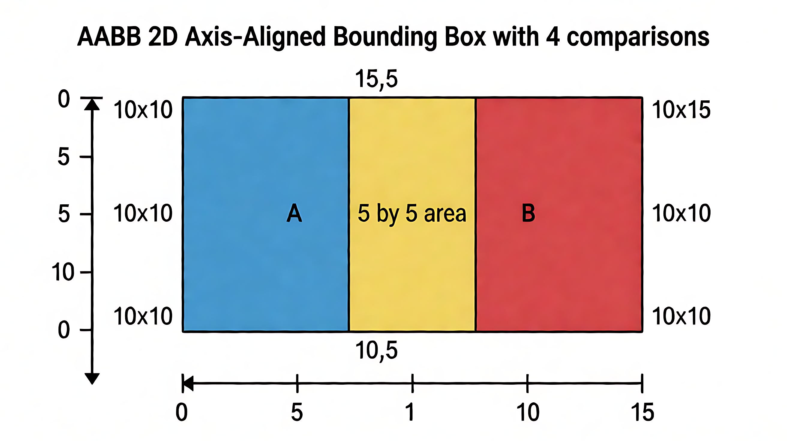
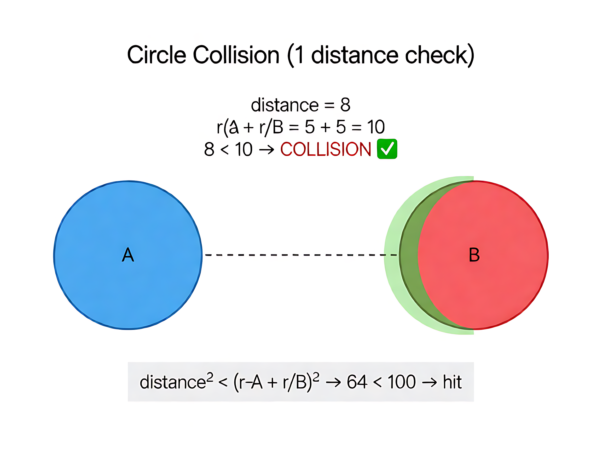
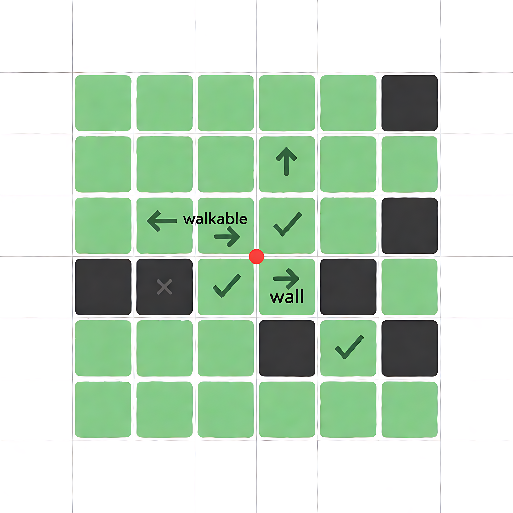
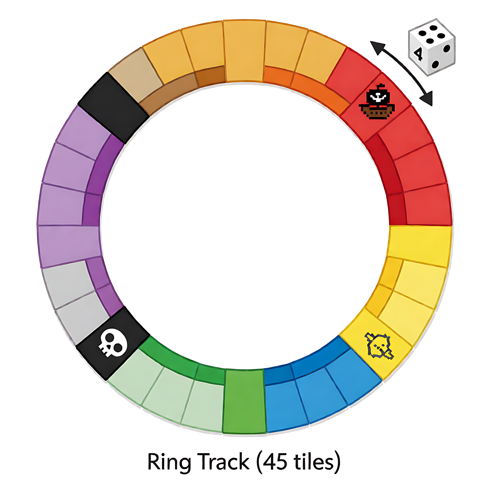

# 第 5 章：碰撞检测与移动规则

## 学习目标

- [ ] 理解为什么游戏需要碰撞检测（没有会怎样）
- [ ] 掌握 AABB / 圆形 / 网格查表三种基础方法
- [ ] 理解本项目环岛赛道摇骰移动模型（不是自由格移动）
- [ ] 理解落格结算语义（终点才结算，BOSS 经过即遇）
- [ ] 能识别本项目代码中碰撞/命中判定的位置

**关键洞察（30 秒版）：**

```
  ① 碰撞检测 = 两个东西的"缝隙 < 0"（穿进去了）
     不用复杂概念，就是比坐标值

  ② AABB = 4 个边坐标比一下（A右>B左 且 A左<B右 且 A下>B上 且 A上<B下）
     贴边（=）不算重叠（10 > 10 不成立）

  ③ 本项目主地图不是"能不能走到这格"（自由格已删）
     而是"摇骰走 N 格落在哪"（环岛赛道查格类型 + 结算）

  ④ UI 点击 = AABB（触摸坐标在按钮矩形内？），4 次比较 O(1)
     实码：main_map.rs:471-478 的 hud_hit 闭包
```

---

## 一、为什么需要碰撞检测

**先想一个问题：如果游戏里完全没有碰撞检测，会怎样？**

```
  你控制角色往墙走  → 角色直接穿过墙，走出地图 ❌
  你点屏幕按钮      → 手指点哪里都没反应，游戏没法操作 ❌
  你射出子弹        → 子弹穿过敌人，敌人不受伤 ❌
  你摇骰走到宝藏格  → 不知道到了，金币拿不到 ❌

  碰撞检测一加上：
  走到墙边停下 ✅  点中按钮触发 ✅  子弹击中扣血 ✅  落格自动结算 ✅
```

**一句话：碰撞检测 = 判断"两个东西碰了 / 到了 / 重叠了没有"。**
没有它，游戏就变成一幅**不能互动的画面**。

生活类比：你在街上走，不能穿过墙壁——你的身体和墙壁做了一次"碰撞检测"。
游戏里只是把这件事从身体换成了代码。

**常见疑问：引擎不已经自带了这些功能吗？**

```
  引擎（Bevy/winit）负责的是：
    "屏幕上有触摸了，坐标是 (x, y)"
    → 输入抽象、事件捕获、坐标转换（物理像素 → 1080 画布坐标）

  你的游戏代码负责的是：
    "(x, y) 落在哪个按钮里？该触发什么？"
    → 引擎不知道你的按钮在哪
    → 引擎只说"有触摸发生"，不告诉你"你点的是谁"

  类比：
    引擎 = 眼睛（看到手指按了屏幕）
    游戏代码 = 大脑（判断按的是哪个按钮，该做什么）
    眼睛不会告诉你"你按的是'确定'键"，大脑需要知道按钮位置，自己判断
```

> 本项目 UI 是 `scenes.json` 数据驱动（矩形坐标表），不是标准 widget 树。
> 每个按钮位置在 JSON 里，引擎不知道，必须自己查表 + AABB 判定。
> （Bevy 有内置 Ui 插件可以自动 hit test，但本项目没用它。）

**三大用途（本项目）**：

| 用途 | 在问什么 | 本项目 |
|---|---|---|
| 移动限制 | "我能走到这格吗" | ~~自由格~~（已删）→ 环岛赛道 |
| 交互命中 | "我点的是哪个按钮" | ✅ AABB（`main_map.rs`） |
| 事件触发 | "我落到哪格、发生什么" | ✅ 落格结算（`rules::board`） |

---

## 二、碰撞检测的本质：三种形状三种方法

所有碰撞检测，不管多复杂，都在回答**"有没有重叠"**。区别只在于**形状不同 → 判断方法不同**。

| 形状 | 方法名 | 核心判断 | 计算量 |
|---|---|---|---|
| 两个矩形 | **AABB** | 4 次边界比较 | 最多 4 次 |
| 两个圆 | **圆碰撞** | 距离² < 半径和² | 1 次平方和 |
| 网格格 | **查表** | 格子的值是否为 0 | 1 次数组索引 |

> **AABB 全称 = Axis-Aligned Bounding Box（轴对齐包围盒）**
> "包围盒" = 用一个最小矩形把物体框住；"轴对齐" = 矩形边平行于坐标轴（不旋转）。
> 生活类比：把东西装进刚好卡住的纸箱，纸箱边不歪不斜。

---

## 三、核心：重叠 = "缝隙 < 0"

**所有碰撞检测，本质就一件事：两个东西之间的"缝隙"是不是负的（穿进去了）。**

```
  两个圆：缝隙 = 圆心距离 - (r1 + r2)
          缝隙 < 0 → 碰到了

  两个矩形（AABB）：x 缝隙 < 0 且 y 缝隙 < 0
          两个方向缝隙都 < 0 → 重叠了

  网格格：格子值 = 0 → 能走（没有障碍）
          格子值 = 1 → 不能走（有墙）
```

---

## 四、AABB（两个矩形重叠）

### 一张图说清楚



> AABB 在 2D 和 3D 里都有，原理相同。
> 2D = 矩形（4 条边，4 次比较）；3D = 长方体（6 个面，6 次比较，多一个 z 轴）。
> 本项目是 2D，只关心 2D。

### 就 4 个数比一下

```
  矩形 A：左=0  右=10  上=0  下=10
  矩形 B：左=5  右=15  上=5  下=15

  问 4 个问题：
    A 的左边在 B 的右边左边吗？  0 < 15  ✅
    A 的右边在 B 的左边右边吗？  10 > 5  ✅
    A 的上边在 B 的下边上面吗？  0 < 15  ✅
    A 的下边在 B 的上边下面吗？  10 > 5  ✅

  4 个全过 → 重叠了

  任何一个没过 → 不重叠（短路退出，不用做完 4 个）
```

**为什么是 4 个？** x 方向 2 个（左/右），y 方向 2 个（上/下），2+2=4。
**贴边**：A右=10，B左=10 → 10 > 10 不成立 → 不重叠（刚好贴着不算）。

### 本项目实码（`main_map.rs:471-478`）

```rust
// 触摸点 (px, py) 是否落在按钮矩形 {x, y, w, h} 内？
// 按钮的 4 条边：左=x  右=x+w  上=y  下=y+h
let hud_hit = |key: &str| -> bool {
    l.extra.get(key).is_some_and(|r| {
        r.w > 0 && r.h > 0
            && (r.x..(r.x + r.w)).contains(&px)   // px 在 [x, x+w)
            && (r.y..(r.y + r.h)).contains(&py)   // py 在 [y, y+h)
    })
};
// 调用：main_map.rs:486  hud_hit(DECK_SPIN) = 摇骰 CTA
// 命中判定内联在各场景 on_touch（L459 起）
```

> 一行 `contains` = 上面 4 个数比较的 Rust 写法。

---

## 五、方法 2：圆形碰撞

**生活类比：两个泡泡是否碰到一起**



```
  泡泡 A：圆心 (0,0)  r=5
  泡泡 B：圆心 (8,0)  r=5

  判断（用平方避免开根号）：
    距离² < (半径A + 半径B)²
    8² < (5+5)²
    64 < 100 → 碰到了 ✅

  拉开：B 圆心 (12,0) → 144 > 100 → 没碰到 ❌
```

**本项目不用圆形碰撞**——UI 里的圆形形状（罗盘环/圆角铜牌）渲染时是圆的，
但**命中区仍是矩形 AABB**（`dx <= hit_r && dy <= hit_r`，本质方形）。
理解圆碰撞有助于理解为什么"子弹击中"类用距离平方判断。

---

## 六、方法 3：网格查表（最简的"碰撞"）

**生活类比：棋盘上问"这个格子能不能走"**



```
  地图 = 二维数组，每格一个值：0 = 空地（能走），1 = 墙（不能走）

  玩家 (行2, 列2) 查 4 个邻格：
    南 地图[3][2] = 0 → 能走 ✅
    西 地图[2][1] = 1 → 被挡 ❌
    东 地图[2][3] = 0 → 能走 ✅
    北 地图[1][2] = 1 → 被挡 ❌

  一次下标 + 一次值比较 = O(1)，无几何计算
```

> 本项目**不再用自由格移动**（S19.1 方向键已删除）。
> 网格数据仍用于地形渲染（画哪些格是陆地/礁石），移动规则已改为环岛赛道。

---

## 七、本项目的碰撞：环岛赛道（S19）

**上面的三种方法，本项目主地图移动都不直接用。实际玩法是"大富翁式摇骰"。**

**生活类比：大富翁掷骰子**

```
  玩家在环路上，面朝前方
  掷骰子 → 走 N 格 → 落到哪个格就停
```

### 赛道数据（`assets/data/board.json`）

```
  每图一条闭合环（顺时针）：m01=45格  m02=46格  m03=33格
  每格类型：start / plain / port / city / event / card / battle / treasure / boss
```

### 摇骰 + 前进 + 落格结算（`rules::board`）

```
  ① 摇骰：step = rng(1..=6)
  ② 前进：pos = (pos + step) % 格数；绕起点 → lap+1（奖励金币）
  ③ 落格结算（只认终点格，路过不结算）：
    port     → 提示"可贸易/建造"
    city     → +50 金
    event    → 抽一张卡
    card     → 抽一张卡
    battle   → 扣 30 HP + 失 20 金
    treasure → +200 金
    boss     → 绕满 boss_min_laps 圈后经过/落格才进战斗（见拦停规则）；未满圈只提示
    plain    → 无事
```

**"碰撞"在这个模型里 = 格类型查表 + 结算**，不是几何碰撞。



<video controls width="100%" src="../../evidence/tutorial/05_ring_track_demo.mp4"></video>

<video controls width="100%" src="../../evidence/tutorial/05_aabb_demo.mp4"></video>

### BOSS 拦停规则（S19.3）

```
  经过或落在 BOSS 格 → 触发战斗
  但需绕满 boss_min_laps 圈（默认 1）才现身
  未满圈 → 提示"BOSS 尚未现身（还需绕 N 圈）"，不进场景

  为什么"经过即遇"而非"恰好落格"？
    33~46 格赛道，恰好落格 ≈ 1/40 概率 → 期望 32~41 次摇骰
    改为经过即遇 → 期望 16~21 次，节奏收敛
```

### 实码位置

```
crates/ti-core/src/rules/board.rs:291  — spin()（摇骰 1..=sides）
crates/ti-core/src/rules/board.rs:315  — advance_one()（前进一格 + 绕圈计 lap）
crates/ti-core/src/rules/board.rs:343  — step()（一次摇骰回合 + BOSS 判定）
```

---

## 八、空间划分优化（物体多时才需要）

```
  暴力：100 物体 = 4950 次比较（每对都查一遍）
  网格：100 物体 ≈ 100 次（只查附近几块）
  四叉树：递归细分，适合动态场景
  BVH：3D 分层包围盒

  本项目不需要（回合制 + 环岛赛道，物体数量 < 100）
```

---

## 九、项目对照汇总

| 场景 | 方法 | 代码位置 |
|---|---|---|
| 主地图移动 | 环岛赛道查格类型 | `rules/board.rs` + `board.json` |
| UI 点击 | AABB（4 次比较） | `main_map.rs:471-478` `hud_hit` 闭包 |
| 战斗 | 无（回合制） | — |
| 物理引擎 | 无 | 回合制不需要 |

---

## 实践练习

**练习 1：AABB 手算**

两个矩形：A 左上 (0,0) 10×10，B 左上 (12,0) 10×10
- 重叠吗？哪次比较短路？

**练习 2：摇骰模拟**

m01 赛道 45 格，玩家在格 #40，摇骰 = 4：
- 新位置 = ?（提示：40+4=44，44 < 45 不绕圈）
- 如果新格类型是 `treasure`，发生什么？

**练习 3：BOSS 拦停**

m03 赛道 33 格，BOSS 在格 #30，`boss_min_laps=1`：
- 玩家在格 #28（lap=0），摇骰 = 5 → 经过格 #30 时 BOSS 现身吗？
- 玩家在格 #28（lap=1），摇骰 = 5 → 经过格 #30 时呢？

**练习 4：UI 命中**

打开 `main_map.rs` 的 `on_touch`（L459 起），找出：
- 触摸坐标如何拿到（`sample.x`/`sample.y` 的坐标系）
- `hud_hit` 对 `deck_spin` 的命中判定是哪几行
- 多个按钮重叠时优先级怎么定（摇骰 CTA 最先命中）

## 常见坑

| 坑 | 原因 | 避免 |
|---|---|---|
| 以为主地图是自由格移动 | S19.1 已删方向键 | 只保留摇骰（`GameInput::Spin`） |
| 落格结算用了路过格 | 大富翁语义：只有终点结算 | 只看 `(pos+step) % len` |
| BOSS 要"恰好落在" | S19.3 改为经过即遇 | 绕满 `boss_min_laps` 圈后经过即触发 |
| AABB 用 `>=` 代替 `>` | 贴边也算重叠 | 严格 `>`（10 > 10 不成立） |
| 格索引用 float | 整数格无浮点误差 | `usize`/`i32` |
| 每帧全量扫描赛道 | 赛道只有 33~46 格 | 直接查 `board[pos % len]`，O(1) |

## 学习记录

- 状态：未开始
- 完成日期：
- 心得/疑问：
