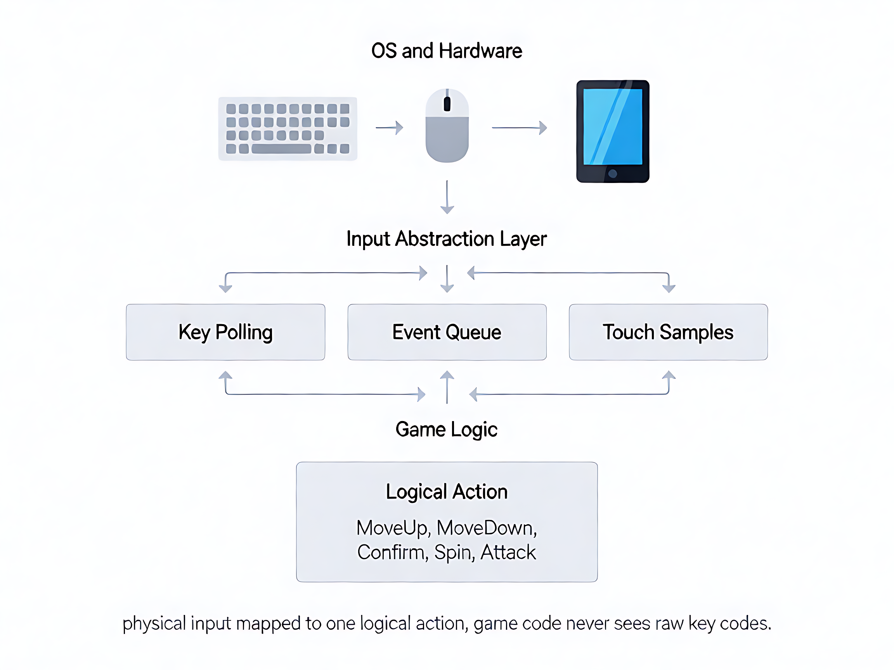

# 第 6 章：输入系统

## 学习目标

- [ ] 理解输入系统要解决的 4 层问题（硬件 → 抽象 → 映射 → 路由）
- [ ] 掌握事件驱动 vs 状态轮询的取舍（"触发一次" vs "持续做"）
- [ ] 理解输入映射层（物理 → 逻辑）的设计（同一个键不同场景不同含义）
- [ ] 理解 Bevy 拾取系统（S29.2）替代旧触摸几何的原理
- [ ] 能识别本项目输入架构中每层的职责

**关键洞察（30 秒版）：**

```
  ① "按着走"用 .held（轮询），"触发一次"用 .just_pressed（事件）
     用错 = 按 3 秒只走 1 格

  ② 事件和轮询是独立通道（读同一张状态表），漏事件不影响轮询

  ③ 引擎给"按着没/这帧按了没"，你给"这个键在你的游戏里是什么意思"
     映射 + 路由 + 决策 = 你自己写的

  ④ 同一个键在不同场景映射不同（空格 = 摇骰/确认/攻击）
     映射在应用层做，行业相同（Unity/Unreal 都是场景级映射）
```

---

## 一、问题：输入系统到底在解什么？

**一句话：把"玩家手上的动作"变成"游戏代码能执行的指令"。**

### 具体场景：玩家在主地图按了空格键

```
  玩家在 PC 上按了空格键，目的是"摇骰前进"。

  但游戏代码收到的不是"玩家想摇骰"
  它收到的是操作系统的一个原始事件：
    "VK_SPACE 键，按下，时间戳 1791234567.123"

  从"按空格"到"摇骰前进"，中间要穿过 4 层：

  ① 硬件捕获
     操作系统（Windows）收到 VK_SPACE 键按下
     → winit（Bevy 的窗口层）捕获到 KeyEvent

  ② 坐标/事件转换
     如果是触摸：物理像素 (540,1400) → 画布坐标 (540,1400)
     如果是键盘：不需要坐标，直接是"哪个键"
     如果是手柄：轴值 0.7 → 归一化 [-1, 1]

  ③ 命中判定（只触摸需要）
     画布坐标 (540,1400) 落在"摇骰 CTA"按钮矩形内吗？
     → Bevy 拾取层回答："是，key=4, index=0"
     → 输出 HitData{key:4, index:0, swipe:0}

  ④ 逻辑映射
     空格键 → GameInput::Spin
     HitData{key:4} → GameInput::Spin
     → 路由到 main_map.on_input(Spin)
     → 执行：摇骰 + 沿赛道前进 N 格
```

**如果跳过第 ③ 步会怎样？**
游戏代码收到触摸坐标 (540,1400)，但它不知道"摇骰按钮在 (540,1400)"
—— 它需要查 scenes.json 才知道摇骰 CTA 的矩形位置。
没有这一步，所有触摸都变成"不知道点了哪"。

**如果跳过第 ④ 步会怎样？**
游戏代码知道"摇骰按钮被点了"，但它不知道"点了摇骰 = 执行 Spin"
—— 它需要映射表。没有这一步，知道点了哪个按钮也白搭。

---

## 二、两个核心设计决策

### 决策 1：事件驱动 vs 状态轮询

**这是输入系统最基础的设计选择，选错会导致手感问题。**

**本节 3 个要点（先记住，下面展开）：**

```
  ① "按着走"必须用 .held（轮询），不能用 .just_pressed（事件）
     用错 = W 按 3 秒只走了 1 格（事件只在按下那 1 帧 true）

  ② 事件和轮询是独立通道，漏事件不影响轮询
     两者读同一张"键状态表"，事件="变了什么"，轮询="现在什么样"

  ③ 引擎给机制（键状态表/事件队列），你给语义（映射+路由+决策）
     你不需要自己实现键盘捕获，直接用 .held()/.just_pressed() 查
```

#### 事件驱动：记录"发生了什么"

```
  想象一个排队系统：
    顾客按铃 → 服务员听到铃 → 记在小本子上 → 处理

  时间轴（每帧 = 1/60 秒）：

  帧 1:  玩家按了空格 → 事件 [Press Space] 入队
  帧 2:  游戏处理队列 → 取出 [Press Space] → 执行摇骰
  帧 3:  玩家松开了空格 → 事件 [Release Space] 入队
  帧 4:  游戏处理队列 → 取出 [Release Space] → 停止

  关键点：按下和松开是两个独立事件
  即使帧 2 处理慢了，事件还在队列里，不会丢
```

**适合**：触发型操作（点按钮、按一次跳、触发技能）
**核心特征**："发生了某事"，有明确的时间点

#### 状态轮询：问"现在是什么样"

```
  想象看表：每 10 秒看一次"现在是几点"
  你不需要"几点几分的时候"，你只关心"现在"

  时间轴（每帧 = 1/60 秒）：

  帧 1:  查一下：W 键按着没？→ 按着 → 角色上移 1 格
  帧 2:  查一下：W 键按着没？→ 按着 → 角色再上移 1 格
  帧 3:  查一下：W 键按着没？→ 没按了 → 角色停下

  关键点：不记录"什么时候按的/什么时候松的"
  只看"当前这一帧，键是不是按着"
```

**适合**：持续型操作（WASD 移动、摇杆转向、按住加速）
**核心特征**："现在是什么状态"，没有时间点

#### 为什么不能只用一种？

**只事件驱动，做不了持续移动：**
```
  玩家按住 W 键 3 秒 = 180 帧
  事件队列：[Press W@0.0s] [Release W@3.0s]
  只有 2 个事件。但你需要 180 帧每帧都移动 1 格。
  事件告诉你"按了"和"松了"，中间 178 帧怎么办？
  → 需要你查"现在 W 按着没"= 轮询
```

**只状态轮询，会漏快速连点：**
```
  玩家快速按两下空格（4ms 内按了又松了）
  帧 1 开头：空格没按 → 帧 2 开头：空格没按（4ms 太短，两次轮询之间就按完了）
  → 两下全漏了 ❌
  → 需要事件记录"按下了"这个瞬间
```

**结论：两者都要。**

#### "长按"到底是怎么实现的？

**常见误解：以为"长按"是一个独立事件。** 不是。
**长按 = "按下"和"松开"之间那段持续按着的时间，不是事件，是状态。**

```
  你按住 W 键 3 秒，实际发生的事：

  t=0.0s   事件：KeyDown(W)    ← 唯一的"按"事件
  t=0~3s   （中间没有任何事件，W 就是一直按着）
           每帧轮询：W 按着没？→ 是 → 上移 1 格（重复 180 帧）
  t=3.0s   事件：KeyUp(W)      ← 唯一的"松"事件

  所以"长按"= KeyDown 和 KeyUp 之间那段"持续按着"
  这段"持续"不是事件，只能靠轮询问"现在按着没"
```

**移动（WASD）= 按下事件 + 每帧轮询 + 松开事件：**

```
  ① 按下瞬间：事件 KeyDown(W) → 记录"W 开始按了"
  ② 每帧（轮询）："W 按着没？" → 是 → 上移 1 格（180 帧重复）
  ③ 松开瞬间：事件 KeyUp(W) → 记录"W 松了"，停止移动
```

**手机"长按 1 秒开菜单"= 按下事件 + 轮询 + 计时器：**

```
  t=0.0s  事件：TouchDown → 开始计时
  每帧：  手指还按着没？（轮询）→ 是 → 计时器 +1
  到达 1s：
    还按着 → 触发"长按"动作（开菜单）
    已松开 → 取消（判定为"短按"）
  t=0.8s  事件：TouchUp → 计时器 < 1s → 短按（点了没按够）
```

**类比**：
- 事件 = 门关上了（一个瞬间，有明确时间点）
- 轮询 = 门现在是开还是关（一个状态，没有时间点）
- 长按 = 门关着的那段时间（不是瞬间，是"按下"到"松开"之间的持续）

#### "按 W 一直走"到底怎么处理？

**不用处理"开始走事件 + 停下事件"。最简单的做法：每帧问"W 按着没"，按着就动，不按就自然停。**

```
  每帧（60 次/秒）：
    if (W 按着) { 上移 1 格 }   ← 就是这一行，没有别的
    else { 不动 }

  帧 1: W 按着？是 → 上移
  帧 2: W 按着？是 → 上移
  ...
  帧 N: W 按着？否（玩家松手了）→ 不动（自然停）

  没有"开始走"事件，没有"停下"事件
  就是每帧问一次，按着就动，不按就不动
```

**事件真正有用的场景 = "按下瞬间要触发一次"（不持续）：**

| 操作 | 用什么 | 为什么 |
|---|---|---|
| 按住 W 持续移动 | **轮询**（每帧查 `held(W)`） | 要"持续"，不关心按下瞬间 |
| 按空格摇骰一次 | **事件**（`just_pressed(Space)`） | 要"瞬间触发一次"，不关心持续 |
| 长按 1 秒开菜单 | **轮询 + 计时器** | 要"持续了多久" |
| 点按钮 | **事件**（HitData） | 触发型操作 |

#### 漏了事件，轮询会启动吗？

**不会互相依赖。事件和轮询读的是同一张"键状态表"，是两条独立通道。**

```
  键盘驱动内部维护一张"键状态表"：
    W = 按着    S = 没按    A = 没按    D = 没按

  事件系统 = 读"这帧状态表变了什么"（增量）
  轮询系统 = 读"这帧状态表现在是什么样"（绝对值）
  两者读同一张表，互不影响
```

**漏了事件，轮询照跑：**

```
  帧 N:   按下 W → 事件入队 → 但帧太忙，没处理（漏了）
  帧 N+1: 轮询"W 按着没？" → 查状态表 → W = 按着 → 上移 ✅
  帧 N+2: 轮询 → W = 按着 → 上移 ✅
  帧 M:   松开 W → 轮询 → W = 没按 → 停

  漏了"开始"事件，轮询自动接上，移动只晚 1 帧
```

**真正会出问题的是：你只用了事件，没用轮询。**

```
  如果代码写成"只在 KeyDown 事件时才开始移动"：
    漏了事件 → 不知道 W 按着 → 不移动 → 玩家觉得卡了 ❌

  如果代码写成"每帧轮询 W 按着没"：
    漏了事件也无所谓 → 下一帧轮询发现 W 按着 → 自动动 ✅

  结论：
    持续操作（移动）→ 只用轮询（天然免疫漏事件）
    一次性触发（摇骰）→ 用事件（漏了等下次按）
    两者独立，不互相依赖
```

#### 事件和轮询是引擎给的还是自己写的？

**引擎免费提供底层机制，你只需要做"映射 + 决策"。**

```
  引擎（Bevy/winit）免费给你的（不用自己实现）：
    ① 键状态表：每帧自动维护，.pressed() / .held() 直接查
    ② 事件队列：winit 捕获 OS 按键，自动入队
    ③ 触摸坐标：Bevy 拾取层自动转成画布坐标

  你自己写的（引擎不帮你做）：
    ④ 映射：空格在"主地图"= 摇骰，在"菜单" = 确认
       （引擎不知道空格在你的游戏里是什么意思）
    ⑤ 路由：当前场景该响应什么动作
       （引擎不知道你现在在哪个场景）
    ⑥ 决策：这个操作该用事件还是轮询
       （摇骰 = 事件；WASD 移动 = 轮询）
```

**代码对照：**

```rust
// 引擎给的（直接查，不用实现）：
let w_held   = input.keyboard_button_input.held(KeyCode::KeyW);       // 轮询
let space_jp = input.keyboard_button_input.just_pressed(KeyCode::Space); // 事件

// 你写的（映射）：
let action = match current_scene {
    SceneKind::MainMap => {
        if space_jp { GameInput::Spin }      // 主地图：空格 = 摇骰
        else if w_held { GameInput::MoveUp } // 主地图：W = 移动
        else { GameInput::None }
    }
    SceneKind::Index => {
        if space_jp { GameInput::Confirm }   // 菜单：空格 = 确认
        else { GameInput::None }
    }
    _ => GameInput::None,
};

// 你写的（路由）：
route_input(action);  // 发给当前场景
```

**总结：引擎给你"按着没/这帧按了没"的原始数据，"这个键在你的游戏里是什么意思"是你自己定义的。**

#### 开发中要选事件还是轮询？每个动作选一次就写死

```
  设计阶段（一次性）：
    "摇骰按钮" → 按下触发一次 → 用 .just_pressed（事件）
    "WASD 移动" → 按着就持续动 → 用 .held（轮询）

  写代码阶段（直接写死）：
    if space.just_pressed() { do_spin() }   ← 永远这样
    if W.held() { move_up() }              ← 永远这样
    不用每帧再想"该用哪个"
```

**Bevy 里两个 API：**

```rust
// 轮询："这个键现在按着没？"
input.keyboard_button_input.held(KeyCode::KeyW)

// 事件："这个键是这帧刚按下的吗？"
input.keyboard_button_input.just_pressed(KeyCode::Space)
```

**按 W 按住 3 秒（180 帧）时：**

```
  just_pressed(W):  帧1=true，帧2~180=false  ← 只有按下那帧
  held(W):          帧1~180 全 true            ← 每帧都是
  just_released(W): 帧181=true                  ← 只有松开那帧

  移动用 .held → 帧1~180每帧都动 ✅
  触发用 .just_pressed → 只有帧1触发一次 ✅
```

**设计时问自己一句话就够：**

| 问题 | 用 | 例子 |
|---|---|---|
| "按下去要触发一次什么" | `.just_pressed` | 摇骰、确认、攻击 |
| "按着要持续做什么" | `.held` | 移动、转向、蓄力 |

**选完写死，不用每帧再想。**

#### 如果用错会怎样？（"按着走"用事件的后果）

```
  假设你错误地用事件做"W 按着走"：

  帧 1: just_pressed(W) = true  → 移动 1 格
  帧 2: just_pressed(W) = false → 不动 ❌
  帧 3: just_pressed(W) = false → 不动 ❌
  ...
  帧180: just_pressed(W) = false → 不动 ❌

  结果：W 按了 3 秒，角色只走了 1 格就停了
  因为事件只在"按下那一刻"是 true，后面 179 帧全 false
```

**这就是"按着走"必须用轮询（.held）的原因：**

```
  正确做法：if W.held() { move_up() }

  帧 1:   held(W) = true  → 移动
  帧 2:   held(W) = true  → 移动
  ...
  帧180:  held(W) = true  → 移动
  帧181:  held(W) = false → 停（松手了）

  W 按 3 秒 = 走了 180 格 ✅
```

**两个 API 的本质区别（一句话）：**

```
  .just_pressed(key) = "这帧新按下了吗？"
    只有按下那 1 帧 = true，其余全 false
    → 适合"触发一次"（摇骰、攻击、确认）

  .held(key)         = "现在按着吗？"
    按着的那 N 帧全 = true
    → 适合"持续做"（移动、转向、蓄力）
```

**用错 = 行为不符合预期。选对 = 一行代码就对了。**

#### 本项目的选择

```
  键盘：事件（触发型为主）
    空格 = 摇骰（触发一次前进）
    方向键 = 菜单上下（触发一次移动）
    W/A/S/D 持续移动 → 用轮询（.held()）

  触摸：事件（Bevy 拾取层）
    点按钮 = 触发命中事件 → HitData
    滑动 = 方向事件 → HitData.swipe

  手柄：轮询（轴值是连续的）
    每帧读摇杆位置 → 角色转向
```

---

### 决策 2：映射在哪一层做

**问题：物理按键（W）和逻辑动作（MoveUp）之间的"翻译"放在哪？**

**本节要点：**
- 映射在**应用层**做（方案 B），不是引擎统一配置
- 原因：同一个键在不同场景含义不同（空格 = 摇骰/确认/攻击）
- 行业同样做法（Unity Input Action Map / Unreal Input Context 层级化）

```
  方案 A：翻译在引擎层（统一配置）
    引擎知道 W = MoveUp，游戏代码直接 on_input(MoveUp)
    优点：游戏代码干净
    缺点：改映射要改引擎配置

  方案 B：翻译在应用层（本项目用的）
    引擎只给"哪个键按了"，应用层做映射
    优点：不同场景可以用不同映射（空格在主地图=摇骰，在菜单=确认）
    缺点：映射代码分散

  方案 C：让玩家自定义（游戏内改键）
    读/写映射配置文件
    优点：玩家自由
    缺点：需要 UI 配键界面 + 持久化
```

**本项目用方案 B**：
```
  同一个空格键，在不同场景映射到不同逻辑动作：
    主地图：空格 → Spin（摇骰）
    菜单：空格 → Confirm（确认）
    战斗：空格 → Attack（攻击）

  映射在 ti-engine 的 input_system 里，
  根据"当前场景"查不同的映射表。
```

**行业怎么做的**：
```
  Unity Input System：
    可以配多个 Input Action Map，运行时切换
    例：战斗场景用 CombatMap，菜单用 MenuMap
    和方案 B 思路一样，但配置化（JSON 文件，不用改代码）

  Unreal Enhanced Input：
    Input Context 层级化（全局 + 场景级）
    切换场景时自动挂/卸对应 Context
    效果一样：不同场景不同映射

  Godot：
    InputMap 全局一份，所有场景共用
    缺点：场景切换不能改映射（要做的话自己写代码）
```

---

## 三、触摸与拾取（S29.2 更新）

### 旧方案（已废弃）：手写几何逆解

```
  旧流程（S29.2 之前）：
    触摸坐标 → 逆等距投影 → 格坐标 → 查哪个元素 → 命中

  问题：
    每加一个场景就要手写一套逆解代码
    坐标转换散落在各场景 on_touch 里
    无法 headless 测试（需要真实触摸事件）
```

### 新方案（S29.2）：Bevy 拾取层

```
  新流程（现行）：
    触摸坐标 → Bevy Picking 系统 → 拾取命中 → HitData → route_hit → 场景 on_hit

  HitData {
    key: u32,      // 被点元素的类型键（0 = 空白）
    index: i32,    // 被点元素的下标（-1 = 无）
    swipe: u8,     // 滑动方向（0=点按 1=上 2=下 3=左 4=右）
  }

  优点：
    · 命中判定归 Bevy 引擎（不用手写几何）
    · 逻辑层只消费归一 HitData（headless 可测）
    · 新场景加元素 = 在 scenes.json 里加 pick_key/pick_index（不改 Rust）
```

**核心思想：把"你在哪"（几何）和"你点了什么"（语义）分开。**
Bevy 拾取层负责"在哪"，HitData 的 key/index 负责"什么"。

---

## 四、项目对照（逐层）

### 第 1 层：平台输入抽象

```
crates/ti-platform/src/backend.rs:86  — Input trait
  方法：poll_touch() / poll_keys() / poll_gamepad()
  各平台实现：winit 键盘 + Bevy 拾取触摸（ti-engine 内做）
```

### 第 2 层：逻辑动作枚举

```
crates/ti-app/src/game_app/mod.rs:108  — GameInput（18 个变体）
crates/ti-app/src/game_app/mod.rs:158  — HitData（S29.2）
```

### 第 3 层：路由分发

```
crates/ti-app/src/scenes/mod.rs:696  — route_input(GameInput) → 场景 on_input
crates/ti-app/src/scenes/mod.rs:715  — route_hit(HitData)   → 场景 on_hit
```

### 第 4 层：场景处理

```
crates/ti-app/src/scenes/*.rs  — 每个场景的 on_input / on_hit
  main_map：Spin（摇骰）/ TradeBuy / TradeSell / Build / BoatUpgrade
  index：   Confirm（菜单项）/ Back（退出）
  vs：      Attack（战斗）
  saveload：LoadSave / WriteSave
  message：MsgNext / MsgPrev / MsgClose
```

### 手势追踪

```
crates/ti-platform/src/settings.rs:92   — Gesture 枚举（Tap/Swipe/Drag）
crates/ti-platform/src/settings.rs:109  — GestureTracker（触摸样本 → 手势）
```

### 虚拟按键（移动端）

```
crates/ti-platform/src/input.rs:11  — VirtualButton
crates/ti-platform/src/settings.rs   — VirtualKeyPad
```

移动端没有物理键盘，用屏幕上的虚拟按键覆盖层模拟。



---

## 五、完整数据流图

```
  ┌─ 硬件 ──────────────────────────────────────────────────────────────┐
  │  键盘 → winit KeyPressed      触摸 → Bevy 拾取层    手柄 → gilrs   │
  └─────────────────────────────────────────────────────────────────────┘
        │                              │                          │
        ▼                              ▼                          ▼
  ┌─ 平台抽象（ti-platform）──────────────────────────────────────────┐
  │  Input trait                                                       │
  │    poll_keys() → 当前按住的键                                      │
  │    poll_touch() → 当前触摸样本（旧）/ 走 Bevy 拾取（新）           │
  │    poll_gamepad() → 手柄轴/按钮                                    │
  └────────────────────────────────────────────────────────────────────┘
        │                              │
        │                              ▼
        │                   ┌─────────────────────────────────┐
        │                   │  Bevy 拾取层（ti-engine/pick.rs）│
        │                   │  坐标 → 命中元素 → HitData      │
        │                   │  { key, index, swipe }           │
        │                   └──────────────┬──────────────────┘
        ▼                                   │
  ┌─ 逻辑映射（ti-engine input_system）────────────┐
  │  Key 事件 → GameInput 枚举                     │
  │  例：空格 → Confirm，W → MoveUp，骰子按钮 → Spin │
  └──────────────────────┬──────────────────────────┘
                         │
                         ▼
  ┌─ 路由分发（ti-app scenes/mod.rs）──────────────────────────────┐
  │  route_input(GameInput) → 当前场景 on_input                    │
  │  route_hit(HitData)    → 当前场景 on_hit（S29.2）              │
  └──────────────────────┬────────────────────────────────────────┘
                         │
                         ▼
  ┌─ 场景处理（ti-app scenes/*.rs）───────────────────────────────┐
  │  main_map.on_input(Spin) → host.advance(Spin) → 摇骰前进      │
  │  main_map.on_hit(HitData{key=4,index=0}) → 点摇骰 CTA        │
  │  index.on_input(Confirm) → 进入 SelectRole                     │
  └────────────────────────────────────────────────────────────────┘
```

---

## 六、为什么 Bevy 引擎本身不够用

**常见疑问：Bevy 有内置 Input 系统，为什么还要自己写 Input trait？**

```
  Bevy 内置 Input（ButtonInput<Key/Mouse>）：
    · 只有查询接口（.pressed() / .held()）
    · 没有"逻辑动作映射"（它不知道 W = MoveUp）
    · 没有"跨场景路由"（它不知道当前场景该响应什么）

  本项目需要的（Bevy 不提供）：
    · GameInput 枚举（统一语义，跨场景通用）
    · route_input / route_hit（按当前场景分发）
    · 键盘 → GameInput 的映射（场景特定，如主地图空格=摇骰不是确认）

  所以 Input trait = 在 Bevy Input 之上加一层"语义映射 + 路由"
```

---

## 七、实践练习

**练习 1：追踪一次摇骰点击的完整路径**

从"玩家点了摇骰按钮"到"角色前进 N 格"，列出经过的所有函数（用第 6 节的数据流图）。

**练习 2：新增"按 F1 打开帮助"**

需要改哪些文件？（提示：`GameInput` 加 `Help` 变体 → `index.on_input` 加分支 → `ti-engine` 加 F1 映射）

**练习 3：HitData 的 key/index 含义**

打开 `scenes/mod.rs:715` `route_hit`，找出：
- `key` 对应 scenes.json 里的哪个字段？（`pick_key`）
- `index` 对应什么？（列表型元素的第几项）
- 为什么用 `u32`/`i32` 而不是枚举？（opaque，跨场景统一）

**练习 4：事件 vs 轮询选择**

以下操作分别用事件还是轮询？说明理由：
- 按"确认"键选菜单项
- 按住 W 持续向上移动
- 快速连按空格跳 3 下
- 摇杆控制角色转向

## 常见坑

| 坑 | 原因 | 避免 |
|---|---|---|
| 快速按键丢失 | 轮询间隔太长 | 事件驱动 + 输入缓冲队列 |
| 触摸坐标没转换 | 物理像素直接当画布坐标 | Bevy 拾取层已自动转（S29.2） |
| 输入阻塞渲染 | 在渲染循环里等输入 | 输入收集与渲染分离（每帧开头 poll） |
| 多设备输入冲突 | 键盘+手柄同时操作 | 优先级（最近输入优先 / 指定主设备） |
| 场景切换后输入残留 | 旧场景的 on_touch 还在响应 | 场景切换时清空输入队列 |
| 手写几何逆解（旧方式） | 新场景要重写逆解代码 | 用 Bevy 拾取层 + HitData（S29.2） |

## 学习记录

- 状态：已完成
- 完成日期：2026-10-28
- 心得/疑问：

### 讨论经验（本会话沉淀）

**Q1：W 用事件了，只按一下时动起来了，后面每帧没有事件，是不是第二帧就不走了？**
A：是。`.just_pressed` 只在按下那 1 帧 = true，后面全 false。
"按着走"的业务要"所有帧都 true"，必须用 `.held`。
用错 = W 按 3 秒只走了 1 格。

**Q2：事件驱动在前，轮询在后，如果事件漏了，轮询会不会不启动？**
A：不会。事件和轮询是独立的两条通道，读同一张键状态表。
事件 = "变了什么"（增量），轮询 = "现在什么样"（绝对值）。
漏了 KeyDown(W) 事件，下一帧 `.held(W)` 仍然 = true，自动接上。
真正会卡的是"只用事件不用轮询"→ 漏了就不动。

**Q3：事件和轮询是引擎给的还是自己实现的？**
A：引擎（winit/Bevy）免费提供键状态表 + 事件队列 + 坐标转换。
你自己写的是：映射（空格=摇骰）、路由（发给哪个场景）、决策（事件还是轮询）。
`input.keyboard_button_input.held(key)` 直接查，不用自己实现。

**Q4：同一个键不同场景映射不同，怎么做的？**
A：映射在应用层（ti-engine input_system），根据"当前场景"查不同映射表。
空格在主地图 = Spin，在菜单 = Confirm，在战斗 = Attack。
行业做法相同（Unity Input Action Map / Unreal Input Context 层级化）。

**Q5：碰撞检测不就是两个形状的距离 < 0？**
A：对。这就是最核心的直觉。AABB = 4 个边坐标比一下（4 次比较），
圆 = 距离² < 半径和²（1 次），网格 = 查表值是否为 0（1 次索引）。
不需要"神神道道"，就是比坐标值。
