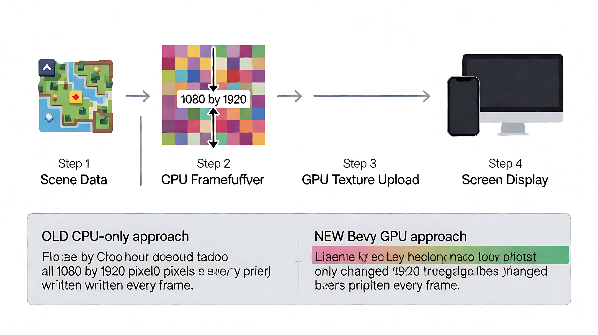

# 第 7 章：渲染基础

## 学习目标

- [ ] 理解帧缓冲（Framebuffer）的概念和大小
- [ ] 掌握基本图元绘制（矩形/文字/精灵）
- [ ] 理解 Z-order（绘制顺序）和裁剪
- [ ] 理解脏行带优化（只传变化区域）
- [ ] 理解 Bevy GPU 渲染路径（S18.8a 起）
- [ ] 能识别本项目渲染架构中每层的职责

**关键洞察（30 秒版）：**

```
  ① 帧缓冲 = 一张 1080×1920 的像素网格（16 位色，~4MB）
     画完整张贴到屏幕（旧 CPU 路径）或交给 GPU 画（新 Bevy 路径）

  ② 渲染顺序 = 先画背景，后画前景（后画的压前面的）
     本项目的 Z-order = 函数调用顺序（无枚举，越靠后越上面）

  ③ 裁剪 = 视野外的不画（省 40% 计算）
  ④ 脏行带 = 只有变化了的行才上传到 GPU（省 99% 传输）

  ⑤ S18.8a 起：渲染引擎 = Bevy GPU（wgpu），不再是 CPU 逐像素写
     CPU 帧缓冲降为"测试/快照后端"，生产路径走 Bevy
```

---

## 一、帧缓冲（Framebuffer）

**生活类比：画家的画布。** 画完整张再贴到屏幕上。

```
  画布 = 1080 x 1920 的像素网格（不是 176x220！那是 legacy 旧坐标）
  每个像素 = RGB565（16 位色，2 字节）
  总大小 = 1080 x 1920 x 2 = 4,147,200 字节（约 4 MB）

  画完 → 整张贴到屏幕（旧 CPU 路径）
       → 或交给 Bevy GPU 画（新 S18.8a 路径）
```

**为什么是 1080×1920 不是 176×220？**

```
  176×220 = 原版手机游戏的分辨率（macroquad 时代）
  S18 迁移到 Bevy 后，逻辑坐标系改为 1080×1920
  176×220 是 legacy 坐标，运行时禁止出现（doccheck2 grep 门禁）
  画布单一事实源 = crates/ti-render/src/framebuffer.rs:
    CANVAS_W = 1080
    CANVAS_H = 1920
```

**帧缓冲在哪**：

```
crates/ti-render/src/framebuffer.rs:7  — CANVAS_W = 1080
crates/ti-render/src/framebuffer.rs:9  — CANVAS_H = 1920
crates/ti-render/src/framebuffer.rs:21 — Framebuf（RGB565 固定大小缓冲）
```

### 画布是逻辑坐标，不是物理屏幕

**不同设备屏幕大小不一样，游戏怎么适配？**

```
  物理屏幕（每个设备不同）：
    手机 = 1080×2400
    平板 = 1536×2048
    桌面 = 1920×1080（横）

  逻辑画布（固定，所有设备一样）：
    1080×1920（竖屏）

  游戏逻辑只认识 1080×1920
  渲染器负责把 1080×1920 缩放到实际屏幕（letterbox）
    手机 1080×2400 → 缩放 1.0×（宽度刚好）+ 上下黑边
    桌面 1920×1080 → 缩放 0.75× + 左右黑边
```

**为什么这么做？**

```
  如果游戏直接写物理屏幕坐标：
    "按钮在 (1920, 50)" → 手机只有 1080 宽，按钮在哪？❌

  游戏写逻辑画布坐标：
    "按钮在 (900, 100)" → 任何屏幕都能渲染（缩放适配）✅
```

**换算链**：

```
  游戏逻辑 → 1080 画布（左上原点，y 向下）
           → Bevy 世界（中心原点，y 向上）
             world_x = canvas_x − 540
             world_y = 960 − canvas_y
           → GPU 渲染
           → 物理屏幕（letterbox 缩放 = min(screen_w/1080, screen_h/1920)）
```

**一句话：画布 = "虚拟屏幕"（固定 1080×1920），每个设备通过缩放适配。游戏逻辑不关心实际屏幕多大。**

### 为什么是 1080？

```
  1080 = 现代手机的标准宽度（1080p HD）
    · 1080×1920 竖屏 = 很多 Android 手机的实际分辨率
    · 1920×1080 横屏 = 桌面显示器标准
    · 选 1080 = 游戏在手机上 1:1 显示，不糊不放大

  为什么不选 720？→ 太糊（老手机分辨率）
  为什么不选 1440？→ 太大（老设备跑不动）
  为什么不选 1024（2 的幂）？→ 现代 GPU 没惩罚，1080 更通用（行业标准）

  本项目历史：
    原版 = 176×220（2005 年手机，macroquad 时代）
    S18 迁移 Bevy = 1080×1920（现代手机/桌面通用）
```

---

## 二、基本图元

**"图元"（Primitive）= 渲染器能"直接画"的最小单元。就像乐高积木块。**

```
  你不能"画一只猫"（GPU 不认识"猫"）
  GPU 只会画"三角形"（3 个顶点组成一个面）
  所有画面 = 三角形的组合
```

### GPU 层 vs API 层（两个层次，别搞混）

**GPU 底层唯一图元 = 三角形。我们的 API 把三角形抽象成高级操作。**

```
  GPU 层（wgpu/OpenGL 底层）：
    唯一图元 = 三角形（3 个顶点）
    一切 = 三角形（矩形 = 2 个三角形，文字 = N 个三角形）

  API 层（我们的 Canvas trait，ti-render/src/canvas.rs）：
    fill_rect(x, y, w, h, color)  → 底层 = 2 个三角形（一个四边形）
    blit_image(asset, x, y, w, h) → 底层 = 2 个三角形（一个四边形 + 贴图）
    draw_text(x, y, text)          → 底层 = N 个三角形（每个字形 = 1 个四边形 = 2 个三角形）

  你写代码时只用 API 层（fill_rect / blit_image / draw_text）
  不用手写"画一个三角形"（GPU 层的事，Bevy 自动帮你拆）
```

**类比：印刷厂**

```
  GPU = 印刷机（只会印"色块"= 三角形）
  API = 排版软件（你选"按钮/文字/图片"，排版软件自动拆成三角形）
  你不用自己"切三角形"，排版软件帮你切

  矩形按钮 → 排版软件切成 2 个三角形 → 印刷机印
  文字     → 排版软件切成 N 个四边形（每字 1 个）→ 印刷机印
  贴图     → 排版软件切成 2 个三角形 + 贴图 → 印刷机印
```

| 层级 | 图元 | 说明 |
|---|---|---|
| GPU 层 | 三角形 | 唯一底层图元，GPU 只会画这个 |
| API 层 | fill_rect / blit_image / draw_text | 3 个高级操作，底层都是三角形 |
| 游戏层 | 按钮/角色/地形/棋盘格 | 用 API 层的 3 个操作组合出来 |

**为什么 Bevy 不需要你手写三角形？**

```
  本项目的 Bevy 实现（ti-engine/src/scene_render.rs）：
    fill_rect  → Sprite::from_color（Bevy 自动建 2 个三角形）
    blit_image → Sprite（贴图）（Bevy 自动建 2 个三角形 + 纹理）
    draw_text  → Text2d（Bevy 自动建字形四边形 = 每字 2 个三角形）

  你只管说"画什么"，Bevy 管"怎么拆成三角形"
  手写三角形 = 3D 游戏/自定义网格的场景（我们不是）
```

**注意**：API 层没有"画一个圆形"或"画一条线"的原语——所有形状都是矩形 + 文字 + 贴图的组合。
这是有意为之（S15 渲染线裁决：运行时零 legacy 像素，画面 100% 由代码绘制产出）。

---

## 三、Z-order（绘制顺序）

**核心：后画的压先画的。** 就像贴贴纸，后贴的盖住先贴的。

```
  画错（先人物后背景）：            画对（先背景后人物）：
    ① 画人物                       ① 画背景
    ② 画背景（盖住人物）❌          ② 画人物（盖在背景上）✅
```

**本项目的 Z-order = 函数调用顺序（无枚举）**：

```
  chrome.rs::scene_shell 的调用序（从底到顶）：

  ① parchment_bg（背景/画布）
  ② 外框/标题条
  ③ 面板/棋盘格
  ④ 角色/物体/地形
  ⑤ UI 控件（按钮/血条）
  ⑥ 文本（永远最上层）

  代码里就是按这个顺序调用 fill_rect / blit_image
  没有 z_index 字段，没有 z-order 枚举
  "谁先画" = "谁在代码里先被调用"
```

**为什么不用 z_index 枚举？**

```
  因为本项目的层是固定的（场景结构不变）
  层序在 chrome.rs 的调用序里硬编码
  加新层 = 在调用序里插一行（不用改枚举）
  Bevy 路径有 z_index（EXP-103：Bevy 0.20 z 层用负值 + 升序绘制）
```

### 透明（Alpha）：后画的不一定"盖住"

**生活类比：彩色玻璃。** 后贴的不是"白板"（盖住一切），而是"玻璃"（后面透出来）。

```
  贴图 = RGBA8（每像素 4 字节）：
    R + G + B = 颜色
    A（alpha）= 透明度
      0   = 完全透明（后面的直接露出来）
      128 = 半透明（和背景混合）
      255 = 完全不透明（盖住后面）

  画一张"角色贴图"（背景是透明的）：
    角色像素：A = 255（不透明，盖住背景）
    背景像素：A = 0（完全透明，让背景露出来）

  结果：角色"浮"在背景上面，不是"方块盖住"
```

**绘制顺序 + 透明 = 混合（blending）**：

```
  第 ① 层（背景）：不透明（A=255）
  第 ② 层（角色）：角色不透明，背景透明（A=0）
     → 角色像素盖住背景，角色透明的地方背景露出来
  第 ③ 层（UI 面板）：半透明（A=128）
     → 面板和背景混合（50% 面板 + 50% 背景）

  公式（alpha 混合）：
    最终色 = 前景色 × A/255 + 背景色 × (1 − A/255)
```

**类比**：

```
  不透明（A=255）= 白板（盖住后面一切）
  半透明（A=128）= 彩色玻璃（看到后面但带颜色）
  完全透明（A=0） = 玻璃（看不到自己，只看到后面）
```

**本项目的透明**：

```
crates/ti-render/src/image.rs — RGBA8 位图（A 通道 = 透明度）
blit_image 自动按 alpha 混合（不需要手动处理）
背景图/角色图/地形图都有透明区域（抠掉的 = A=0）
```

---

## 四、裁剪（Clipping）

**视野外的不画。**

```
  世界地图 g×g 格（如 20×20 = 400 格）
  视野只装下其中一小块（约 10×8 = 80 格）

  不裁剪：400 格全算 → 白算 80%
  裁剪：  只算可见 80 格 → 省 80% 计算

  具体做法：绘制精灵前，检查目标矩形是否与视野矩形相交
    相交 → 画
    不相交 → 整个跳过（连循环都不进）
```

**本项目的裁剪**：

```
crates/ti-app/src/scenes/main_map.rs — 按 board_fit 计算可见格范围
docs/process/07_render_pipeline.md   — "越界求交裁剪"契约
```

> 注意：裁剪的是"格子"（逻辑单位），不是"像素"（物理单位）。
> 先算哪些格可见，再只画那些格。

---

## 五、脏行带优化（Dirty Rectangle）

**生活类比：只擦变化的作业页。** 100 行作业改了 2 行，不用全擦重写。

```
  帧缓冲 = 1920 行，每行 1080 个像素

  全量上传：每帧传 1920 行 × 1080 × 2 字节 = ~4 MB
  脏行带：  只有变化了的行才传

  帧 1：画面全变（场景切换）→ 全量上传 1920 行
  帧 2：只有光标移动 → 只传第 98 行附近 = 2~3 行
  帧 3：什么都没变 → 不传任何行

  回合制游戏大部分帧"什么都没变" → 省 99% 传输量
```

**本项目的脏行带**：

```
crates/ti-platform/src/gfx.rs:136  — dirty_rows: [bool; 1920]
  每行一个标记，true = 这行改了
  present 时只把 true 的行上传到 GPU 纹理
```

### 谁知道哪些行变了？（软件记账，不是硬件）

**不是 GPU，不是硬件，是我们自己的代码"顺便"标记的。**

```
  流程：
    ① fill_rect(x, y, w, h, color)
       → 写像素到 CPU 帧缓冲
       → 同时调 mark_dirty(x, y, w, h)
       → mark_dirty：for row in y..y+h { dirty_rows[row] = true }

    ② present()（每帧结束）
       → 遍历 dirty_rows
       → 只把 true 的行上传到 GPU 纹理
       → 上传完全部 reset 为 false

  关键：写像素的代码"顺便"告诉系统"我改了这几行"
       没有黑魔法，就是你写的时候自己记账
```

**类比：厨房记账**

```
  帧缓冲 = 一张大桌布（1920 条横纹）
  dirty_rows = 一个小本子（1920 个格子）

  你往桌布第 98 条横纹上倒了酱油：
    ① 倒酱油（写像素）
    ② 在本子第 98 格打勾（mark_dirty）

  清洗员（present）来看：
    只看本子 → 只洗打勾的那几行 → 洗完全擦掉勾
    不用整张桌布洗一遍
```

**没有 GPU 呢？**

```
  嵌入式/老设备（无 GPU）：
    帧缓冲 = 直接接 LCD 控制器（LCD 直读内存）
    不需要"上传 GPU"，但 LCD 总线（SPI/I2C）有带宽限制
    脏行带仍然有用：只通过总线传变化的行 → 省传输时间

  本项目 S18.8a 之后：
    生产路径 = Bevy GPU（wgpu）
    Bevy 内部自己做 diff（不手动标 dirty_rows）
    CPU 帧缓冲 + 脏行带 = 降级为测试/快照后端
```

**一句话：脏行带 = 软件记账（谁改了哪行，自己记），不是硬件自动追踪。**

> S18.8a 起，生产路径走 Bevy GPU（wgpu），CPU 帧缓冲降为"测试/快照后端"。
> 脏行带优化在 CPU 后端仍有价值（离屏截图/渲染测试），GPU 路径由 wgpu 驱动。

---

## 六、Bevy 渲染路径（S18.8a 起）

**本项目渲染引擎 = Bevy 0.20（GPU，wgpu），不是 CPU 逐像素写。**

```
  旧路径（macroquad 时代）：
    CPU 逐像素写帧缓冲（1080×1920 × 2 字节 = 4MB 每帧）
    → 单纹理 blit 到屏幕
    → CPU-bound，无 GPU 加速

  新路径（S18.8a 起，现行）：
    Bevy 2D（wgpu）：
      矩形 → Mesh2D（GPU 立即绘制）
      文字 → Text2d（GPU 图集）
      贴图 → Sprite（GPU 纹理）
      相机 → Camera2d + OrthographicProjection（letterbox）
    → GPU-driven，空闲成本≈0
```

**架构形状（`ti-engine` crate）**：

```
crates/ti-engine/src/scene_render.rs  — BevyCanvas（Canvas trait 的 Bevy 实现）
crates/ti-engine/src/bin/treasure_bevy.rs — 主循环 + 相机 + 输入
crates/ti-render/src/canvas.rs        — Canvas trait（后端无关原语）
```

**CPU 帧缓冲的角色**：

```
  保留用途：
    · 离屏截图（render_invariants 测试）
    · 渲染快照门禁（bevy-cpu-parity：GPU 读回 vs CPU 期望逐像素对照）
    · 非 GPU 平台的回退路径

  不再是"生产渲染路径"（生产 = Bevy GPU）
```

**坐标换算（1080 逻辑 → Bevy 世界）**：

```
  Bevy 2D 世界：原点在画布中心（540, 960），y 向上
  1080 逻辑：原点在画布左上（0, 0），y 向下

  换算（唯一口径，scene_render.rs::to_world）：
    world_x = logical_x − 540
    world_y = 960 − logical_y
```



---

## 七、图片怎么画到屏幕上？（纹理映射 + GPU 管线）

### 图片不用"转换成图元"

**误解：PNG 图片 → 要变成三角形/矩形才能给 GPU？**

**实际：PNG → 解码成像素数组 → 上传 GPU 显存（叫"纹理"）→ GPU 采样画上去。**

```
  完整流程：
    ① PNG 文件（磁盘）
    ② CPU 解码 → RGBA8 像素数组（宽×高×4 字节）
    ③ 上传 GPU 显存 → 叫"纹理"（texture）
    ④ 你告诉 GPU："在 (100,200) 画一张 64×64 的纹理"
    ⑤ GPU 画一个 64×64 的矩形，每个像素从纹理取颜色

  关键：GPU 不需要"把猫变成三角形"
    你画的是一个"矩形"（4 个角）+ 一张"纹理"（猫图案）
    GPU 把矩形覆盖到的每个像素，从纹理里取对应颜色
    这叫"纹理映射"（texture mapping）
```

**类比：壁纸贴墙**

```
  纹理 = 一张壁纸（猫图案）
  矩形 = 墙上要贴壁纸的那块区域
  GPU = 把壁纸贴到那面墙上
    · 不是"把猫变成方块"
    · 是"把猫图案贴到指定位置"
```

### GPU 内部 4 步（每帧）

**顶点着色器 = "角在哪"，片元着色器 = "像素什么色"。**

```
  ① 顶点着色器（Vertex Shader）= 算"角在哪"
     输入：矩形的 4 个角的坐标（逻辑坐标）
     输出：4 个角在屏幕上的坐标（经过相机变换）
     做的事：纯数学变换（乘矩阵），不涉及颜色
     每帧只跑 4 次（4 个角）

  ② 光栅化（Rasterization）
     "这个矩形覆盖了哪些像素？"
     把"数学矩形"变成"具体像素格子"
     GPU 硬件自动做（不需要 shader）

  ③ 片元着色器（Fragment Shader）= 算"像素什么色"
     输入：一个像素 + 它在纹理里的位置（UV 坐标）
     输出：这个像素的 RGBA 颜色
     做的事：从纹理采样 + alpha 混合 → 输出颜色
     每个被覆盖的像素跑 1 次（64×64 的图 = 4096 次）

  ④ 混合（Blending）
     "新颜色和旧颜色怎么合？"
     公式：最终 = 前景 × A + 背景 × (1−A)
     GPU 硬件自动做
```

**"贴壁纸"类比（更直观）**：

```
  顶点着色器 = 量墙（"壁纸的 4 个角贴墙上哪个位置？"）
    → 只算 4 个角的位置，不关心壁纸图案

  光栅化     = 铺墙（"这面墙有哪些格子被壁纸盖住？"）
    → 硬件自动做，不需要 shader

  片元着色器 = 贴壁纸（"每个格子上该是什么颜色？"）
    → 从壁纸图案（纹理）里取对应位置的颜色
    → 每个格子（像素）单独取一次
```

**数量级区别（为什么必须用 GPU）**：

```
  画一张 64×64 的猫：
    顶点着色器：跑 4 次（4 个角）→ 极快
    片元着色器：跑 4096 次（64×64 个像素）→ 慢但并行
      GPU 有几千个核心同时算 → 所以还是快
      CPU 逐像素算 → 这就是为什么"必须用 GPU"
```

**一句话**：先定位置（顶点，4 次），再填颜色（片元，N 次）。两者分工明确。

### 顶点坐标是谁算的？（加载时 vs 每帧）

**关键区分：顶点坐标只在加载时算 1 次（CPU），每帧只是"变换"（GPU），不是重新算。**

```
  加载时（CPU，1 次）：
    把"形状"变成"顶点坐标列表"
    2D 矩形 → 4 个角：(x, y), (x+w, y), (x+w, y+h), (x, y+h)
    3D 模型 → 几百/几千个顶点（从模型文件读出来的）
    这些坐标上传到 GPU 显存（叫"顶点缓冲"）

  每帧（GPU）：
    顶点着色器拿这些顶点，算"在屏幕上画在哪"
    不创建新顶点，只是变换已有顶点的位置（乘矩阵）
```

**类比：做蛋糕**

```
  加载时 = 备料（面粉、鸡蛋、糖 → 面团），只备 1 次
  每帧   = 烤（面团 → 烤箱 → 蛋糕），每次只是"加热变形"
  顶点着色器 = 烤箱，顶点 = 面团
```

### 2D 矩形怎么变成顶点？（4 个角 → 2 个三角形）

```
  你告诉 Bevy："在 (100, 200) 画一张 64×64 的贴图"
  Bevy 自动算 4 个角（你不用手写顶点坐标）：
    角 0 = (100, 200)  左上
    角 1 = (164, 200)  右上
    角 2 = (164, 264)  右下
    角 3 = (100, 264)  左下

  拆成 2 个三角形（GPU 只会画三角形，不会画四边形）：
    三角形 A = 角 0, 角 1, 角 2
    三角形 B = 角 2, 角 3, 角 0

  每个角还带 UV 坐标（"这个角对应纹理的哪个位置"）：
    角 0 → UV (0,0) = 纹理左上
    角 1 → UV (1,0) = 纹理右上
    角 2 → UV (1,1) = 纹理右下
    角 3 → UV (0,1) = 纹理左下
```

**3D 模型怎么变成顶点？**

```
  3D 模型文件（FBX/GLTF）里已经存好了：
    顶点列表：(x, y, z) × N 个
    法线列表：(nx, ny, nz) × N 个（光照方向）
    UV 列表：  (u, v) × N 个（纹理坐标）
    索引列表：  哪些顶点组成一个三角形（1,2,3 → 4,5,6...）

  加载时（1 次）：CPU 读文件 → 解析出顶点数组 → 上传 GPU 显存
  每帧：顶点着色器对每个顶点做 模型矩阵 × 视角矩阵 × 投影矩阵
    → 3D 坐标变成 2D 屏幕坐标 → 画三角形 → 填颜色
```

**完整数据流（谁算什么）**：

```
  ① 加载时（CPU，1 次）：
     形状 → 顶点坐标 + UV + 法线 → 上传 GPU 显存
     2D 贴图：Bevy 自动算 4 个角（你只说 position + size）
     3D 模型：从文件读（文件里已有顶点，不"生成"）

  ② 每帧（GPU）：
     顶点着色器：顶点坐标 + 相机矩阵 → 屏幕坐标（"画在哪"）
     光栅化（硬件）：屏幕坐标 → "覆盖了哪些像素"
     片元着色器：UV → 纹理取色（"什么色"）
     混合：新色 + 旧色 → 最终屏幕颜色
```

### 光栅化和片元着色器"看起来一样"是怎么回事？

**在简单 2D 贴图里，它们视觉上确实很像。但概念不同：**

```
  光栅化 = "哪些像素被三角形盖住了？"（只给位置，不给颜色）
  片元着色器 = "每个被盖住的像素，颜色是什么？"（位置 + 颜色）

  简单 2D（我们的游戏）：
    光栅化："这 4096 个像素被盖住了"
    片元："每个像素从纹理取个色"（就是查表，没别的计算）
    → 看起来一样（都是"像素亮了"）

  复杂 3D（带光照）：
    光栅化："这 10 万个像素被盖住了"
    片元："每个像素要算：法线×光源方向×纹理×阴影..."
    → 看起来完全不一样（有明暗/阴影/高光）
```

**一句话：光栅化 = 圈出像素（"哪些格子要填"），片元 = 给每个格子填颜色（"填什么色"）。简单 2D 里"圈"和"填"视觉上一样，3D 里"填"要算光照就完全不同了。**

[视频：贴壁纸类比——顶点着色器量角 → 光栅化铺格 → 片元着色器填色](../../evidence/tutorial/07_wallpaper_cat.mp4)

### 需要自己写 shader 吗？

```
  本项目：不需要。
    Bevy 内置 2D 游戏 shader：
      Sprite（贴图）→ 内置采样 shader
      Mesh2D（矩形）→ 内置纯色 shader
      Text2d（文字）→ 内置字形 atlas shader
    你只管说"画什么"，Bevy 管"怎么画"

  什么时候需要自己写 shader？
    · 特殊效果（泛光/溶解/波浪扭曲）→ 本项目没有（2D 游戏）

  行业对比：
    Unity：Shader Graph（拖节点）
    Unreal：HLSL（手写）
    Bevy：render pipeline API（高级用户可写）
    本项目：全部内置，不写
```

**类比：做菜**

```
  顶点着色器 = 切食材（矩形 4 角 → 屏幕位置）
  光栅化     = 铺盘子（哪些像素被覆盖）
  片元着色器 = 调味（从纹理取颜色 + alpha 混合）
  混合       = 摆盘（前景 + 背景合成）
  本项目 = 用预制菜（Bevy 内置 shader），不自己写菜谱
```

---

## 八、项目对照

| 概念 | 文件 | 行号 |
|---|---|---|
| 帧缓冲常量 | `ti-render/src/framebuffer.rs` | L7 CANVAS_W=1080, L9 CANVAS_H=1920 |
| 帧缓冲体 | `ti-render/src/framebuffer.rs` | L21 Framebuf（RGB565） |
| 脏行带 | `ti-platform/src/gfx.rs` | L136 dirty_rows: [bool; 1920] |
| Canvas trait | `ti-render/src/canvas.rs` | 3 原语：fill_rect / draw_text / blit_image |
| Bevy 渲染 | `ti-engine/src/scene_render.rs` | BevyCanvas 实现 |
| Z-order 调用序 | `ti-app/src/scenes/chrome.rs` | scene_shell 函数调用顺序 |
| 裁剪 | `ti-app/src/scenes/main_map.rs` | board_fit 可见格计算 |

---

## 九、实践练习

**练习 1：帧缓冲大小**

计算：1080×1920，RGB565（2 字节/像素），总字节数是多少？
（提示：1080 × 1920 × 2 = ?）

**练习 2：识别渲染顺序**

打开 `crates/ti-app/src/scenes/chrome.rs` 的 `scene_shell` 函数，标注绘制顺序（从底到顶）。
确认：文本是否永远在最上层？

**练习 3：脏行带**

在 `ti-platform/src/gfx.rs` 找到 `dirty_rows`，理解：
- 什么时候整行标记为 dirty？（`mark_dirty` 调用）
- `present` 时如何只上传 dirty 行？
- 回合制游戏为什么大部分帧 dirty_rows 全 false？

**练习 4：Bevy 坐标换算**

画布坐标 (100, 200) → Bevy 世界坐标是多少？
（提示：world_x = 100 − 540 = −440，world_y = 960 − 200 = 760）

## 常见坑

| 坑 | 原因 | 避免 |
|---|---|---|
| 用 176×220 当画布大小 | legacy 坐标，运行时禁止 | 画布 = 1080×1920（doccheck2 grep 门禁） |
| 越界写入 | 没有裁剪 | 绘制前检查边界（board_fit 可见格） |
| Z-order 错误 | 绘制顺序不对 | 按 scene_shell 调用序（先背景后前景） |
| Bevy 坐标 y 轴方向反 | Bevy y 向上，1080 y 向下 | `world_y = 960 − canvas_y`（减不是加） |
| 每帧全量重绘 | 没有脏行带 | 只上传 dirty 行（CPU 后端）/ wgpu 自动优化（GPU 路径） |
| 文字模糊 | 没用预光栅化字形 | TTF 三档 96/44/28px，回退位图 advance |

## 学习记录

- 状态：未开始
- 完成日期：
- 心得/疑问：
