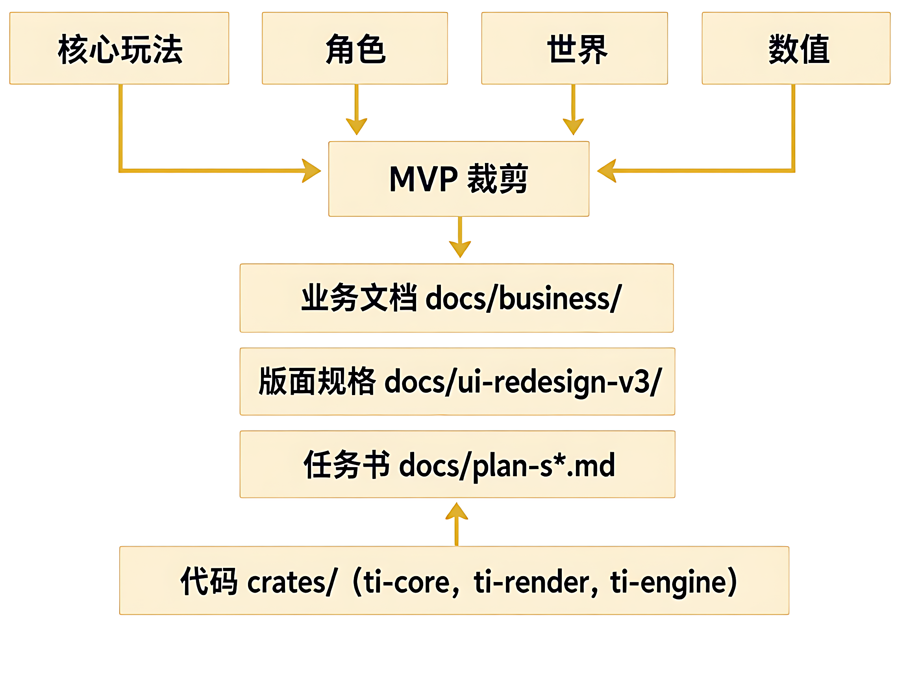

# 第 11 章：游戏设计文档与 MVP

## 学习目标

- [ ] 理解"先定文档再动代码"的纪律为什么能省 5 倍返工时间
- [ ] 掌握 4 段最小设计文档模版（核心玩法 / 角色 / 世界 / 数值）
- [ ] 理解 MVP 裁剪原则：先做最小可玩闭环，再叠加系统
- [ ] 能在本项目中定位"先定案再落码"的纪律实例

---

## 一、为什么设计文档先于代码

**生活类比：装修房子**

```
直接开工（无设计文档）：
  铺地板 → 拆墙 → 发现插座在地板中间 → 重铺
  装空调 → 发现管道没预留 → 全部返工
  耗时：3 个月，返工 3 次

先画图（设计文档）：
  画好水电图 → 预留插座位置 → 按图施工
  耗时：1 个月 + 1 周画图 = 1.5 个月，返工 0 次
```

游戏开发也一样：**业务规则定案前写代码 = 铺地板前不画水电图**。
本项目硬规则 7 就是这条纪律的机器化版本：
"改动面含「业务规则」时**先在 `docs/business/` 定案再动代码**"。

---

## 二、最小设计文档 4 段模版

参考书 §4 + 附录 B，一份可执行的设计文档最少 4 段：

### 段 1：核心玩法（1 句话 + 1 个循环图）

> "玩家每轮掷骰子 → 沿环岛轨道前进 → 落格结算事件 → 经济/战斗/收集。"

核心玩法必须是 **1 个循环**，不能是 3 个并列系统。
"战斗 + 建造 + 收集" 是 3 个系统，"掷骰落格结算" 才是 1 个循环。

### 段 2：角色（玩家 + 对手 各 1 段）

| 角色 | 目标 | 操作 | 失败后果 |
|---|---|---|---|
| 玩家 | 夺宝 | 掷骰 + 交钱/攻占/收集 | 破产 |
| AI 船长 | 阻止玩家 | 按固定策略占格 | 失去领地 |

角色表不是"有 5 种敌人"，而是"玩家做什么 + 对手做什么 + 怎么判胜负"。

### 段 3：世界（地图 + 规则 + 视觉 各 1 句）

| 维度 | 一句话 |
|---|---|
| 地图 | 31 格环形赛道，10 类岛各 2 格 + 9 功能格 + 1 BOSS 格 |
| 规则 | 落格三分支：无主→占 / 他人→交钱或攻 / 自己→升级 |
| 视觉 | 海盗羊皮海图风格，暖棕 + 黄铜，满屏 |

### 段 4：数值（3 个关键数字 + 平衡公式）

| 数值 | 初始值 | 公式/约束 |
|---|---|---|
| 玩家初始金币 | 100 | 每格过路费 = 金币 × 0.5（不能一次破产） |
| 船造价 | 0 / 800 / 2500 / 6000 | 货舱 99/150/240/400 = 单次贸易上限 |
| BOSS 位置 | 环半周 = 15 格 | `spaces[31//2]`（S31.0 I3 不变量） |

---

## 三、MVP 裁剪原则

**原则：先做最小可玩闭环，再叠加系统。**

MVP 判据：**一个陌生人 5 分钟能从头玩到结局（赢/输），有明确胜负**。

| 做（MVP 必须） | 不做（MVP 之后） |
|---|---|
| 1 张地图 + 核心循环 | 多张地图 / 存档 |
| 玩家 + 1 个 AI 对手 | 4 个 AI + 4 种策略 |
| 掷骰 + 落格 + 结算 | 经济系统全规则 |
| 胜负判定 | 排行 / 成就 |

本项目实例：`docs/plan-s34-main-map-v6-vs-v2.md` 的 U1~U17 需求总账
（见 `docs/ui-redesign-v3/13_user_requirements_ledger.md`）就是 MVP 裁剪纪律的实例——
每条需求有"做/不做"的明确边界，违反即返工。

---

## 四、项目对照

### 本项目"先定案再落码"纪律实例

| 阶段 | 文档 | 内容 | 落码顺序 |
|---|---|---|---|
| S27.1 | `10_main_map_v5_spec.md` | 31 格卡环 + 中央岛 + 10 类岛 + 交互契约 | S27.2 资产 → S27.4 表现 |
| S28.0 | `territory.md` | 5 席位 + 领地格 vs 功能格 + 31 格 + 落格分支 | S28.1 规则 → S28.2 存档 |
| S34.0 | `12_main_map_v6_vs_v2_spec.md` | §1 不规则岛 + §2 VS v2 4 帧 | S34.1~S34.6 逐任务 |



**规律：业务文档（`docs/business/`）定规则 → 版面规格（`docs/ui-redesign-v3/`）定像素 → 任务书（`docs/plan-s*.md`）定顺序 → 代码（`crates/`）落实现。** 文档链 3 层，缺任何一层 = 返工。

### 与书 §4 的差异

书 §4 强调"设计文档是纸面产出"，本项目强调"设计文档是**机器门禁的锚点**"：
- `gate.ps1` 第 9 项 `doccheck` 校验文档编号 / 跨文档引用
- `check_scene_narrative` 校验版面规格与 scenes.json 坐标一致性
- `balance.combat` 数值表在 `docs/business/combat.md` 定案后才进 `assets/data/balance.json`

---

## 五、实践练习

### 练习 1：给一条新玩法写 4 段设计文档

> 假设要加"港口贸易市场"（3 个 NPC 商人，各有 1 种商品，价格按供需浮动）。
> 按 4 段模版各写 1 段，每段不超过 5 行。
> 检查：段 1 是 1 个循环吗？段 4 有 3 个关键数字吗？

### 练习 2：MVP 裁剪

> 给 `docs/plan-s34-main-map-v6-vs-v2.md` 的 U1~U17 做一次裁剪：
> 标出哪些是 MVP 必须，哪些可以 MVP 之后。
> 对照 `docs/ui-redesign-v3/13_user_requirements_ledger.md` 看你的裁剪与台账一致吗？

### 练习 3：定位本项目"先定案再落码"链

> 打开 `docs/business/territory.md`，找 1 条规则（如"落格三分支"）。
> 按 `plan-s34` 链追踪它在哪 3 个文档中被锚定（业务 / 版面 / 任务书），
> 写 3 行路径 + 章节号。

---

## 六、常见坑

1. **把设计文档当规格书**：4 段模版是"定方向"，不是"写像素坐标"。像素坐标归 `ui-redesign-v3/`，本模版管的是"做什么 + 不做什么 + 怎么判胜负"。
2. **MVP 做成 P0 功能集**：MVP = 最小可玩闭环，不是"最核心的 3 个功能"。有 3 个功能但没有胜负 = 没做完。
3. **业务文档写了两遍**：`docs/business/` 是单一事实源，`plan-s*.md` 是任务书，不要在同一文档里重复写规则。

---

## 七、学习记录

- [ ] 读完本章 + 完成 3 条练习
- [ ] 给 1 条本项目规则画出 3 层文档锚定链（业务 / 版面 / 任务书）
- 日期：____
