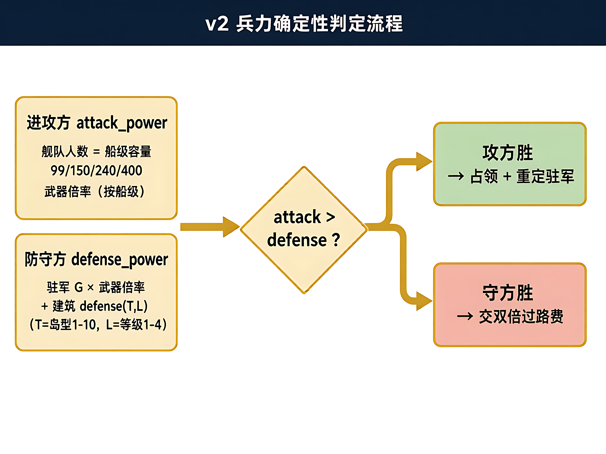

# 第 12 章：回合制与战斗框架

## 学习目标

- [ ] 理解回合制游戏的核心结构：turn token（回合令牌）+ 意图消息（message channel）
- [ ] 理解本项目 v2 战斗模型的"确定性兵力判定"设计（非随机回合制）
- [ ] 掌握 `rules::battle` 兵力公式的 3 个关键变量
- [ ] 能在本项目中定位战斗代码的 4 个落点（业务 / 规则 / 场景 / 资产）

---

## 一、回合制的本质：turn token

**生活类比：乒乓球比赛**

```
① 球在谁手里 = 轮到谁行动
② 发球 = 回合开始
③ 接球 = 响应回合
④ 比分 = 状态累积（HP / 胜负判定）
```

回合制游戏的核心 = **1 个 turn token（令牌）**，决定"现在轮到谁"：

```
turn_token: PLAYER | ENEMY
  每帧检查：if turn_token == PLAYER → 收集玩家意图 → 结算 → turn_token = ENEMY
            if turn_token == ENEMY  → AI 决策 → 结算 → turn_token = PLAYER
```

**意图消息（message channel）是"玩家按了攻击"的载体：**

```
玩家按"攻击" → 发 Intent{ Attack(target) } 消息
              → 结算系统消费消息 → 扣 HP / 加伤害 → 出结果 → 发 TurnEnd 消息
              → 换边 → 收集 AI 意图 → ...
```

本项目用 Bevy 0.20 的 `add_message` + `MessageReader`/`MessageWriter` 实现
（见 `docs/process/20_bevy_picking.md`），战斗场景用同一机制传递攻击/防御/道具意图。

---

## 二、本项目 v2 战斗模型（确定性兵力判定）

> **S33.1–S33.6 定案（2026-10-30）**：原"攻击 / 道具 / 防御" 3 动作 HP 回合制**作废**。
> 新模型 = **单场定胜负的兵力对比，无随机回合**，胜负可预先算出来。

### 兵力公式（3 个变量）

```
进攻方：
  attack_power = 舰队人数 × 武器倍率
  （舰队人数 = 该玩家当前船只等级容量上限 = balance.boat 的 99/150/240/400）

防守方：
  defense_power = 驻军人数 G × 驻军武器倍率
                  + 建筑防御 defense(T, L)
  （T = 岛类型 1~10，L = 建筑等级 1~4，defense 表在 balance.json）

胜负判定（确定性，无骰子）：
  attack_power > defense_power → 攻方胜（占领 + 重定驻军）
  attack_power ≤ defense_power → 守方胜（攻方交双倍过路费）
```



### 与书 §7~9 的对比

| 维度 | 书（Roguelike） | 本项目 |
|---|---|---|
| 回合 | 玩家先 / 敌人后 / 交替 | **无回合**，一次性兵力对比 |
| 随机性 | 每回合攻击随机伤害 | **确定性**，胜负可预先计算 |
| 胜负 | HP 减到 0 | `attack_power > defense_power` |
| 道具 | 背包 + 药水 | 4 道具图标（keg/medkit/rum/smoke），**无道具回合**，纯演出 |
| 目标 | 找到亚拉护身符 | 夺宝（`is_cleared` 通关门禁） |

**为什么本项目不用随机回合制？**
v2 定案：随机伤害在多人领土战里不可控（双倍过路费 + 驻军重定 + 战斗演出 3 处状态联动），
确定性判定让"攻不攻占"成为可计算的决策（玩家看兵力公式即可判断胜算），符合大富翁式策略感。

---

## 三、战斗代码 4 个落点

| 层 | 位置 | 职责 |
|---|---|---|
| 业务 | `docs/business/combat.md` §兵力模型 | 兵力公式 + 过路费规则（单一事实源） |
| 规则 | `crates/ti-core/src/rules/battle.rs` | 兵力计算 + 胜负判定函数（无渲染依赖） |
| 场景 | `crates/ti-render/src/scenes/vs_proto.rs` | VS 场景：列阵 + 炮火演出 + 结果横幅 |
| 资产 | `assets/ui/boss_captain.png` 等 4 枚 | 角色立绘 + 甲板背景 + 道具图标 |

**改战斗数值前先改 `docs/business/combat.md`**（硬规则 7），再动 `balance.json`，最后改 `rules/battle.rs`。
顺序反了 = 返工。

---

## 四、回合制框架（通用知识，对照书 §7）

> 本项目不用回合制，但理解它对未来扩展（如 PVP 模式 / 新副本）有用。

### 框架 4 个组件

```
1. 意图收集：本帧收集玩家输入（攻击/防御/道具）
   → Bevy：read IntentMessages → 过滤本方 → 发 TurnResolve

2. 结算：消费 Intent → 扣 HP / 加伤害 → 状态变更
   → 本项目：无（兵力一次性判定，无逐回合结算）

3. 换边：turn_token 翻转 + 发 TurnEnd
   → 本项目：无

4. 胜负判定：HP ≤ 0 → GameOver
   → 本项目：attack_power > defense_power → winner = attacker
```

### 系统启停（按场景）

```
进场 VS 场景：
  注册 combat_system（列阵动画 + 结果横幅）
  不注册 turn_system（本项目无逐回合）

进主地图：
  不注册 combat_system
  注册 board_system（摇骰落格）
```

本项目用 `scenes/mod.rs` 的场景路由 + `ui_probe_system` 的 ComputedNode 探针
实现场景级系统启停（见 `docs/process/19_bevy_ui.md` §9.8）。

---

## 五、实践练习

### 练习 1：手动算一次攻占胜负

> 玩家 2 级船（容量 150），对方 3 级驻军（G=200）+ 岛 7（T=7）建筑 2 级（L=2）。
> 查 `assets/data/balance.json` `combat` 段，代入公式，判断攻方是否胜。
> 写 3 行：attack_power = ? / defense_power = ? / 谁胜？

### 练习 2：给 VS 场景写 3 条 e2e 断言

> 参考 `crates/ti-engine/tests/` 现有测试，写 3 条断言：
> 1. 进入 VS 场景后，结果横幅 3 秒后消失
> 2. 攻方兵力 > 守方兵力时，横幅文案 = "占领成功"
> 3. 攻方兵力 ≤ 守方兵力时，横幅文案 = "占领失败"
> 断言不跑通 = 场景演出未接线，归 S34 VS v2 任务

### 练习 3：定位 `is_cleared` 在代码里的 3 处

> 在 `crates/ti-core/src/` 中 grep `is_cleared`，找到：
> 1. 定义处（progression.rs）
> 2. 调用处（主地图结算）
> 3. 存档写入处（save `unlocked_mask` 逐图写入）
> 写 3 行：文件 + 行号 + 一句话说明。

---

## 六、常见坑

1. **把书 §7 的 Roguelike 回合制直接抄进本项目**：v2 已定案无回合，抄了等于推翻业务文档。
2. **改战斗数值只改 `balance.json`**：数值定案在 `combat.md`，只改 JSON 不更新文档 = 文档↔数据漂移（gate 第 9 项 `doccheck` 会拦）。
3. **把 VS 演出当成业务逻辑**：列阵/炮火/横幅是渲染层（`vs_proto.rs`），`rules::battle` 只输出胜负结果，不碰动画。

---

## 七、学习记录

- [ ] 读完本章 + 完成 3 条练习
- [ ] 手算 1 次攻占胜负（练习 1）
- 日期：____
